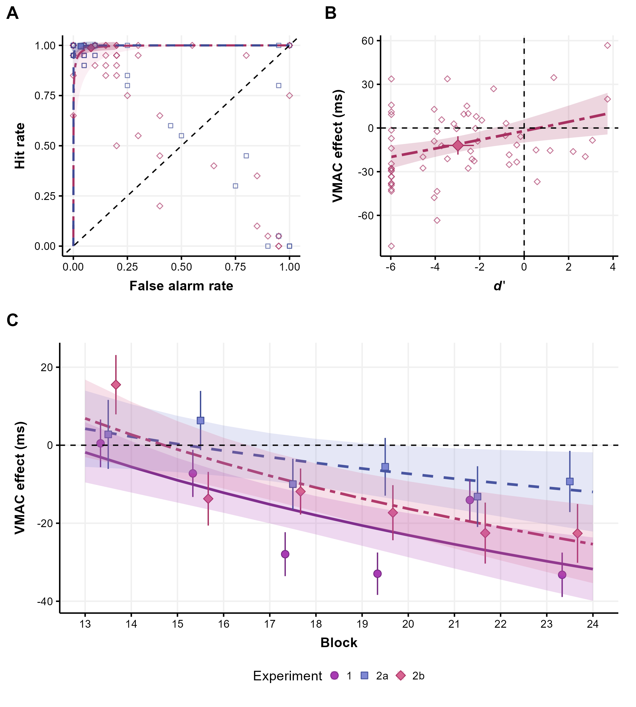
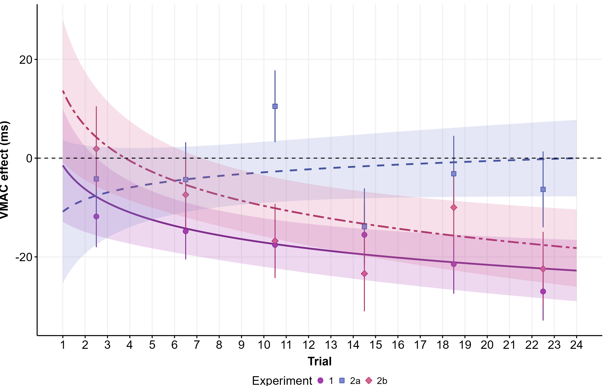

```{r}
#| label: setup-analysis-objects
#| include: false

knitr::opts_chunk$set(
  echo = FALSE,
  warning = FALSE,
  message = FALSE
)

read_results_rds <- function(path, label) {
  if (!file.exists(path)) {
    stop(sprintf("Could not find %s at '%s'.", label, path))
  }

  readRDS(path)
}

source(file.path("scripts", "functions.R"))

e1 <- read_results_rds(
  file.path("output", "analysis", "analysis_e1.rds"),
  "Experiment 1 analysis results"
)

e2 <- read_results_rds(
  file.path("output", "analysis", "analysis_e2.rds"),
  "Experiment 2 analysis results"
)

le_reanalysis_path <- file.path("output", "analysis", "re_analysis_le2024.rds")
le <- if (file.exists(le_reanalysis_path)) readRDS(le_reanalysis_path) else NULL

bayes_summary_path <- file.path("output", "models", "model_comparison_summary.csv")
bayes <- if (file.exists(bayes_summary_path)) {
  read.csv(bayes_summary_path, stringsAsFactors = FALSE)
} else {
  NULL
}

if (is.null(bayes)) {
  stop("Could not find the Bayesian model comparison pairwise summary. Please rerun scripts/run_model_comparison.R or scripts/export_model_comparison_pairwise.R.")
}

e1_acquisition_rt_model <- e1$acquisition_rt_model
e1_reversal_rt_model <- e1$reversal_rt_model
e1_acquisition_acc_model <- e1$acquisition_acc_model
e1_reversal_acc_model <- e1$reversal_acc_model
e1_phase_anova <- e1$phase_anova
e1_final_plot <- e1$final_plot

e2_awareness_model_a <- e2$awareness_model_a
e2_awareness_model_b <- e2$awareness_model_b
e2_awareness_model_combined <- e2$awareness_model_combined
e2_awareness_vmac_model <- e2$awareness_vmac_model
e2_awareness_reliability <- e2$awareness_reliability
e2a_acquisition_rt_model <- e2$e2a_acquisition_rt_model
e2a_reversal_rt_model <- e2$e2a_reversal_rt_model
e2b_acquisition_rt_model <- e2$e2b_acquisition_rt_model
e2b_reversal_rt_model <- e2$e2b_reversal_rt_model
e2a_acquisition_acc_model <- e2$e2a_acquisition_acc_model
e2a_reversal_acc_model <- e2$e2a_reversal_acc_model
e2b_acquisition_acc_model <- e2$e2b_acquisition_acc_model
e2b_reversal_acc_model <- e2$e2b_reversal_acc_model
e2a_phase_anova <- e2$e2a_phase_anova
e2b_phase_anova <- e2$e2b_phase_anova
e2_comparison_rt_model <- e2$comparison_rt_model
e2_comparison_acc_model <- e2$comparison_acc_model
e2_comparison_plot <- e2$comparison_plot

le_phase_anova_nominal <- if (!is.null(le)) le$phase_anova_nominal else NULL
le_phase_anova_feedback <- if (!is.null(le)) le$phase_anova_feedback else NULL
le_within_block_model <- if (!is.null(le)) le$within_block_model else NULL

format_decimal <- function(x, digits = 1, drop_leading_zero = FALSE) {
  out <- formatC(x, format = "f", digits = digits)

  if (drop_leading_zero) {
    out <- sub("^-0\\.", "-.", out)
    out <- sub("^0\\.", ".", out)
  }

  out
}

format_superiority_prob <- function(x, digits = 3) {
  threshold <- 1 - 10^(-digits)

  if (is.na(x)) {
    return("NA")
  }

  if (x >= threshold) {
    return(paste0("> .", paste(rep("9", digits), collapse = "")))
  }

  if (x <= 10^(-digits)) {
    return(paste0("< .", paste(rep("0", digits - 1), collapse = ""), "1"))
  }

  sub("^0", "", formatC(x, format = "f", digits = digits))
}

extract_bayes_comparison <- function(bayes_results, group_code) {
  out <- bayes_results[bayes_results$group == group_code, , drop = FALSE]

  if (nrow(out) != 1) {
    stop(sprintf("Could not find a unique Bayesian comparison summary row for group '%s'.", group_code))
  }

  out
}

bayes_revfb <- extract_bayes_comparison(bayes, "RevFB")
bayes_rev <- extract_bayes_comparison(bayes, "Rev")

extract_coef_table <- function(model) {
  out <- as.data.frame(coef(summary(model)))
  out$term <- rownames(out)
  rownames(out) <- NULL
  p_col <- grep("^Pr\\(", names(out), value = TRUE)[1]

  if (is.na(p_col)) {
    stop("Could not identify the p-value column in the model summary.")
  }

  out$p_value <- out[[p_col]]
  out
}

resolve_model_term_pattern <- function(model, patterns) {
  terms <- extract_coef_table(model)$term

  for (pattern in patterns) {
    hits <- terms[grepl(pattern, terms, perl = TRUE)]
    if (length(hits) > 0) {
      return(hits[1])
    }
  }

  stop(
    sprintf(
      "Could not identify a model term matching any of these patterns: %s",
      paste(patterns, collapse = ", ")
    )
  )
}

latex_model_term_pattern <- function(model,
                                     patterns,
                                     beta_label,
                                     include_ci = FALSE,
                                     ...) {
  term <- resolve_model_term_pattern(model, patterns)
  latex_model_term(
    model = model,
    term = term,
    beta_label = beta_label,
    include_ci = include_ci,
    ...
  )
}

min_model_p <- function(model,
                        include_patterns = NULL,
                        exclude_patterns = NULL,
                        exclude_terms = "(Intercept)") {
  out <- extract_coef_table(model)

  if (!is.null(include_patterns)) {
    keep <- Reduce(
      `|`,
      lapply(include_patterns, function(pattern) grepl(pattern, out$term, perl = TRUE))
    )
    out <- out[keep, , drop = FALSE]
  }

  if (!is.null(exclude_patterns)) {
    drop <- Reduce(
      `|`,
      lapply(exclude_patterns, function(pattern) grepl(pattern, out$term, perl = TRUE))
    )
    out <- out[!drop, , drop = FALSE]
  }

  out <- out[!out$term %in% exclude_terms, , drop = FALSE]

  if (nrow(out) == 0) {
    return(NA_real_)
  }

  min(out$p_value, na.rm = TRUE)
}

extract_awareness_criterion <- function(model) {
  out <- as.data.frame(
    marginaleffects::avg_predictions(
      model,
      type = "link",
      re.form = NA
    )
  )[1, , drop = FALSE]

  out$estimate <- -out$estimate

  if (all(c("conf.low", "conf.high") %in% names(out))) {
    old_low <- out$conf.low
    old_high <- out$conf.high
    out$conf.low <- -old_high
    out$conf.high <- -old_low
  }

  out
}

extract_awareness_dprime <- function(model) {
  as.data.frame(
    marginaleffects::avg_slopes(
      model,
      variables = "signal",
      type = "link",
      re.form = NA
    )
  )[1, , drop = FALSE]
}

latex_link_estimate <- function(row, symbol, digits = 2) {
  paste0(
    "$", symbol, " = ",
    format_num_latex(row$estimate, digits = digits),
    "$, 95\\% CI [",
    format_num_latex(row$conf.low, digits = digits), ", ",
    format_num_latex(row$conf.high, digits = digits), "]"
  )
}

extract_vmac_at_dprime <- function(model, dprime = 0) {
  as.data.frame(
    marginaleffects::avg_comparisons(
      model,
      variables = "Singleton",
      newdata = marginaleffects::datagrid(
        model = model,
        signal = dprime,
        ID = NA
      ),
      re.form = NA,
      comparison = \(hi, lo) exp(hi + (sigma(model) ^ 2) / 2) - exp(lo + (sigma(model) ^ 2) / 2)
    )
  )[1, , drop = FALSE]
}

latex_contrast_ci <- function(row, label, digits = 2) {
  paste0(
    "$M_{\\text{", label, "}} = ",
    format_num_latex(row$estimate, digits = digits),
    "$, 95\\% CI [",
    format_num_latex(row$conf.low, digits = digits), ", ",
    format_num_latex(row$conf.high, digits = digits), "]"
  )
}

latex_reliability <- function(estimate, ci_low, ci_high, label = "r_{\\text{sb}}", digits = 2) {
  paste0(
    "$", label, " = ",
    format_num_latex(estimate, digits = digits),
    "$, 95\\% CI [",
    format_num_latex(ci_low, digits = digits), ", ",
    format_num_latex(ci_high, digits = digits), "]"
  )
}
```


Administering rewards contingent on task goals is typically associated with improved performance in various cognitive domains [@engelmann2007_emotion; @padmala2011_jneuro]. This effect has been attributed to enhanced cognitive control driven by motivational factors [@botvinick2014computational]. However, performance tends to decline when a task-irrelevant stimulus reliably predicts a reward [@anderson2011_pnas_value; @anderson2011_plosone; @dellaLibera2009_gainslosses]. This reward-driven distraction has been proposed to be independent of task goals and the physical salience, and depends critically on the learning history with the stimuli [@awh2012]. For instance, in the paradigm developed by @lepelley2015_vmac_xge, participants performed an additional singleton task variant, searching for a shape-defined target while ignoring a color singleton distractor. Unbeknownst to the participants, the color of the distractor predicted the magnitude of the reward on each trial. However, attending to the distractor color was detrimental to performance because the reward amount depended on speed and accuracy. Nevertheless, participants exhibited slower response times when the high-value distractor appeared compared to the low-value distractor. In other words, attention was involuntarily drawn to the high-value distractor, even when it resulted in a smaller reward. This effect is known as value-modulated attentional capture (VMAC).

There is numerous evidence in the literature confirming that participants attend to high-value distractors even when doing so results in losing reward [@failing2015; @lepelley2015_vmac_xge; @pearson2015; @pearson2016b]. This has led some researchers to conceptualize VMAC as a Pavlovian attentional bias [@anderson2016_habit; @bucker2017a; @sali2014_jep; @pearson2022; @lepelley2024; @heck2025], representing the increased attentional priority that receives reward signals due to its acquired incentive salience [@berridge2009; @flagel2011; @flagel2017]. Once established, VMAC persists despite the omission of reward feedback [@garre-frutos2024; @watson2019_plosone_vmac_persist; @detommaso2021] and can be observed months after learning has taken place [@anderson2013_pbr_persistence]. If VMAC is as inflexible as has been proposed [@anderson2021_nbr_selectionhistory; @anderson2016_habit], once learned one would expect VMAC to persist even when stimulus–reward contingencies change. For instance, in the study by @liao2020, participants were initially trained to search for color-defined targets that were, unbeknownst to them, associated with different reward values (high, low, or none). In a second training phase, these contingencies were reversed: the previously high-reward color no longer signaled reward, and a previously unrewarded color became the new high-value target. During a subsequent test phase—where the former target colors appeared as irrelevant distractors—the color associated with high reward during the first training phase interfered more with performance than the others. Critically, in a second test phase following the reversal, this same originally high-value color continued to capture attention, despite no longer being associated with reward. These results indicate that reward-related attentional biases can persist even when the contingencies that support them have been reversed.

However, other studies implementing reversal stages have reported different outcomes. For example, @failing2017_app found that when stimulus–reward contingencies were reversed on a block-wise basis—such that the previously high-value distractor now predicted low reward, and vice versa—the reversal of the VMAC effect occurred gradually within each block, rather than immediately. This pattern has been interpreted as evidence for a learning-dependent mechanism, rather than goal-directed attentional prioritization. That is, if VMAC were driven by goal-directed control, one would expect participants to update their attentional priorities immediately upon detecting the new contingencies. Interestingly, although not explicitly discussed by @failing2017_app, their results also showed that the VMAC effect disappeared entirely at the onset of a new reversal stage. One important discrepancy[^d1] between @liao2020 and @failing2017_app is that the latter instructed participants about the reversal of stimulus–reward contingencies before each block. This difference highlights an interesting pattern: when participants were explicitly informed about the reversed contingencies, the VMAC effect was completely abolished. This stands in stark contrast to findings from @liao2020 and other studies showing strong persistence of VMAC when contingencies are merely omitted or the value of the distractors is equated—even when participants are instructed about the change [@garre-frutos2024; @gonzalez2025; @watson2019_plosone_vmac_persist; @le2024]. However, previous research on this topic is not without limitations. In @failing2017_app, the sample size was relatively small (N = 18) compared to what is required to detect a meta-analytic VMAC effect of moderate size (SMD = 0.35), which would require at least 66 participants to achieve 80% power [@rusz2020]. Furthermore, they performed a bin analysis that collapsed all reversal blocks, and almost none of the bins yielded significant effects, making it difficult to interpret the temporal dynamics of VMAC reversal. Other studies implementing a reversal phase either included too few trials during reversal or failed to examine the time course of reversal altogether [@Albertella2019_AddictBehRep; @Albertella2020b_JBTEP; @detommaso2021]. Despite these limitations, the available evidence suggests that reversing a feature–reward association may be substantially faster than extinguishing a previously learned association. However, this difference could also reflect the nature of the instructions provided to participants [@garre-frutos2025a].

[^d1]: Another critical design decision in @liao2020 that may explain their results is that the reversal occurred between a stimulus that had previously been associated with no outcome during the training stage rather than between stimuli associated with different outcome magnitudes (e.g., high- and low-value stimuli). In most paradigms to measure VMAC, reward-predictive stimuli are usually reliable predictors of an outcome. Typically, the magnitude of the reward is manipulated [@anderson2011_pnas_value; @lepelley2015_vmac_xge]. Making a stimulus completely nonpredictive of reward can significantly impact learning [latent inhibition\; @lubow1973] and attention [learned predictiveness\; @lepelley2013]. Therefore, it is possible that the observed pattern of "inertia" was driven primarily by the predictiveness of the new high-value stimulus rather than by resistance to reversal itself.

While VMAC is typically considered automatic—given that attentional prioritization of reward-related stimuli often contradicts task goals [@anderson2016_habit; @lepelley2015_vmac_xge]—recent evidence suggests that the learning process underlying the effect is influenced by verbal instructions and reliably associated with measures of awareness [@garre-frutos2025a; @garre-frutos2025c]. This is not entirely surprising, considering that human Pavlovian learning has often been linked to awareness [@lovibond2002a; @schmidt2012; @weidemann2016; @mertens2020]. Verbal instructions can strongly shape learned associations [@lovibond2003; @atlas2019; @atlas2023; @mertens2018], and some authors have even suggested that Pavlovian learning in humans may be entirely based on propositional reasoning processes [@mitchell2009]. This raises the possibility that the apparent flexibility observed in reversal learning may depend on participants’ knowledge of the new associations. One way to test this hypothesis is by evaluating whether VMAC is sensitive to verbal instructions. For example, @watson2019_plosone_vmac_persist tested whether instructions could modulate previously acquired learning by comparing the magnitude of VMAC at the end of a reward-based training phase and at the beginning of a subsequent unrewarded phase, where participants were informed that the previously reward-predictive features would no longer be predictive. They found that instructions alone did not eliminate the effect: VMAC persisted at the start of the unrewarded phase [see also @watson2019_plosone_vmac_persist; @detommaso2021]. However, to our knowledge, no study has directly tested the effect of instructions on a contingency-reversal design.

In light of the above, the present study aimed to test the role of explicit knowledge in the reversal of the VMAC effect. If reversal learning is moderated by explicit awareness of new contingencies, we hypothesized that providing instructions should abolish any previously learned attentional biases. This would contrast with previous findings showing the persistence of VMAC under extinction, even when instructions are provided. Conversely, in the absence of instructions, we expected the previously learned associations to persist. To test these hypotheses, Experiment 1 included both an acquisition phase and a reversal stage in which participants received explicit instructions about the contingency change, along with trial-by-trial reward feedback. In Experiment 2a, participants were only instructed about the contingency reversal but received no reward feedback (nominal extinction). In Experiment 2b, participants received trial-by-trial feedback during reversal, but no instructions. This design allowed us to isolate the effects of instructions and feedback on the reversal of VMAC.


# Experiment 1

Experiment 1 aimed to test the temporal dynamics of VMAC reversal learning. We followed almost the same procedure as @garre-frutos2024, except that we employed a reversal stage instead of an unrewarded stage. In the reversal stage, participants were explicitly informed that the high-valued distractor would swap its role with the previously low-value distractor, and they also received direct experience (trial-by-trial feedback) of the reversal.

## Method

### Participants

For this experiment, we did not conducted any a priori power analysis, but we employed an unusually larger sample size compared to previous research [see @rusz2020]. Ninety-two students (65 self-identified as female) from the University of Granada participated in this experiment. Their age ranged from 18 to 45 years old ($M = 21.10$, $SD = 3.60$). The inclusion criteria were speaking Spanish fluently and having normal or corrected vision and perception of color. One participant was excluded due to exceptionally low accuracy (<.70).

### Stimuli, materials, and procedure

Upon arrival at the laboratory, participants read and signed the informed consent[^d2]. Subsequently, they started the experimental task. The VMAC task was adapted from @lepelley2015_vmac_xge and @watson2019_plosone_vmac_persist, which included a reversal stage. Participants completed the VMAC task in a darkened room, seated approximately 60 cm from the screen. The design of the experiment (@fig-1, A) comprised two stages: acquisition and reversal, with 12 blocks per phase and 24 trials in each block. Between blocks, participants were allowed to rest as long as they wished. In each trial, the participant was first presented with a fixation cross at the center of the screen. After a delay of 500 ms, a search display appeared, consisting of six shapes (~2.3º $\times$ 2.3º) arranged evenly around an imaginary circle (~10.1º $\times$ 10.1º). Out of the six shapes, five were circles (distractors) containing a white line randomly tilted 45º to the right or left. The remaining shape was a diamond (target) and contained a line oriented horizontally or vertically. The search display remained on the screen until either a response was recorded or the trial reached its maximum duration of 2000 ms, resulting in a timeout.

[^d2]: After informed consent, participants performed a series of questionnaires for a project outside of the scope of the present study: the Spanish adaptation of the short version of the UPPS-P questionnaire [UPPS-P\; @candido2012], the Spanish adaptation of the Emotion Regulation Questionnaire [ERQ\; @cabello2013_erq_es], and the Spanish version of the Trait Food Craving Questionnaire [FCQ-T\; @cepedabenito2000_fcqt_es]. 

::: {#fig-1}

{width="100%" fig-scap="Schematic representation of the task." apa-note="\footnotesize Panel A: Participants could earn points based on performance, and when a high-value singleton appeared in the display, points were multiplied by 10 (a bonus trial). Panel B: In a subsequent reversal stage, the color-reward contingencies were switched, so that the previously low-value singleton predicted high reward. In Experiment 1, participants were explicitly informed about the reversal before starting the reversal stage."}

Example of the sequence of events in the experimental task.
:::

Participants were instructed to indicate the orientation of the line within the diamond as quickly as possible to earn points, pressing either "C" for horizontal or "G" for vertical. The number of points received on each trial depended on their speed and accuracy. Before starting the task, participants underwent a practice block without reward feedback and without colored distractors. During the task, in 20 of 24 trials per block, one of the circles was colored in one of two specific colors, and the other shapes were grey. One color defined a high-value singleton and the other a low-value singleton. This resulted in 10 high-value trials and 10 low-value trials per block. Possible pairs of colors for high-value and low-value assignments were pink/green or orange/blue, and the assignment was random. In the remaining four trials, none of the circles were colored (absent). The order of trial presentation was randomized within each block. For correct responses, participants were awarded 0.1 points for every millisecond that their RT was under 1000 ms in the low-value and absent conditions. In the high-value condition, points earned were multiplied by 10 (bonus trial). Before starting the task, participants were informed about which singletons would predict the multiplicator. They were instructed to ignore them to avoid distractions and maximize points. Responses with an RT >1000 ms did not award points, and errors in each condition resulted in losing the points that could have been won otherwise. The feedback screen was presented for 700 ms, indicating the points won or lost. If no response was received within 2000 ms, a timeout was shown with the message: "Too slow. Please, respond faster." The inter-trial interval was 1200 ms. To engage motivation and attention, at the end of the block, accumulated points were reported, and participants unlocked medals sequentially through the task (Bronze, Silver, Gold, Platinum, Diamond, Elite).

After completing the acquisition stage, participants were informed that the singleton-value contingencies would reverse: the previous high-value singleton would no longer predict a bonus, and the previous low-value singleton would now anticipate extra points. Participants then initiated the reversal blocks, during which all other parameters remained unchanged.

At the end of the experiment, participants were asked to provide a contingency rating for the color–reward relationship. A slider was presented with each color singleton at its ends, representing the relative percentage of points gained. Participants moved a dot to indicate the relative number of points earned for each color. For instance, if the slider was shifted toward the high-value color, the percentages updated accordingly (e.g., 70% high-value vs. 30% low-value).

### Data analysis

Analyses followed previous studies [@garre-frutos2024; @garre-frutos2025a; @garre-frutos2025b]. Participants with accuracy below 0.70 and trials with incorrect responses (6.95%) or RTs below 150 ms or above 1800 ms (0.35%) were excluded. We employed linear mixed models (LMM) on log-transformed RTs, including predictors for Singleton (high-value, low-value, absent), Block, and the Singleton × Block interaction. Following @barr2013, we fitted the maximal random-effects structure allowed by the design without singular fits or convergence issues [@bates2015; @matuschek2017]. We used repeated contrasts for Singleton, coding one coefficient for the VMAC effect (high–low) and one for the AC effect (low–absent). In the reversal stage, the same contrasts were used, but with different interpretations: a successful reversal was indicated by a negative VMAC effect, meaning that RTs for the previously low-value distractor were higher than for the previously high-value distractor. The low–absent contrast now reflected both attentional capture and reversed VMAC. A positive interaction with Block would also indicate reversal. Because RTs across blocks are often better explained by a power function, we compared linear vs. power models using the Akaike Information Criterion (AIC). All model details are in the Supplementary Material; in the main text, we report only *t*-tests for contrasts of interest using Satterthwaite degrees of freedom. Each phase was modeled separately.

Task accuracy was analyzed with generalized linear mixed models (GLMM) with a binomial likelihood and a logit link [@jaeger2008]. To test persistence of VMAC at the onset of reversal, we compared the last two acquisition blocks with the first two reversal blocks using a repeated-measures ANOVA with Phase (Acquisition, Reversal) and Singleton (High, Low) as factors. Planned t-tests probed the VMAC effect in each phase separately.

## Results 
### Acquisition stage
```{r}
#| label: exp1-acquisition-results-setup
#| include: false

model_rt <- e1_acquisition_rt_model
model_acc <- e1_acquisition_acc_model
include_ci <- FALSE

extract_acc_summary <- function(model) {
  out <- as.data.frame(coef(summary(model)))
  out$term <- rownames(out)
  rownames(out) <- NULL
  p_col <- grep("^Pr\\(", names(out), value = TRUE)[1]
  list(
    table = out,
    p_col = p_col
  )
}

extract_acc_overall <- function(model) {
  mf <- stats::model.frame(model)
  y <- stats::model.response(mf)
  w <- stats::weights(model)

  if (is.null(w)) {
    w <- rep(1, length(y))
  }

  total_n <- sum(w, na.rm = TRUE)
  total_success <- sum(y * w, na.rm = TRUE)
  estimate <- total_success / total_n
  ci <- stats::prop.test(total_success, total_n)$conf.int

  data.frame(
    estimate = estimate,
    conf.low = ci[1],
    conf.high = ci[2]
  )
}

latex_acc_overall <- function(row, digits = 3) {
  paste0(
    "$M = ", format_num_latex(row[[1]], digits = digits), "$, ",
    "95\\% CI [", format_num_latex(row[[2]], digits = digits), ", ",
    format_num_latex(row[[3]], digits = digits), "]"
  )
}

acc_term_labels <- c(
  "scale(Block_num)" = "Block",
  "scale(log(Block_num))" = "Block",
  "SingletonAC" = "low-absent",
  "SingletonVMAC" = "high-low",
  "SingletonAC:scale(Block_num)" = "low-absent \\times Block",
  "SingletonVMAC:scale(Block_num)" = "high-low \\times Block",
  "SingletonAC:scale(log(Block_num))" = "low-absent \\times Block",
  "SingletonVMAC:scale(log(Block_num))" = "high-low \\times Block"
)

extract_acc_sig_terms <- function(model) {
  acc_info <- extract_acc_summary(model)
  acc_table <- subset(acc_info$table, term != "(Intercept)")
  acc_table$term[acc_table[[acc_info$p_col]] < 0.05]
}

has_acc_sig_terms <- function(model) {
  length(extract_acc_sig_terms(model)) > 0
}

min_acc_p <- function(model) {
  acc_info <- extract_acc_summary(model)
  acc_table <- subset(acc_info$table, term != "(Intercept)")
  min(acc_table[[acc_info$p_col]], na.rm = TRUE)
}

latex_acc_sig_terms <- function(model, term_labels = acc_term_labels) {
  sig_terms <- extract_acc_sig_terms(model)
  beta_labels <- unname(ifelse(sig_terms %in% names(term_labels), term_labels[sig_terms], sig_terms))
  sig_text <- unname(latex_model_terms(
    model = model,
    terms = sig_terms,
    beta_labels = beta_labels,
    include_ci = FALSE
  ))
  paste(sig_text, collapse = "; ")
}

acc_overall <- extract_acc_overall(model_acc)
```

A power function model was selected due to its lower AIC ($|\Delta_{\text{AIC}}| = 200.3$). Model predictions are shown in @fig-2. There was a main effect of Block (`r latex_model_term(model_rt, term = "scale(log(Block_num))", beta_label = "Block", include_ci = include_ci)`), indicating a general decrease in RTs. A significant AC effect was found (`r latex_model_term(model_rt, term = "SingletonAC", beta_label = "low-absent", include_ci = include_ci)`; $M_{\text{low-absent}} = 38.4$, 95% CI [32.8, 44.1]), with higher RTs in the low-value distractor condition ($M = 714$, 95% CI [696, 733]) compared to the absent condition ($M = 677$, 95% CI [660, 694]). A significant VMAC effect was also observed (`r latex_model_term(model_rt, term = "SingletonVMAC", beta_label = "high-low", include_ci = include_ci)`; $M_{\text{VMAC}} = 24.2$, 95% CI [18.1, 30.3]), showing higher RTs for the high-value singleton ($M = 739$, 95% CI [721, 758]) than for the low-value singleton. Both the AC effect (`r latex_model_term(model_rt, term = "SingletonAC:scale(log(Block_num))", beta_label = "low-absent \\times Block", include_ci = include_ci)`) and the VMAC effect (`r latex_model_term(model_rt, term = "SingletonVMAC:scale(log(Block_num))", beta_label = "high-low \\times Block", include_ci = include_ci)`) interacted significantly with Block, indicating a progressive increase in VMAC and a decrease in AC.

::: {#fig-2}

{width="100%" fig-scap="Model predictions for Experiment 1." apa-note="\footnotesize Insets show the model high-low conditional effect (VMAC) together with the raw VMAC effect. Lines represent predicted conditional means on the raw response scale, shaded areas indicate 95% confidence intervals, dots represent raw mean RTs using epochs of two blocks, and error bars represent the standard error of the mean."}

Model predictions as a function of singleton condition across blocks.

:::

Accuracy `r if (has_acc_sig_terms(model_acc)) "remained high" else "was near ceiling"` (`r latex_acc_overall(acc_overall)`). `r if (has_acc_sig_terms(model_acc)) paste0("The accuracy model revealed significant effects for ", latex_acc_sig_terms(model_acc), ".") else paste0("There were no significant predictors or interactions (all $ps \\ge ", format_decimal(min_acc_p(model_acc), 3, drop_leading_zero = TRUE), "$).")`

### Reversal stage
```{r}
#| label: exp1-reversal-results-setup
#| include: false

model_rt <- e1_reversal_rt_model
model_acc <- e1_reversal_acc_model
include_ci <- FALSE
acc_overall <- extract_acc_overall(model_acc)
```

In the reversal stage, the power function again provided a better fit ($|\Delta AIC| = 6$). As shown in @fig-2, there was a significant effect of Block (`r latex_model_term(model_rt, term = "scale(log(Block_num))", beta_label = "Block", include_ci = include_ci)`) and a reversed VMAC effect (`r latex_model_term(model_rt, term = "SingletonVMAC", beta_label = "high-low", include_ci = include_ci)`; $M_{\text{high-low}} = -18.3$, 95% CI [-23.5, -13.1]), with RTs for the previously low-value distractor ($M = 652$, 95% CI [637, 667]) higher than for the previously high-value distractor ($M = 633$, 95% CI [618, 649]). The low-absent contrast was also significant (`r latex_model_term(model_rt, term = "SingletonAC", beta_label = "low-absent", include_ci = include_ci)`; $M_{\text{low-absent}} = 43.4$, 95% CI [36.3, 50.4]), showing that RTs for the previously low-value distractor were also higher than when no distractor was presented ($M = 608$, 95% CI [595, 622]). Both the high-low and low-absent contrasts interacted with Block (`r latex_model_term(model_rt, term = "SingletonVMAC:scale(log(Block_num))", beta_label = "high-low \\times Block", include_ci = include_ci)`; `r latex_model_term(model_rt, term = "SingletonAC:scale(log(Block_num))", beta_label = "low-absent \\times Block", include_ci = include_ci)`), reflecting a progressive increase in attentional priority for the previously low-value distractor.

Accuracy `r if (has_acc_sig_terms(model_acc)) "remained high" else "was near ceiling"` (`r latex_acc_overall(acc_overall)`). `r if (has_acc_sig_terms(model_acc)) paste0("The accuracy model revealed significant effects for ", latex_acc_sig_terms(model_acc), ".") else paste0("There were no significant predictors or interactions (all $ps \\ge ", format_decimal(min_acc_p(model_acc), 3, drop_leading_zero = TRUE), "$).")`

```{r}
#| label: exp1-persistence-results-setup
#| include: false

extract_phase_results <- function(phase_model,
                                  acquisition_pattern = "^Acquisition$",
                                  reversal_pattern = "^Reversal$",
                                  singleton_var = "Singleton",
                                  phase_var = "Phase") {
  phase_formula <- stats::as.formula(paste("~", singleton_var, "|", phase_var))
  emm_formula <- stats::as.formula(paste("~", singleton_var))
  phase_emm <- emmeans::emmeans(phase_model, phase_formula)
  phase_levels <- unique(as.character(phase_emm@grid[[phase_var]]))
  acquisition_phase <- phase_levels[grepl(acquisition_pattern, phase_levels, ignore.case = TRUE)][1]
  reversal_phase <- phase_levels[grepl(reversal_pattern, phase_levels, ignore.case = TRUE)][1]

  if (is.na(acquisition_phase) || is.na(reversal_phase)) {
    if (length(phase_levels) == 2) {
      numeric_levels <- suppressWarnings(as.numeric(phase_levels))

      if (!all(is.na(numeric_levels))) {
        ordered_levels <- phase_levels[order(numeric_levels)]
      } else {
        ordered_levels <- sort(phase_levels)
      }

      acquisition_phase <- ordered_levels[1]
      reversal_phase <- ordered_levels[2]
    } else {
      stop("Could not identify the Acquisition and Reversal phase labels in the afex model.")
    }
  }

  get_phase_vmac <- function(phase_label) {
    emm <- emmeans::emmeans(
      phase_model,
      emm_formula,
      at = stats::setNames(list(phase_label), phase_var)
    )
    out <- as.data.frame(summary(pairs(emm), infer = c(TRUE, TRUE)))
    if (nrow(out) < 1) {
      stop(sprintf("Could not extract the planned Singleton contrast for phase '%s'.", phase_label))
    }
    out[1, , drop = FALSE]
  }

  acq_vmac <- get_phase_vmac(acquisition_phase)
  rev_vmac <- get_phase_vmac(reversal_phase)

  list(
    acquisition = acq_vmac,
    reversal = rev_vmac,
    acquisition_d = as.data.frame(effectsize::t_to_d(acq_vmac$t.ratio, df_error = acq_vmac$df, paired = TRUE)),
    reversal_d = as.data.frame(effectsize::t_to_d(rev_vmac$t.ratio, df_error = rev_vmac$df, paired = TRUE))
  )
}

latex_phase_vmac <- function(row, d_obj) {
  paste0(
    "$M_{\\text{VMAC}} = ", format_num_latex(row$estimate, digits = 1), "$, ",
    "95\\% CI [", format_num_latex(row$lower.CL, digits = 1), ", ",
    format_num_latex(row$upper.CL, digits = 1), "], ",
    "$t_{", format_num_latex(row$df, digits = 0), "} = ",
    format_num_latex(row$t.ratio, digits = 2), "$, ",
    "$p ", format_p_latex(row$p.value), "$, ",
    "$d_z = ", format_num_latex(d_obj$d, digits = 2), "$, ",
    "95\\% CI [", format_num_latex(d_obj$CI_low, digits = 2), ", ",
    format_num_latex(d_obj$CI_high, digits = 2), "]"
  )
}

e1_phase_results <- extract_phase_results(e1_phase_anova)
acq_vmac <- e1_phase_results$acquisition
rev_vmac <- e1_phase_results$reversal
acq_d <- e1_phase_results$acquisition_d
rev_d <- e1_phase_results$reversal_d
```


To test persistence of VMAC after reversal instructions, we compared the last two acquisition blocks with the first two reversal blocks in an RM-ANOVA. A main effect of Singleton was found (`r latex_afex_term(e1_phase_anova, "Singleton", effect_label = "Singleton")`), with higher RTs for the high- vs. low-value distractor. A significant effect of Phase was also found (`r latex_afex_term(e1_phase_anova, "Phase", effect_label = "Phase")`), reflecting faster RTs in the reversal stage. Importantly, there was a significant Singleton x Phase interaction (`r latex_afex_term(e1_phase_anova, "Singleton:Phase", effect_label = "Singleton x Phase")`). This interaction indicated that the VMAC effect was reduced in the reversal stage compared to acquisition (`r latex_phase_vmac(acq_vmac, acq_d)`) and was abolished at the onset of reversal (`r latex_phase_vmac(rev_vmac, rev_d)`).


## Discussion

We observed a robust VMAC effect in the acquisition phase, replicating previous studies. The effect progressively developed over trials, with search times becoming progressively slower for the high than for the low-value singleton. In the reversal stage, we observed that the VMAC effect immediately disappeared at the beginning of the reversal phase and progressively reversed following the new contingencies. Our results are consistent with previous studies. As soon as contingencies are switched, the VMAC effect changes accordingly, rapidly down-weighting the attentional priority for the previously high-value distractor [@Albertella2019_AddictBehRep; @Albertella2020b_JBTEP]. On the other hand, although VMAC disappears at the beginning of the reversal phase, as in Failing and Theeuwes [@failing2017_app], it also gradually changes its sign to adapt to the new contingency. Previous studies using a similar paradigm have shown that the VMAC effect persists in conditions where rewards are omitted after learning has been established [@watson2019_plosone_vmac_persist; @garre-frutos2024; @garre-frutos2025b], suggesting a rather inflexible attentional bias to the stimulus that predicts reward and resembling the type of inflexibility that can be found in sign-tracking exhibited by animals [@fitzpatrick2019_signtracking_review; @morrison2015_frontiers_neurosci_sign_tracking]. In contrast, when contingencies are reversed, updating previously learned contingencies is practically immediate. That is, at the group level, the VMAC effect completely disappears at the onset of the reversal stage.

The fact that there is no persistence in attention to the previously high-value distractor could indicate that there may be a modulatory role related to participants' goals in the reversal of the VMAC effect. Some authors conceptualize reversal learning as a form of implicit-controlled regulation [@braunstein2017_explicitImplicitRegulation]. Accordingly, a recent study by @le2024 evaluated how the VMAC effect [measured as overt fixations\; @pearson2016b] was influenced by different procedures of revaluation. In Experiment 2, @le2024 showed a similar pattern to the one presented here. When participants were presented with information about a reversal in contingencies and received trial-by-trial reward feedback, they showed a reversal in VMAC (i.e., participants now looked more to the previously low-value singleton, successfully learning the new contingency). On the other hand, if participants were told that the previously low-value singleton now signaled a high reward, but reward feedback was not provided [a procedure called “nominal extinction”\; @luque2020; @watson2018], the VMAC effect completely disappeared, but not reversed. In other words, VMAC was modulated by instructions alone.

# Experiments 2a and 2b

Based on the previous discussion, in Experiments 2a and 2b, we aimed to test the role of explicit knowledge in the reversal of the VMAC effect by manipulating the type of information provided to participants (instructions or trial-by-trial reward feedback) in the reversal phase. First, we intended to replicate and extend the results of @le2024 using  a different measure (RTs instead of  % of overt eye fixations to the distractor). In Experiment 2a, participants underwent a reversal phase under nominal extinction, as in Experiment 2 by @le2024. Beyond conceptually replicating @le2024, in Experiment 2b we tested the effect of the absence of explicit instructions over the VMAC effect observed under reversal learning conditions. To our knowledge, in the studies that follow the paradigm developed by @lepelley2015_vmac_xge, the reversal has always been implemented by providing participants with instructions about the reversed contingencies. For that reason, we aimed to test whether reward feedback alone would produce a similar pattern of results as in Experiment 1. To that aim, in Experiment 2b, participants performed the same acquisition stage as in Experiment 1, but contingencies were reversed without informing participants about the transition between the acquisition and reversal stages.

If knowledge about the new contingencies is necessary to reverse the previously acquired attentional bias, we expect that instructions alone should abolish VMAC (Experiment 2a), while in the absence of such knowledge the previously acquired association should persist (Experiment 2b), although participants may become aware of the reversal through experience, and ultimately reverse the previously acquired association.

## Method

### Participants

Following on a preregistered power analysis based on Experiment 1 (see Supplementary Material), we aimed to recruit at least 60 participants for both Experiment 2a and 2b. As in Experiment 1, the inclusion criteria were speaking Spanish fluently and having normal or corrected vision and perception of color. Participants were recruited from the University of Granada and the University of Málaga in exchange for course credit. Sixty-three participants took part in Experiment 2a (50 self-identified as female; participants’ ages ranged from 18 to 45, $M_{\text{age}} = 19.6$, $SD_{\text{age}} = 3.5$), with 44 from the University of Málaga. In Experiment 2b, sixty-two participants were recruited (57 self-identified as female; participants’ ages ranged from 18 to 26, $M_{\text{age}} = 19$, $SD_{\text{age}} = 2.09$), with 58 from the University of Málaga.

### Stimuli, Materials, and Procedure

All the details of the task remained as in Experiment 1, except for the manipulations outlined below. Following the preregistration, we excluded incorrect responses and RTs below 150 ms or above 1800 ms. In Experiment 2a, we omitted 6.16% of trials due to incorrect responses and 0.4% due to outlier RTs. Similarly, in Experiment 2b, 7.26% of trials were excluded for incorrect responses and 0.5% for outlier RTs.

#### Experiment 2a: Reversal in nominal extinction

Before starting the reversal stage, participants of Experiment 2a were informed that the color-reward associations would switch: the previously low-value singleton now predicted high-value rewards. We also informed participants that they could earn points in each trial, although the points feedback would remain hidden. Feedback was only provided on whether the response was correct or incorrect. At the end of each block, we informed the participants of the total number of points accumulated until that point, without giving any information about the new contingencies.

##### Experiment 2b: Reversal without instructions

In contrast to Experiments 1 and 2a, in Experiment 2b, the reversal phase was introduced without prior announcement; that is, participants were not explicitly informed of the change in contingencies. Starting from the 13th block, the color-reward contingencies were reversed, and feedback indicated points earned or lost in each trial under the new contingencies.
In both Experiments, participants underwent an awareness test to assess their understanding of the reversal contingencies once the task finished. In this task, we presented participants with different configurations of stimuli as presented during the main task. Participants were asked to report if a specific configuration of stimuli would have predicted a bonus trial during the last blocks (i.e., last blocks of the reversal stage) in the previous task by pressing either “c” (yes) or “m” (no). Participants performed 48 trials of this task (equivalent to 2 block trials in the main task) with 20 high, 20 low, and eight absent singleton trials. This test was designed to have a measure of awareness based on Signal Detection Theory (SDT) and allowed us to calculate the reliability of the test (see data analysis section).

### Data analysis

Our analytical approach was the same as in Experiment 1. The only addition was an awareness test to measure participants' knowledge of the contingency reversal. The awareness task included at the end of Experiments 2a and 2b was analyzed using an SDT framework. Every time that a participant indicated that a bonus trial was presented in a given trial of the awareness test, we considered it as a “Hit” if a previously high-value singleton (i.e., high-value color in acquisition) was presented, and a “False Alarm” otherwise. We fitted a GMLM with a probit link to calculate SDT-based parameters [@decarlo1998; @decarlo2010]. The intercept of our model represents the overall probability of saying “yes” in z-scores and acts as a response criterion (-c). We also included a predictor that indicates whether in a given trial the high-value singleton during the reversal stage was presented (signal trials) or not (noise trials) using deviation coding, which reflects the participant’s discrimination capacity (d’), or the increase in the probability of saying “yes” as a function of the presence of the signal in z-scores. Unlike classic analysis using SDT indexes, note that given our procedure, it is reasonable to expect both positive and negative $d^{\prime}$ scores. Namely, a positive d’ indicates that a participant responds consistently with the contingency learned in the acquisition phase, while a negative d’ implies that participants have correctly updated their responses to the contingencies presented during the reversal phase.

Furthermore, we also assessed whether individual differences in awareness modulated the time course of the VMAC reversal in the absence of instructions [Experiment 2b\; see also @garre-frutos2025a; @garre-frutos2025c]. To that end, we extracted the by-participant random $d^{\prime}$ from the probit model described above and used it as an additional predictor in the model for RTs in the reversal phase, together with its interaction with VMAC and Block (dropping the absent singleton distractor condition for simplicity). We reported both the split-half reliabilities of $d^{\prime}$ and the VMAC effect to inform the interpretation of this analysis.

Lastly, following our preregistered analysis plan, we compared the pattern of results from our three Experiments during the reversal stage. This analysis was performed by fitting the same LMM for the reversal stage described above, but including an Experiment predictor together with their interaction with the rest of predictors. To facilitate interpretability, we used dummy coding, setting Experiment 1 as the reference level, with two coefficients for each Experiment 2a and 2b. In other words, the LMM for this analysis would be completely comparable to the model fitted for Experiment 1, and the coefficients for Experiment 2a and 2b only would indicate how both Experiments deviate from the results described in Experiment 1. This analysis was restricted to high- and low-value distractors –excluding absent distractor trials– to facilitate interpretability.

## Results

### Acquisition stages
```{r}
#| label: exp2-acquisition-results-setup
#| include: false

model_rt_a <- e2a_acquisition_rt_model
model_rt_b <- e2b_acquisition_rt_model
model_acc_a <- e2a_acquisition_acc_model
model_acc_b <- e2b_acquisition_acc_model
acc_overall_a <- extract_acc_overall(model_acc_a)
acc_overall_b <- extract_acc_overall(model_acc_b)
acc_info_a <- extract_acc_summary(model_acc_a)
acc_info_b <- extract_acc_summary(model_acc_b)
acc_min_p_a <- min(subset(acc_info_a$table, term != "(Intercept)")[[acc_info_a$p_col]], na.rm = TRUE)
acc_main_min_p_b <- min_model_p(
  model_acc_b,
  exclude_patterns = c(":"),
  exclude_terms = "(Intercept)"
)
include_ci <- FALSE
```

As in the previous Experiment, we selected a power function model for both Experiments 2a and 2b due to its lower $AIC$ (Exp. 2a: $|\Delta_{\text{AIC}}| = 135.4$, Exp. 2b: $|\Delta_{\text{AIC}}| = 31.8$). The two Experiments yielded nearly identical patterns during the acquisition phases, as shown in @fig-3. In both cases, there was a main effect of Block (Exp. 2a: `r latex_model_term(model_rt_a, term = "scale(log(Block_num))", beta_label = "Block", include_ci = include_ci)`; Exp. 2b: `r latex_model_term(model_rt_b, term = "scale(log(Block_num))", beta_label = "Block", include_ci = include_ci)`), reflecting a gradual reduction in RTs across the blocks. There was also a significant AC effect in both Experiments 2a (`r latex_model_term(model_rt_a, term = "SingletonAC", beta_label = "low-absent", include_ci = include_ci)`; $M_{\text{low-absent}} = 32$, 95% CI [24.7, 39.4]) and 2b (`r latex_model_term(model_rt_b, term = "SingletonAC", beta_label = "low-absent", include_ci = include_ci)`; $M_{\text{low-absent}} = 31.5$, 95% CI [23.7, 39.3]), with RTs consistently greater when the low-value distractor was presented (Exp. 2a: 745, 95% CI [721, 769]; Exp. 2b: 739, 95% CI [720, 759]) compared to the absent distractor condition (Exp. 2a: 713, 95% CI [692, 735]; Exp. 2b: 708, 95% CI [691, 726]). Intriguingly, the model for Experiment 2b yielded a significant interaction between AC effect and Block (`r latex_model_term(model_rt_b, term = "SingletonAC:scale(log(Block_num))", beta_label = "low-absent \\times Block", include_ci = include_ci)`), whereas the model for Experiment 2a did not reveal such interaction (`r latex_model_term(model_rt_a, term = "SingletonAC:scale(log(Block_num))", beta_label = "low-absent \\times Block", include_ci = include_ci)`).

As expected, we observed a significant VMAC effect in both datasets (Exp. 2a: `r latex_model_term(model_rt_a, term = "SingletonVMAC", beta_label = "high-low", include_ci = include_ci)`; Exp. 2b: `r latex_model_term(model_rt_b, term = "SingletonVMAC", beta_label = "high-low", include_ci = include_ci)`), as RTs for the high-value distractor were consistently slower (Exp. 2a: 771, 95% CI [748, 794]; Exp. 2b: 761, 95% CI [744, 780]) than for the low-value distractor. Consistent with the AC effect, an interaction of the VMAC effect with Block was observed in Experiment 2b (`r latex_model_term(model_rt_b, term = "SingletonVMAC:scale(log(Block_num))", beta_label = "high-low \\times Block", include_ci = include_ci)`) whereas such interaction was not found in Experiment 2a (`r latex_model_term(model_rt_a, term = "SingletonVMAC:scale(log(Block_num))", beta_label = "high-low \\times Block", include_ci = include_ci)`).

Regarding accuracy, participants in both Experiments demonstrated near-perfect performance (Exp. 2a: `r latex_acc_overall(acc_overall_a)`; Exp. 2b: `r latex_acc_overall(acc_overall_b)`). In the model for Experiment 2a, no significant effect was found (all $ps \ge `r format_decimal(acc_min_p_a, 3, drop_leading_zero = TRUE)`$). By contrast, in Experiment 2b, while no main effects were significant (all $ps \ge `r format_decimal(acc_main_min_p_b, 3, drop_leading_zero = TRUE)`$), significant interactions were observed between AC and Block (`r latex_model_term(model_acc_b, term = "SingletonAC:scale(Block_num)", beta_label = "low-absent \\times Block", include_ci = FALSE)`) and between VMAC and Block (`r latex_model_term(model_acc_b, term = "SingletonVMAC:scale(Block_num)", beta_label = "high-low \\times Block", include_ci = FALSE)`). Both interactions were driven by the low-value distractor condition, where accuracy increased through blocks (see Supplemental Material), which rules out a speed-accuracy trade-off explanation for our previous results.

<!--

As in the previous Experiment, we selected a power function model for both Experiments 2a and 2b due to its lower $AIC$ (Exp. 2a: $|\Delta_{\text{AIC}}| = 135.4$, Exp. 2b: $|\Delta_{\text{AIC}}| = 31.8$). The two Experiments yielded nearly identical patterns during the acquisition phases, as shown in @fig-3. In both cases, there was a main effect of Block (Exp. 2a: `r latex_model_term(model_rt_a, term = "scale(log(Block_num))", beta_label = "Block", include_ci = include_ci)`; Exp. 2b: `r latex_model_term(model_rt_b, term = "scale(log(Block_num))", beta_label = "Block", include_ci = include_ci)`), reflecting a gradual reduction in RTs across the blocks. There was also a significant AC effect in both Experiments 2a (`r latex_model_term(model_rt_a, term = "SingletonAC", beta_label = "low-absent", include_ci = include_ci)`; $M_{\text{low-absent}} = 32$, 95% CI [24.7, 39.4]) and 2b (`r latex_model_term(model_rt_b, term = "SingletonAC", beta_label = "low-absent", include_ci = include_ci)`; $M_{\text{low-absent}} = 31.5$, 95% CI [23.7, 39.3]), with RTs consistently greater when the low-value distractor was presented (Exp. 2a: 745, 95% CI [721, 769]; Exp. 2b: 739, 95% CI [720, 759]) compared to the absent distractor condition (Exp. 2a: 713, 95% CI [692, 735]; Exp. 2b: 708, 95% CI [691, 726]). Intriguingly, the model for Experiment 2b yielded a significant interaction between AC effect and Block (`r latex_model_term(model_rt_b, term = "SingletonAC:scale(log(Block_num))", beta_label = "low-absent \\times Block", include_ci = include_ci)`), whereas the model for Experiment 2a did not reveal such interaction (`r latex_model_term(model_rt_a, term = "SingletonAC:scale(log(Block_num))", beta_label = "low-absent \\times Block", include_ci = include_ci)`).

As expected, we observed a significant VMAC effect in both datasets (Exp. 2a: $\beta_{\text{high-low}} = 0.034$, $t_{62.5} = 6.77$, $p < 0.001$, $M_{\text{high-low}} = 25.6$, 95% CI [18.2, 32.9]; Exp. 2b: $\beta_{\text{high-low}} = 0.03$, $t_{60.83} = 4.99$, $p < 0.001$, $M_{\text{high-low}} = 22.1$, 95% CI [13.3, 30.9]), as RTs for the high-value distractor were consistently slower (Exp. 2a: 771, 95% CI [748, 794]; Exp. 2b: 761, 95% CI [744, 780]) than for the low-value distractor. Consistent with the AC effect, an interaction of the VMAC effect with Block was observed in Experiment 2b ($\beta_{(\text{high-low})\times\text{Block}} = 0.016$, $t_{1650} = 3.22$, $p = 0.001$) whereas such interaction was not found in Experiment 2a ($\beta_{(\text{high-low})\times\text{Block}} = 0.004$, $t_{1683} = 1.03$, $p = 0.304$).

Regarding accuracy, participants in both Experiments demonstrated near-perfect performance (Exp. 2a: $M = 0.96$, 95% CI [0.95, 0.97]; Exp. 2b: $M = 0.95$, 95% CI [0.94, 0.96]). In the model for Experiment 2a, no significant effect was found (all $p > 0.144$). By contrast, in Experiment 2b, while no main effects were significant ($p > 0.230$), significant interactions were observed between AC and Block ($\beta_{(\text{low-absent})\times\text{Block}} = 0.193$, $z = 2.02$, $p = 0.043$), and between VMAC and Block ($\beta_{(\text{high-low})\times\text{Block}} = -0.141$, $z = -2.02$, $p = 0.043$). Both interactions were driven by the low-value distractor condition, where accuracy increased through blocks (see Supplemental Material), which rules out a speed–accuracy trade-off explanation for our previous results.

-->

### Experiment 2a: Reversal in nominal extinction

```{r}
#| label: exp2a-reversal-results-setup
#| include: false

phase_model <- e2a_phase_anova
phase_results <- extract_phase_results(phase_model)
acq_vmac <- phase_results$acquisition
rev_vmac <- phase_results$reversal
acq_d <- phase_results$acquisition_d
rev_d <- phase_results$reversal_d
model_rt <- e2a_reversal_rt_model
model_acc <- e2a_reversal_acc_model
acc_overall <- extract_acc_overall(model_acc)
acc_info <- extract_acc_summary(model_acc)
acc_other_min_p <- min_model_p(
  model_acc,
  exclude_terms = c("(Intercept)", "SingletonAC", "SingletonVMAC")
)
awareness_dprime <- extract_awareness_dprime(e2_awareness_model_a)
awareness_criterion <- extract_awareness_criterion(e2_awareness_model_a)
include_ci <- FALSE
```

We tested the immediate impact of the reversal instructions on the previous VMAC effect by comparing the last two blocks of the acquisition with the first two blocks of the reversal phase. The RM-ANOVA revealed a main effect of Singleton (`r latex_afex_term(phase_model, "Singleton", effect_label = "Singleton")`), with higher RTs for the high- than the low-value distractor, and a significant effect of Phase (`r latex_afex_term(phase_model, "Phase", effect_label = "Phase")`), reflecting faster RTs during the reversal phase. Importantly, a significant Singleton x Phase interaction was also revealed (`r latex_afex_term(phase_model, "Singleton:Phase", effect_label = "Singleton x Phase")`). As predicted, while the VMAC effect was present in the last two blocks of the acquisition stage (`r latex_phase_vmac(acq_vmac, acq_d)`), it was completely abolished at the onset of the reversal instructions (`r latex_phase_vmac(rev_vmac, rev_d)`).

<!--

We tested the immediate impact of the reversal instructions on the previous VMAC effect by comparing the last two blocks of the acquisition with the first two blocks of the reversal phase. The RM-ANOVA revealed a main effect of Singleton ($F(1, 62) = 5.97$, $M_{\text{SE}} = 2537.8$, $p = 0.017$, $\eta_p^2 = 0.088$), with higher RTs for the high- than the low-value distractor, and a significant effect of Phase ($F(1, 62) = 6.9$, $M_{\text{SE}} = 2315.09$, $p = 0.011$, $\eta_p^2 = 0.1$), reflecting faster RTs during the reversal phase. Importantly, a significant Singleton $\times$ Phase interaction was also revealed ($F(1, 62) = 7.59$, $M_{\text{SE}} = 1344.4$, $p = 0.008$, $\eta_p^2 = 0.109$). As predicted, while the VMAC effect was present in the last two block of the acquisition stage ($M_{\text{high-low}} = 28.23$, 95% CI [13, 43.5], $t_{62} = 3.703$, $p < 0.001$, $d_z = 0.47$, 95% CI [0.21, 0.73]), it was completely abolished at the onset of the reversal instructions ($M_{\text{high-low}} = 2.78$, 95% CI [−13.4, 18.9], $t_{62} = 0.344$, $p = 0.732$, $d_z = 0.04$, 95% CI [−0.21, 0.29]$).

-->

::: {#fig-3}

{width="90%" fig-scap="Model predictions for Experiments 2a and 2b." apa-note="\footnotesize Insets display the VMAC effect throughout blocks of each stage together with the raw VMAC effect at the group level. Lines represent predicted conditional marginal means for each singleton condition, shaded areas denote 95% confidence intervals, dots show observed means for epochs of two blocks, and error bars reflect the standard error of the mean. Panel A: Experiment 2a. Panel B: Experiment 2b."}

Model predictions for each singleton condition across blocks and stages.

:::

Then we analyzed all blocks of the reversal stage in nominal extinction using a power function as it fitted the data better ($|\Delta AIC| = 10.2$). Consistent with the previous stage, we found a significant effect of Block (`r latex_model_term(model_rt, term = "scale(log(Block_num))", beta_label = "Block", include_ci = include_ci)`), with RTs consistently decreasing during the phase. Further, the AC effect was significant (`r latex_model_term(model_rt, term = "SingletonAC", beta_label = "low-absent", include_ci = include_ci)`; $M_{\text{low-absent}} = 35.32$, 95% CI [26.4, 44.21]) which showed that the previously low-value distractor (now high-value) had slower RTs ($M_{\text{low}} = 680$, 95% CI [658, 702]) than the distractor-absent condition ($M_{\text{absent}} = 644$, 95% CI [625, 664]); its interaction with Block was also significant (`r latex_model_term(model_rt, term = "SingletonAC:scale(log(Block_num))", beta_label = "low-absent \\times Block", include_ci = include_ci)`). The model did not reveal a significant main effect of VMAC (`r latex_model_term(model_rt, term = "SingletonVMAC", beta_label = "high-low", include_ci = include_ci)`), with similar overall RTs between previously high- ($M_{\text{high}} = 675$, 95% CI [653, 697]) and low-value distractors. Critically, however, we found a significant interaction between VMAC and Block (`r latex_model_term(model_rt, term = "SingletonVMAC:scale(log(Block_num))", beta_label = "high-low \\times Block", include_ci = include_ci)`) which revealed that the previously acquired VMAC effect gradually reversed its direction without trial-by-trial feedback, with a significant reversed VMAC effect in the last two blocks of reversal ($M_{\text{high-low}} = -11.4$, 95% CI [-19.7, -3.7]; see @fig-3, Panel A).

During this phase, accuracy was again near ceiling (`r latex_acc_overall(acc_overall)`). Still, we observed a significant AC effect (`r latex_model_term(model_acc, term = "SingletonAC", beta_label = "low-absent", include_ci = FALSE)`), with lower accuracy for previously low-value distractors than for the distractor-absent condition. Notably, the contrast between previously high and previously low-value distractors was not significant (`r latex_model_term(model_acc, term = "SingletonVMAC", beta_label = "high-low", include_ci = FALSE)`), and the remaining predictors were also not significant (all $ps \ge `r format_decimal(acc_other_min_p, 3, drop_leading_zero = TRUE)`$).

In the awareness test, as expected, the SDT hierarchical model revealed a significant and negative $d^{\prime}$ at the group level (`r latex_link_estimate(awareness_dprime, "d^\\prime")`), meaning that participants in Experiment 2a reported that the high-value distractor during the reversal stage was more likely to predict a bonus trial, confirming that participants understood instructions about the new association in the reversal stage. Additionally, participants also showed a small but significant tendency to present a liberal response criterion (`r latex_link_estimate(awareness_criterion, "c", digits = 3)`), which indicates that participants' overall probability of responding "yes" was slightly higher than responding "no".

<!--

Then we analyzed all blocks of the reversal stage in nominal extinction using a power function as it fitted the data better ($|\Delta AIC| = 10.2$). Consistent with the previous stage, we found a significant effect of Block ($\beta_{\text{Block}} = -0.016$, $t_{69.67} = -5.846$, $p < 0.001$), with RTs consistently decreasing during the phase. Further, the AC effect was significant ($\beta_{\text{low-absent}} = 0.053$, $t_{61.84} = 8.098$, $p < 0.001$, $M_{\text{low-absent}} = 35.32$, 95% CI [26.4, 44.21]) which showed that the previously low-value distractor (now high-value) had slower RTs ($M_{\text{low}} = 680$, 95% CI [658, 702]) than the distractor-absent condition ($M_{\text{absent}} = 644$, 95% CI [625, 664]); its interaction with Block was also significant ($\beta_{(\text{low-absent}) \times \text{Block}} = 0.01$, $t_{1698} = 2.326$, $p = 0.02$). The model did not reveal a significant main effect of VMAC ($\beta_{\text{high-low}} = -0.007$, $t_{61.5} = -1.544$, $p = 0.128$, $M_{\text{high-low}} = -4.71$, 95% CI [−10.8, 1.36]), with similar overall RTs between previously high- ($M_{\text{high}} = 675$, 95% CI [653, 697]) and low-value distractors. Critically, however, we found a significant interaction between VMAC and Block ($\beta_{(\text{high-low}) \times \text{Block}} = -0.008$, $t_{1697} = -2.269$, $p = 0.023$) which revealed that the previously acquired VMAC effect gradually reversed its direction without trial-by-trial feedback, with a significant reversed VMAC effect in the last two blocks of reversal ($M_{\text{high-low}} = -11.4$, 95% CI [−19.7, −3.7]; see @fig-3, Panel A).

During this phase, accuracy was again near ceiling ($M = 0.96$, 95% CI [0.954, 0.967]). Still, we observed a significant AC effect ($\beta_{\text{lsow-absent}} = -0.275$, $z = -2.594$, $p = 0.009$), with lower accuracy for previously low-value distractors than for the distractor-absent condition ($M_{\text{low-absent}} = -0.01$, 95% CI [−0.017, −0.002]). Notably, the contrast between previously high and previously low-value distractors, and the remaining predictors were not significant (respectively, $\beta_{\text{high-low}} = -0.131$, $z = -1.745$, $p = 0.081$; all $p > 0.149$) in the model.

In the awareness test, as expected, the SDT hierarchical model revealed a significant and negative $d^{\prime}$ at the group level ($d^\prime = -4.25$, 95% CI [−5.35, −3.15]), meaning that participants in Experiment 2a reported that the high-value distractor during the reversal stage was more likely to predict a bonus trial, confirming that participants understood instructions about the new association in the reversal stage. Additionally, participants also showed a small but significant tendency to present a liberal response criterion ($c = -0.29$, 95% CI [−0.003, −0.58]), which indicates that participants’ overall probability of responding “yes” was slightly higher than responding “no”.

-->

### Experiment 2b: Reversal with omission of instructions

```{r}
#| label: exp2b-reversal-results-setup
#| include: false

phase_model <- e2b_phase_anova
phase_results <- extract_phase_results(phase_model)
acq_vmac <- phase_results$acquisition
rev_vmac <- phase_results$reversal
acq_d <- phase_results$acquisition_d
rev_d <- phase_results$reversal_d
model_rt <- e2b_reversal_rt_model
model_acc <- e2b_reversal_acc_model
acc_overall <- extract_acc_overall(model_acc)
acc_info <- extract_acc_summary(model_acc)
acc_min_p <- min(subset(acc_info$table, term != "(Intercept)")[[acc_info$p_col]], na.rm = TRUE)
awareness_dprime <- extract_awareness_dprime(e2_awareness_model_b)
awareness_criterion <- extract_awareness_criterion(e2_awareness_model_b)
awareness_between_min_p <- min_model_p(
  e2_awareness_model_combined,
  include_patterns = c("Experiment")
)
vmac_dprime_term <- resolve_model_term_pattern(
  e2_awareness_vmac_model,
  c("^Singleton.*:signal$", "^signal:Singleton.*$")
)
vmac_at_zero <- extract_vmac_at_dprime(e2_awareness_vmac_model, dprime = 0)
dprime_rel <- e2_awareness_reliability$dprime_split_half
vmac_rel <- e2_awareness_reliability$vmac_split_half
include_ci <- FALSE
```

```{r}
#| label: exp2-between-results-setup
#| include: false

comparison_rt_model <- e2_comparison_rt_model
comparison_acc_model <- e2_comparison_acc_model
comparison_acc_min_p <- min_model_p(
  comparison_acc_model,
  exclude_terms = c("(Intercept)", "scale(Block_num)", "ExperimentA", "ExperimentB")
)
comparison_rt_vmac_block_min_p <- min_model_p(
  comparison_rt_model,
  include_patterns = c("^Singleton.*:scale\\(log\\(Block_num\\)\\):Experiment")
)
```

We followed the approach used in the previous two Experiments to assess whether the VMAC effect persisted given the absence of explicit reversal instructions and compared the last two blocks of the acquisition to the first two blocks of the reversal stage. The RM-ANOVA yielded a main effect of Singleton (`r latex_afex_term(phase_model, "Singleton", effect_label = "Singleton")`), indicating higher RTs for the now high-value distractor. Overall RTs were similar across the stage's blocks, as reflected in a non-significant effect of Phase (`r latex_afex_term(phase_model, "Phase", effect_label = "Phase")`). Importantly, and as we hypothesized, we did not find a significant Singleton x Phase interaction (`r latex_afex_term(phase_model, "Singleton:Phase", effect_label = "Singleton x Phase")`). By the end of the acquisition phase, participants showed a VMAC effect (`r latex_phase_vmac(acq_vmac, acq_d)`) that persisted during the first two reversal blocks (`r latex_phase_vmac(rev_vmac, rev_d)`).

<!--

We followed the approach used in the previous two Experiments to assess whether the VMAC effect persisted given the absence of explicit reversal instructions and compared the last two blocks of the acquisition to the first two blocks of the reversal stage. The RM-ANOVA yielded a main effect of Singleton ($F(1, 61) = 14.52$, $M_{\text{SE}} = 1989.69$, $p < 0.001$, $\eta_p^2 = 0.192$), indicating higher RTs for the now high-value distractor. Overall RTs were similar across the stage’s blocks, as reflected in a non-significant effect of Phase ($F(1, 61) = 0.38$, $M_{\text{SE}} = 1867.63$, $p = 0.541$, $\eta_p^2 = 0.006$). Importantly, and as we hypothesized, we did not find a significant Singleton $\times$ Phase interaction ($F(1, 61) = 2.27$, $M_{\text{SE}} = 1004.77$, $p = 0.137$, $\eta_p^2 = 0.035$). By the end of the acquisition phase, participants showed a VMAC effect ($M_{\text{high-low}} = 27.7$, 95% CI [13.75, 41.6], $t_{61} = 3.976$, $p < 0.001$, $d_z = 0.51$, 95% CI [0.24, 0.77]) that persisted during the first two reversal blocks ($M_{\text{high-low}} = 15.5$, 95% CI [1.63, 29.4], $t_{61} = 2.234$, $p = 0.023$, $d_z = 0.29$, 95% CI [0.03, 0.54]$).

For all blocks of the reversal stage, we fitted a power function model, given again its superior fit ($|\Delta AIC| = 9.7$). RTs declined during this phase, reflected in a significant main effect of Block ($\beta_{\text{Block}} = -0.023$, $t_{61.32} = -13.928$, $p < 0.001$). As we anticipated, there was also a significant reversed VMAC effect ($\beta_{\text{high-low}} = -0.017$, $t_{61.69} = -3.884$, $p < 0.001$, $M_{\text{high-low}} = -11.1$, 95% CI [−16.8, −5.33]), indicating that attentional capture was now greater for previously low- ($M_{\text{low}} = 675$, 95% CI [658, 692]) than for the previously high-value distractor ($M_{\text{high}} = 664$, 95% CI [648, 680]), and a significant interaction with Block ($\beta_{(\text{high-low}) \times \text{Block}} = -0.015$, $t_{3366} = -4.514$, $p < 0.001$) that revealed that the VMAC effect reversal became stronger across blocks. @fig-3 illustrates that when participants were not given explicit instructions, the VMAC effect remained stable across phases and reversed with the experience of trial-by-trial reward feedback. Lastly, we found a significant AC effect, with faster RTs for distractor-absent trials ($M_{\text{absent}} = 640$, 95% CI [625, 656]) compared to trials with a low-value distractor ($\beta_{\text{low-absent}} = 0.053$, $t_{61.32} = 7.596$, $p < 0.001$, $M_{\text{low-absent}} = 34.6$, 95% CI [25.6, 43.67]), though this effect did not significantly interact with Block ($\beta_{(\text{low-absent}) \times \text{Block}} = 0.006$, $t_{4454} = 1.428$, $p = 0.153$).

In terms of accuracy, performance was as high as in Experiments 1 and 2a ($M = 0.953$, 95% CI [0.943, 0.962]), with no significant effects or interactions (all $p > 0.071$). As in the previous Experiment, the SDT hierarchical model on the awareness test showed that participants in Experiment 2b were completely aware of the reversal manipulation at the end of the reversal stage at the group level ($d^\prime = -3.76$, 95% CI [−4.85, −2.67]) and also showed a liberal response criterion ($c = -0.50$, 95% CI [−0.20, −0.89]). Although $d^\prime$ was nominally closer to zero in Experiment 2b than in 2a, a (non-preregistered) comparison between Experiments in the awareness test showed that when an Experiment predictor is included in the model, there is no significant difference between Experiments in both $c$ and $d^\prime$ (all $p > 0.246$). In @fig-4, Panel A, we present the result from the awareness test through an idealized Receiver Operating Characteristic (ROC) curve for both Experiments 2a and 2b.

Lastly, as preregistered, we analyzed whether individual differences in $d^{\prime}$ in Experiment 2b were associated with the reversal of the VMAC effect. As described in the data analysis section, we extracted each participant’s $d^{\prime}$ from the SDT hierarchical model fitted above, and we added it as a predictor to the RT model of the reversal stage of the visual search task. This analysis revealed that individual differences in $d^{\prime}$ were significantly associated with the VMAC effect during the reversal stage ($\beta_{(\text{high-low}) \times d^{\prime}} = 0.005$, $t_{59.64} = 3.142$, $p < 0.001$), showing that individual differences in contingency awareness about the reversal were associated with a successful reversal of the VMAC effect (see @fig-4, Panel B). To further explore this association, we conducted a non-preregistered analysis testing the VMAC effect for participants at $d^{\prime} = 0$ [@greenwald1995; @greenwald1996], showing a non-significant VMAC effect for participants who reported that high- and low-value distractors equally predicted bonus trials in the awareness test ($M_{\text{high-low}} = 1.82$, 95% CI [−6.11, 9.75]). As this kind of analysis is biased by measurement error [@miller2000; @shanks2017; @shanks2021], as preregistered, we reported the split-half reliabilities of both the VMAC and $d^{\prime}$ scores. While the reliability of $d^{\prime}$ is substantially high ($r_{\text{sb}} = 0.98$, 95% CI [0.97, 0.99]) compared to similar measures in awareness tests [e.g., @vadillo2022], VMAC’s reliability is low ($r_{\text{sb}} = 0.33$, 95% CI [0.06, 0.56]) compared to previous reports [@garre-frutos2024].

-->

For all blocks of the reversal stage, we fitted a power function model, given again its superior fit ($|\Delta AIC| = 9.7$). RTs declined during this phase, reflected in a significant main effect of Block (`r latex_model_term(model_rt, term = "scale(log(Block_num))", beta_label = "Block", include_ci = include_ci)`). As we anticipated, there was also a significant reversed VMAC effect (`r latex_model_term(model_rt, term = "SingletonVMAC", beta_label = "high-low", include_ci = include_ci)`; $M_{\text{high-low}} = -11.1$, 95% CI [-16.8, -5.33]), indicating that attentional capture was now greater for previously low- ($M_{\text{low}} = 675$, 95% CI [658, 692]) than for the previously high-value distractor ($M_{\text{high}} = 664$, 95% CI [648, 680]), and a significant interaction with Block (`r latex_model_term(model_rt, term = "SingletonVMAC:scale(log(Block_num))", beta_label = "high-low \\times Block", include_ci = include_ci)`) that revealed that the VMAC effect reversal became stronger across blocks. @fig-3 illustrates that when participants were not given explicit instructions, the VMAC effect remained stable across phases and reversed with the experience of trial-by-trial reward feedback. Lastly, we found a significant AC effect, with faster RTs for distractor-absent trials ($M_{\text{absent}} = 640$, 95% CI [625, 656]) compared to trials with a low-value distractor (`r latex_model_term(model_rt, term = "SingletonAC", beta_label = "low-absent", include_ci = include_ci)`; $M_{\text{low-absent}} = 34.6$, 95% CI [25.6, 43.67]), though this effect did not significantly interact with Block (`r latex_model_term(model_rt, term = "SingletonAC:scale(log(Block_num))", beta_label = "low-absent \\times Block", include_ci = include_ci)`).

In terms of accuracy, performance was as high as in Experiments 1 and 2a (`r latex_acc_overall(acc_overall)`), with no significant effects or interactions (all $ps \ge `r format_decimal(acc_min_p, 3, drop_leading_zero = TRUE)`$). In the awareness test, the SDT hierarchical model showed that participants in Experiment 2b were completely aware of the reversal manipulation at the end of the reversal stage at the group level (`r latex_link_estimate(awareness_dprime, "d^\\prime")`) and also showed a liberal response criterion (`r latex_link_estimate(awareness_criterion, "c", digits = 3)`). Although $d^\prime$ was nominally closer to zero in Experiment 2b than in 2a, a (non-preregistered) comparison between Experiments in the awareness test showed that when an Experiment predictor is included in the model, there is no significant difference between Experiments in both $c$ and $d^\prime$ (all $ps \ge `r format_decimal(awareness_between_min_p, 3, drop_leading_zero = TRUE)`$). In @fig-4, Panel A, we present the result from the awareness test through an idealized Receiver Operating Characteristic (ROC) curve for both Experiments 2a and 2b.

Lastly, as preregistered, we analyzed whether individual differences in $d^{\prime}$ in Experiment 2b were associated with the reversal of the VMAC effect. As described in the data analysis section, we extracted each participant's $d^{\prime}$ from the SDT hierarchical model fitted above, and we added it as a predictor to the RT model of the reversal stage of the visual search task. This analysis revealed that individual differences in $d^{\prime}$ were significantly associated with the VMAC effect during the reversal stage (`r latex_model_term(e2_awareness_vmac_model, term = vmac_dprime_term, beta_label = "high-low \\times d^{\\prime}", include_ci = FALSE)`), showing that individual differences in contingency awareness about the reversal were associated with a successful reversal of the VMAC effect (see @fig-4, Panel B). To further explore this association, we conducted a non-preregistered analysis testing the VMAC effect for participants at $d^{\prime} = 0$ [@greenwald1995; @greenwald1996], showing a non-significant VMAC effect for participants who reported that high- and low-value distractors equally predicted bonus trials in the awareness test (`r latex_contrast_ci(vmac_at_zero, "high-low")`). As this kind of analysis is biased by measurement error [@miller2000; @shanks2017; @shanks2021], as preregistered, we reported the split-half reliabilities of both the VMAC and $d^{\prime}$ scores. While the reliability of $d^{\prime}$ is substantially high (`r latex_reliability(dprime_rel$r, dprime_rel$ci[1], dprime_rel$ci[2])`) compared to similar measures in awareness tests [e.g., @vadillo2022], VMAC's reliability is low (`r latex_reliability(vmac_rel$spearmanbrown, vmac_rel$SB_low, vmac_rel$SB_high)`) compared to previous reports [@garre-frutos2024].

::: {#fig-4}

{width="90%" fig-scap="Awareness analysis and between-experiment comparisons in reversal." apa-note="\footnotesize Panel A: ROC curve visualization for the SDT hierarchical model used to analyze awareness tests in both experiments. Panel B: Association between the VMAC effect during the reversal stage and d-prime in the awareness test for Experiment 2b. Panel C: Comparison between Experiments 1, 2a, and 2b during the reversal stage. In all plots, solid dots represent group-level means, transparent dots show individual participants, lines indicate conditional predicted means, and shaded areas show 95% confidence intervals. Error bars in Panel B represent 95% confidence intervals."}

Awareness analysis and between-experiment comparisons in reversal.
:::

### Between-experiment comparisons in reversal

Following preregistration, we compared the results from Experiments 1, 2a, and 2b during the reversal stage by including an Experiment predictor (with two coefficients, one for Experiment 2a and the other for Experiment 2b). This analysis revealed a significant effect for Experiment (`r latex_model_term_pattern(comparison_rt_model, c("^ExperimentA$"), "Experiment 2a", include_ci = FALSE)`; `r latex_model_term_pattern(comparison_rt_model, c("^ExperimentB$"), "Experiment 2b", include_ci = FALSE)`), reflecting that RTs during the reversal phase were significantly slower in both Experiment 2a and 2b ($M_{\text{Experiment 2a}} = 675$, 95% CI [656, 695]; $M_{\text{Experiment 2b}} = 665$, 95% CI [645, 684]) than in Experiment 1 ($M_{\text{Experiment 1}} = 635$, 95% CI [619, 650]), possibly revealing the joint effect of feedback and instructions on motivation. Interestingly, the significant Singleton $\times$ Experiment 2a interaction (`r latex_model_term_pattern(comparison_rt_model, c("^Singleton[^:]*:ExperimentA$", "^ExperimentA:Singleton[^:]*$"), "high-low \\times Experiment 2a", include_ci = FALSE)`) showed that the reversed VMAC effect was higher in Experiment 1 than in Experiment 2a. By contrast, although VMAC was also nominally reduced in Experiment 2b compared to Experiment 1, the same interaction did not reach statistical significance (`r latex_model_term_pattern(comparison_rt_model, c("^Singleton[^:]*:ExperimentB$", "^ExperimentB:Singleton[^:]*$"), "high-low \\times Experiment 2b", include_ci = FALSE)`). Finally, although there was a significant Block $\times$ Experiment 2b interaction (`r latex_model_term_pattern(comparison_rt_model, c("^scale\\(log\\(Block_num\\)\\):ExperimentB$", "^ExperimentB:scale\\(log\\(Block_num\\)\\)$"), "Block \\times Experiment 2b", include_ci = FALSE)`), meaning that RTs in Experiment 2b decreased faster during reversal, we did not find significant differences in the course of reversal of the VMAC effect between Experiments (all $ps \ge `r format_decimal(comparison_rt_vmac_block_min_p, 3, drop_leading_zero = TRUE)`$). This is congruent with the fact that the same interaction is significant in all experiments independently, but as can be seen in @fig-4, Panel C, the reversal observed in Experiment 2a is nominally slower than for Experiments 1 and 2b, which raised the possibility that learning in Experiment 2a is attenuated, and this lack of significance may be due to the lack of statistical power given this complex three-way interaction [@brysbaert2019].

Regarding accuracy, we fitted the above model using a logistic regression. The model only revealed a significant effect of Block (`r latex_model_term(comparison_acc_model, term = "scale(Block_num)", beta_label = "Block", include_ci = FALSE)`), with overall accuracy slowly declining through the reversal stage, and a significant Experiment 2a and an almost significant Experiment 2b (`r latex_model_term_pattern(comparison_acc_model, c("^ExperimentA$"), "Experiment 2a", include_ci = FALSE)`; `r latex_model_term_pattern(comparison_acc_model, c("^ExperimentB$"), "Experiment 2b", include_ci = FALSE)`), showing that overall accuracy was higher for Experiment 1 than Experiment 2a and (possibly) than Experiment 2b. Critically, there were no other significant predictors or interactions (all $ps \ge `r format_decimal(comparison_acc_min_p, 3, drop_leading_zero = TRUE)`$), meaning that the above results were not contaminated by a speed-accuracy trade-off.

## Discussion

As in Experiment 1, in Experiment 2a and 2b we showed that the reversal of a previously learned Pavlovian attentional bias is quite flexible, compared to reward omission procedures. Specifically, when the reversal was conducted under nominal extinction (Experiment 2a), the verbal instructions abolished the VMAC effect from the very beginning of the reversal stage. On the other hand, when participants were not informed about the reversed contingency (Experiment 2b), we observed that VMAC persisted at the beginning of the reversal stage, and that it progressively reversed following the new contingencies. Interestingly, participants in Experiment 2b were as aware as participants from Experiment 2a at the end of the reversal stage, suggesting that once instructed about the new contingencies, participants actively track changes in the color–reward contingencies [as opposed to when participants are not instructed\; @garre-frutos2025a; @garre-frutos2025c]. Critically, a successful reversal in the absence of instructions was significantly associated with $d^{\prime}$ in a recognition test, which suggests that actual knowledge of the contingency may be underlying the reversal learning. Although the previous results are revealing, perhaps of more importance is the fact that participants in Experiment 2a also reversed the previously acquired Pavlovian attentional biases in the absence of actual trial-by-trial reward feedback, which suggests that knowledge can trigger the learning process underlying VMAC.

Apparently, declarative knowledge about the current status of stimulus-outcome value may have modulated the revaluation of such a relationship. As such, knowledge itself, might have updated previous learning, as reflected by the immediate abolishment of the VMAC effect at the beginning of the reversal stage. In fact, results from Experiments 2a replicated a similar finding in @le2024, in which reversal in conditions of nominal extinction—where no feedback is provided to support new experience based-learning—effectively abolished a previously acquired learned attentional bias. While the authors argued about the possibility of context congruity affecting the effect revaluation process [i.e., reversal procedures imply a change in the relative value of stimulus-outcome relationships, as in acquisition\; @kim2020], that suggestion would also imply that contextual congruency might simply facilitated new learning about the outcome. For example, in nominal extinction conditions, one may explain the lack of VMAC by an efficient “extinction” process, as in purely associative terms, no outcome was presented during the whole reversal stage. In contrast, we observed an immediate and abrupt change in all experiments where participants were provided with explicit instructions about the reversal. Even though it is clear from all Experiments in this study that reversal is faster than other revaluation procedures [@failing2017_app; @Albertella2019_AddictBehRep; @Albertella2020b_JBTEP; @detommaso2021; @le2024; @watson2019_plosone_vmac_persist; @garre-frutos2024; @garre-frutos2025b], we also argue that explicit knowledge alone can modulate learning without the need for new learning experiences.

The previous claim is congruent with a model-based account, in which knowledge about the new contingency can elicit abrupt changes in the internal, learned value representation associated with a stimulus [@atlas2019; @atlas2023; @dayan2014; @pauli2019; @prevost2013]. Even if this is mostly invoked in the context of instrumental learning, there are also Pavlovian accounts suggesting this possibility. This is particularly interesting, as it suggests that the physiological and motivational state of an individual can trigger the revaluation process [@robinsond2013; @dayan2014], even in conditions in which such revaluation would be clearly counterproductive for task goals, as attentional prioritization to the new high-value distractor would still impair performance in the visual search task. In the case of the eye-tracking version of the VMAC paradigm, overtly attending to a high-value distractor prevents the delivery of reward [@lepelley2015_vmac_xge; @pearson2021; @pearson2016b], one of the strongest demonstrations of the Pavlovian conceptualization of VMAC [e.g., @lovibond2024]. However, if explicit information about the actual stimulus–reward relationship can still be updated based on factual information, even when it clearly contradicts task goals, this would argue not only for the existence of a model-based Pavlovian mechanism but also for its apparent automaticity [@melnikoff2025].
	
In the next section we wanted to desambiguate whether the previous findings could be explained by such model-based account. Specifically, we first re-analyzed data from the reversal procedure in Experiment 2 of @le2024 —who used an eye-tracking paradigm—and tested whether the modulation of reversal followed a similar pattern that those of our previous findings by testing whether VMAC was modulated just after new instructions or progressively with new experience. Second, we developed two computational models assuming that VMAC is a direct function of the learned value of VMAC using the implementation suggested by @lepelley2015_vmac_xge. Importantly, we developed two alternative version of how VMAC reversed upon instructions. In a first model, learning was only dependent on experience with the new contingencies. As expected by most formal conceptualization of the interaction between attention and learning, it is plausible that if VMAC reflects increased attentional priority, reversing the contingencies would be actually faster than initial learning, as attention would facilitate learning about the new contingencies [@le2024; @kim2020]. Critically, in a second version of this model, we incorporated an *instructed reversal parameter*, accounting for the immediate effect of instructions on the learned value of the stimuli following conventional implementations of model-based revaluation in the context of Pavlovian learning [@atlas2019]. The comparison between this two models allow us to test whether the previous results can be explained by a purely experience-based learning account, or whether an additional mechanism is necessary to explain the immediate effect of instructions on the reversal of VMAC. 

# Re-analysis of @le2024

@le2024 examined the influence of different revaluation procedures on the VMAC effect using an eye-tracking procedure, in which making a saccade toward the distractor eliminated the possibility of earning a reward in each trial [@lepelley2015_vmac_xge; @pearson2016b]. Their Experiment 2 tested the effect of reversal regarding the stimulus-reward associations established during the acquisition phase of a VMAC task. Specifically, they tested the influence of reversal with feedback and explicit instructions (as in our Experiment 1), reversal under nominal extinction (as in our Experiment 2a), and a no-reversal control condition. As discussed above, their results mimicked those of our Experiment 1, showing a successful revaluation of the VMAC effect when participants received reversal instructions and trial-by-trial feedback, and a abolishment of the VMAC effect when participants only received reversal instructions. Importantly, they did not tested whether such revaluation occurred immediately after reversal instructions or, on the contrary, whether it developed throughout the reversal phase after new experience with the contingencies. 


## Is there evidence of an immediate revaluation of the VMAC effect after reversal instructions in @le2024?

```{r}
#| label: le2024-results-setup
#| include: false

if (is.null(le)) {
  stop("Could not find the Le et al. (2024) re-analysis results. Please rerun scripts/re_analysis_Le2024.R.")
}

le_nominal_phase_results <- extract_phase_results(
  le_phase_anova_nominal,
  acquisition_pattern = "^2$",
  reversal_pattern = "^3$",
  singleton_var = "distractType",
  phase_var = "phase"
)
le_feedback_phase_results <- extract_phase_results(
  le_phase_anova_feedback,
  acquisition_pattern = "^2$",
  reversal_pattern = "^3$",
  singleton_var = "distractType",
  phase_var = "phase"
)

le_nominal_acq <- le_nominal_phase_results$acquisition
le_nominal_rev <- le_nominal_phase_results$reversal
le_nominal_acq_d <- le_nominal_phase_results$acquisition_d
le_nominal_rev_d <- le_nominal_phase_results$reversal_d

le_feedback_acq <- le_feedback_phase_results$acquisition
le_feedback_rev <- le_feedback_phase_results$reversal
le_feedback_acq_d <- le_feedback_phase_results$acquisition_d
le_feedback_rev_d <- le_feedback_phase_results$reversal_d

le_nominal_interaction_txt <- latex_afex_term(
  le_phase_anova_nominal,
  "distractType:phase",
  effect_label = "Singleton x Phase",
  mse_digits = 2
)
le_nominal_acq_txt <- latex_phase_vmac(le_nominal_acq, le_nominal_acq_d)
le_nominal_rev_txt <- latex_phase_vmac(le_nominal_rev, le_nominal_rev_d)

le_feedback_interaction_txt <- latex_afex_term(
  le_phase_anova_feedback,
  "distractType:phase",
  effect_label = "Singleton x Phase",
  mse_digits = 2
)
le_feedback_acq_txt <- latex_phase_vmac(le_feedback_acq, le_feedback_acq_d)
le_feedback_rev_txt <- latex_phase_vmac(le_feedback_rev, le_feedback_rev_d)
```

In @fig-5 we present the data of @le2024 displaying the VMAC effect as the difference in the % of trials in which participants fixated on the distractor (omission trials) during blocks of the acquisition (16 blocks of 20 trials) and reversal (8 blocks) phases of both reversal groups (i.e., reversal with feedback and reversal under nominal extinction). The results from this re-analysis are qualitatively similar to those of our Experiment 1, showing a significant VMAC effect at the end of the acquisition phase that was abolished after reversal instructions. However, although there was a clear reduction of the VMAC effect at the onset of the reversal phase in the nominal extinction group, unlike in our Experiment 2a, there was no evidence of new learning through the reversal phase. To confirm whether revaluation occurred immediately after reversal instructions, we re-analyzed data from @le2024 using an RM-ANOVA with Phase (last two blocks of acquisition vs. first two block of reversal) and Singleton (high- vs. low-value) as within-subject factors for each reversal group separately (instructed reversal with nominal extinction and instructed reversal with feedback). Consistent with our results in Experiments 2a, the RM-ANOVA for the nominal extinction group revealed a significant Singleton $\times$ Phase interaction (`r le_nominal_interaction_txt`), with a significant VMAC effect at the end of the acquisition phase (`r le_nominal_acq_txt`) that was eliminated upon reversal instructions (`r le_nominal_rev_txt`). For the reversal with feedback group, the RM-ANOVA showed a significant Singleton $\times$ Phase interaction (`r le_feedback_interaction_txt`), with a significant VMAC effect at the end of the acquisition phase (`r le_feedback_acq_txt`) that was no longer significant upon reversal instructions (`r le_feedback_rev_txt`). These results confirm that, as in our Experiment 1, there was an immediate revaluation of the VMAC effect after reversal instructions in both reversal groups of @le2024.

::: {#fig-5}

{width="92%" fig-pos="H" fig-scap="Immediate revaluation after reversal instructions in Le et al. (2024)." apa-note="\footnotesize For consistency with the analyses reported above, the data were fitted with a multilevel logistic regression predicting the probability of fixating the distractor from Singleton, Block, and their interaction. During acquisition, the VMAC effect increased across blocks in both groups. During reversal, the VMAC effect decreased across blocks only in the reversal-with-feedback group. Lines represent mean predictions and shaded areas represent 95% confidence intervals."}

Conditional VMAC effect, defined as the difference in the percentage of distractor fixations, during the acquisition and reversal phases of the instructed reversal under nominal extinction and feedback in Experiment 2 of Le et al. (2024).

:::


## Model-based vs. model-free reversal learning in @le2024

Next, can we frame the previous results as a *model-based* revaluation of the VMAC effect upon reversal instructions? To test this possibility, we first developed a computational reinforcement learning model to explain VMAC as a function of the experience of stimulus-reward pairings across trials. Specifically, we implemented the model proposed by @lepelley2016, in which the learned value ($V$) associated with a color singleton $s$ is updated on each trial $i$ according to a Rescorla-Wagner learning rule [@rescorla1972_rw]:

$$ 
V_{s, i} = V_{n-1} + \eta\,\alpha_{s, i}\,\bigl(\lambda_{i} - V_{s, i-1}\bigr)
$$ {#eq-6_1}

where $\eta$ is a learning rate phase-specific parameter[^d3] ranging from 0 to 1, $\lambda$ is the reward in trial $i$, and $\alpha$ is a weight parameter (also ranging from 0 to 1) reflecting attention to the cue. Importantly, as proposed by @lepelley2016, $\alpha$ is updated on each trial according to the learned value of the cue in the previous trial: 

[^d3]: We decided to model the learning rate as phase-specific to account for potential differences in learning speed between the acquisition and reversal stages, given known differences in learning dynamics between these two phases [@Izquierdo2016; @Costa2015; @Piray2021], and because in the instructed reversal with nominal extinction group, as there is no feedback during the reversal phase, using a single learning rate parameter would not capture differences in learning speed between the acquisition and reversal phases.

$$
\alpha_{s, i} = \lvert V_{i-1}\rvert
$$ {#eq-6_2}

In this sense, the more valuable a cue is, the more attention it receives, and, as a consequence, the faster its value is updated. Critically, we implemented two versions of this model. In the *model-free* version, learned value was updated only based on @eq-6_1 and @eq-6_2, meaning that learned values were only updated based on the experienced reward in each trial, with a different $\eta$ parameter for the acquisition and reversal phases. The *model-based* version of the model is practically identical to its model-free counterpart, but it includes an instructed reversal parameter ($\rho$) that reversed the learned values of both singletons immediately after reversal instructions, before any experience with the new contingencies [@atlas2016_elife; @atlas2019; @atlas2019b]: 

$$
\begin{aligned}
V_{\text{high}, i} &= \rho \cdot V_{\text{low}, i-1} + (1 - \rho) \cdot V_{\text{high}, i-1}\\
V_{\text{low}, i} &= \rho \cdot V_{\text{high}, i-1} + (1 - \rho) \cdot V_{\text{low}, i-1}
\end{aligned}
$$ {#eq-6_2b}

where $\rho$ is a free parameter ranging from 0 to 1, with $\rho = 0$ indicating no reversal of learned values and $\rho = 1$ indicating a complete reversal of learned values. Additionally, to link learned values to actual behavior, we assumed that the probability of fixating on a color singleton in trial $i$ follows a logistic function based on the latent attention parameter ($\alpha$) of each singleton in the previous trial:

$$
\begin{aligned}
\operatorname{Pr}(\text{Look}_{i} = 1) \sim \text{Bernoulli}(\theta_{i})\\
\theta_{i} = \frac{1}{1 + e^{-(\beta_{0} + \beta_{1} \cdot \alpha_{s, i-1})}}
\end{aligned}
$$ {#eq-6_3}

where $\beta_0$ is an intercept parameter, reflecting the base probability of fixating a distractor, and $\beta_1$ is a slope parameter reflecting the influence of attention on the probability of fixating on the distractor. In this sense, higher values of $\beta_1$ indicate a greater influence of learned value on the probability of fixating on the distractor, reflecting individual differences in the expression of the VMAC effect. This model was then implemented in a hierarchical Bayesian framework [@gelman2013; @mcElreath2020; @carpenter2017Stan] using the probabilistic programming language *Stan* [@stan2024] and the *cmdstanr* [@cmdstanr] interface. The hierarchical implementation of this model is described in detail in the Supplementary Material.


We fitted both the model-free and model-based models to each reversal group of @le2024 (i.e., reversal with feedback and reversal under nominal extinction) and compared their fit using the Pareto-smoothed importance sampling leave-one-out cross-validation [PSIS-LOO\; @vehtari2017] as a metric of out-of-sample prediction accuracy, summarized by the expected log predictive density (ELPD). Models were fitted with 10,000 iterations along 4 chains, and convergence was assessed using the $\hat{R}$ statistic [@gelman1992; @gelman2013]. In all cases, $\hat{R}$ values were below 1.01, indicating good convergence of the chains [@vehtari2021]. The model-based account showed better out-of-sample predictive performance than the model-free account in both the reversal-with-feedback group ($\Delta ELPD = `r format_decimal(bayes_revfb$elpd_diff, 1)`$, $SE = `r format_decimal(bayes_revfb$se_diff, 1)`$, $P(\Delta ELPD > 0) = `r format_superiority_prob(bayes_revfb$p_superiority)`$) and the nominal-extinction group ($\Delta ELPD = `r format_decimal(bayes_rev$elpd_diff, 1)`$, $SE = `r format_decimal(bayes_rev$se_diff, 1)`$, $P(\Delta ELPD > 0) = `r format_superiority_prob(bayes_rev$p_superiority)`$).[^bayes-prob] In both groups, this pattern confirms that the revaluation of the VMAC effect observed in @le2024 can be best explained as a model-based process.

[^bayes-prob]: $P(\Delta ELPD > 0)$ is the approximate probability that the model-based account predicts new data better than the model-free account, computed from $\Delta ELPD$ and its standard error using the normal approximation for LOO comparisons [@sivula2025loo; @vehtari2017].

::: {#fig-6}

{width="82%" fig-align="center" fig-scap="Posterior predictive checks for the re-analysis of Le et al. (2024)." apa-note="\footnotesize Top rows: reversal with feedback. Bottom rows: nominal extinction. Within each group, panels show acquisition (left) and reversal (right) under the model-based (top) and model-free (bottom) models. Lines show mean predictions, shaded areas 95% credible intervals, and points empirical means with 95% confidence intervals."}

Posterior predictive checks of the model-free and model-based models fitted to the data of Le et al. (2024).

:::

Finally, analysis of the relative fit of both models was further confirmed by the posterior predictive checks presented in @fig-6, showing that a model-based algorithm captures the empirical data better than the model-free model in both reversal groups. Specifically, while in the reversal with the nominal extinction group, only the model-based model captures the clear immediate shift in the VMAC effect after reversal instructions. In the reversal with feedback group, the model-free model predicts persistence of the original VMAC effect at the very beginning of the reversal phase (as in Experiment 2b), while only the model-based model captures the immediate reversal of the VMAC effect after instructions (as in Experiment 1). In other words, the model-based model captures the qualitative pattern of results observed in both reversal groups of @le2024, suggesting that instructions can trigger an automatic updating of the learned values associated with the color singletons even in the absence of any experience with the new contingencies. 


# General Discussion

In the present study, we aimed to evaluate the sensitivity of the reversal of a previously learned Pavlovian attentional bias to verbal instructions about the change in contingency. In Experiment 1, we showed that once participants were instructed about the reversed contingencies, the VMAC effect was abolished. In Experiment 2a participants received verbal instructions without trial-by-trial reward feedback during the reversal phase—only after each block, thus preventing new learning [@hogarth2020; @luque2020; @watson2018_cobs_limits]—while in Experiment 2b participants received trial-by-trial reward feedback, without verbal instructions about the reversal. The results of Experiment 2a confirmed that verbal instructions specifically abolished the VMAC effect learned in the previous acquisition stage, while participants in Experiment 2b showed a clear pattern of persistence, as expected, and eventually succeeded in reversing the Pavlovian attentional bias to match the new contingency. As depicted in @fig-4, Panel A, the awareness test shows that, by the end of the reversal stage, participants in both groups seem to be fully aware of the new contingency at the group level. Importantly, individual differences in reversal under "implicit" conditions (Experiments 2b) were strongly associated with knowledge of the new reversed contingencies (as measured by $d^\prime$ scores in the awareness test). Finally, to test the potential role of instructions in modulating reversal learning, we fitted two computational reinforcement learning models to the data from @le2024, who implemented a similar reversal procedure under both feedback and nominal extinction conditions using an eye-tracking procedure where directing overt attention eliminated the possibility of earning a reward in each trial. The results of this model comparison confirmed that a model-based revaluation model, which assumed that instructions can update learned values immediately after reversal instructions, provided a better fit to the data than a purely experience-based model-free learning model, where learning is only explained by incremental value updating based on experience.

Overall, our results suggest that VMAC is clearly more flexible than previously conceptualized [@anderson2016_habit; @anderson2021_nbr_selectionhistory; @failing2018], and that verbal instructions in a reversal learning procedure can abolish a previously learned Pavlovian attentional bias. This results are consistent with the general observation that Pavlovian learning is strongly modulated by awareness of stimulus–outcome contingencies [@lovibond2002a; @mertens2020], and also with recent evidence showing that VMAC is also strongly dependent on awareness and instructions [@garre-frutos2025a]. In the context of instrumental learning, neural computations mediating are often thought to rely on two distinct mechanisms: a model-based reinforcement learning system that unfolds through prospective evaluation of future outcomes, and a model-free system, that relies on the cached value of actions learned through experience and updated through prediction errors [@drummond2020a]. Similarly, some authors have suggested that this distinction may also apply to Pavlovian learning [@dayan2014], proposing that associations between stimuli can be driven by prediction-error–based algorithms [@rescorla1972_rw; @pearce1980_psyr; @lePelley2004_qjepB; @esber2011_prsb], but also by a different kind of model-based algorithms, in which a conditioned stimulus can change its value based on the interaction between the identity of the unconditioned stimulus and the current motivational state [@dayan2014]. 

Consistent with this view, learning through verbal instructions often produces conditioned responses that are difficult to distinguish from those acquired through direct experience, both behaviorally and physiologically [@cook1937; @mowrer1938; @ohman1971; @tabbert2011]. Learning through experience or instructions can, however, be dissociated at the neural level. For example, @atlas2016_elife showed that fear-conditioned responses encoded through instructions relied more on the orbitofrontal cortex, whereas the amygdala was selectively activated by associations acquired through direct experience [@braem2017]. Even the amygdala appears to be sensitive to learning through experience: @prevost2013 showed that amygdala activity during fear conditioning is better explained by a model-based algorithm that predicts reversal during Pavlovian conditioning than by other model-free prediction-error rules. Furthermore, @pauli2019 showed using Pavlovian reversal learning task that the ventral striatum activity forecasts the motivational value of forthcoming outcomes, whereas the dorsal caudate and central orbitofrontal cortex encode the identity of the upcoming cue independently of value; crucially, only this identity-based code was associated with participants’ explicit knowledge of contingency reversals [see also @aquino2024_jneuro]. 

As proposed by @atlas2019, computationally, the effect of verbal instruction on Pavlovian learning can be modeled by including an additional parameter in conventional reinforcement learning models that modulates the expected value associated with a cue immediately after receiving instructions—thereby determining how two cues exchange their value following a reversal instructions. Critically, results from the re-analysis of @le2024 strongly suggest that the same mechanism may underlie the instructed reversal of VMAC. In the case of VMAC, however, given that in typical experimental paradigms attending to the distractor is not only response-irrelevant but also contradicts the instrumental goals [as it prevents the delivery of reward\; @lepelley2015_vmac_xge; @pearson2016b; @pearson2015; see also @lee2023], we also argue that this model-based revaluation mechanism is not necessarily under voluntary control. Most of the literature suggest that VMAC can be conceptualized as a form of "attentional sign-tracking" [@colaizzi2020; @lepelley2024; @heck2025] in which a cue can gain "incentive salience" through its association with reward [@berridge_robinson_2016]. This form of behavior is often described, from a purely instrumental perspective, as an analog to a model-free process [@huys2014_modelbased_modelfree; @lesaint2014_dual_systems_factored; @moinafshar2023_rl_pavlovian_instrumental; @wuensch2021_positive_affective_value]. However, from a Pavlovian perspective, there have been several conceptualizations of incentive sensitization occurring in sign-tracking as following a model-based mechanism where immediate updates of incentive salience can occur based on specific physiological state of the organism, rather than in an incremental fashion driven by experience [@zhang2009; @smith_read_2022_mais; @dayan2014]. In this sense, similar process can be triggered here by verbal instructions, where the new association may immediately update the incentive salience of the distractor feature when participants are motivated to learn the new contingencies. Intriguingly, as this model-based revaluation is clearly counterproductive to task goals, it might reflect an automatic revaluation process that, once the new association is known, updates the incentive salience of the distractor feature in an automatic fashion [@melnikoff2025]. In other words, perhaps we can consider this revaluation "inflexible", as such learning supports the automatic capture of attention by the new reward-signaling featural value, even when this is detrimental to task performance.

However, even tough our results strongly suggest that explicit knowledge plays a key role in the reversal of VMAC, in both our study and in @le2024, it is important to note that in all cases, instructing participants about the reversal was not sufficient to completely reverse the VMAC effect, which suggest that the potential influence of instructions may be not strong enough to completely overwrite prior learning. Most of the literature on instructed learning where instructions have strong effects on conditioned responses is typically implemented in the context of aversive conditioning [@cook1937; @mowrer1938; @ohman1971; @tabbert2011; @atlas2016_elife], where the unconditioned stimulus is inherently salient and motivationally relevant. In this context, it is possible that if we conceptualize the model-based revaluation of VMAC as a function of the motivational state triggered by the new information regarding the reversal of contingencies, then the motivational relevance of the unconditioned stimulus may be a key factor determining the strength of this revaluation [@zhang2009; @dayan2014; @smith_read_2022_mais]. In this sense, the study from @mikhael2021 showed strong effect of instructing participants that directing their gaze toward a salient distractor would result in a electric shock. Specifically, they found a clear effect of instructions on the oculomotor capture by the distractor. Given the aversive nature of the unconditioned stimulus in the conditions tested by @mikhael2021, potential effects of model based revaluation may be even stronger than in the appetitive conditions tested here and in @le2024. 

A particularly puzzling result is how participants successfully reversed VMAC without specific trial-by-trial feedback in Experiment 2a. As proposed above, explicit knowledge may influence both initial re-evaluation and learning through different mechanisms. Nevertheless, results from Experiment 2a suggest that new learning was established even under nominal extinction, where, in principle, only participants’ propositional knowledge of the new association could explain the reversal of VMAC. However, the results observed by @le2024 in reversal with nominal extinction contradicted our own findings, as they did not observed any evidence of reversal learning in the absence of trial-by-trial feedback. This incongruence may be explained by several reasons, such as a differences in acquisition (288 vs. 384 trials) and reversal (288 vs. 192 trials) lengths, different processes measured by oculomotor capture vs. RTs measures [@watson2020; @muller2016], or even the lack of statistical power in @le2024 compared to the present study (29 vs. 63 participants). However, there was one interesting difference between both studies: the presence of an overall (and unspecific) feedback at the end of each Block. While participants in our Experiment 2a received feedback for their overall performance at the end of each block of 24 trials, this feedback was not employed in @le2024. Note that, in principle, this general feedback should not have a direct effect on learning, because it is completely uninformative regarding which specific color cue caused the outcome in previous trials. However, it was worthwhile for us exploring whether this particular methodological difference is driving the observed learning in the reversal blocks of Experiment 2a. 

```{r}
#| label: intrablock-results-setup
#| include: false

if (is.null(le_within_block_model)) {
  stop("Could not find the within-block re-analysis model. Please rerun scripts/re_analysis_Le2024.R.")
}

within_block_model <- le_within_block_model
within_block_block_exp_min_p <- min_model_p(
  within_block_model,
  include_patterns = c("^Singleton.*:scale\\(log\\(Block_num\\)\\):Experiment")
)

```

To test the above possibility, we performed a non-preregistered analysis where we re-analyzed the results from the between-experiment comparison in the reversal section. For this re-analysis, we coded trials within each block ranging from 1 to 24 (the maximum number of trials per block), and we added to the above-described model a Singleton $\times$ Trial $\times$ Experiment interaction as a covariate for the interaction with Block. This allowed us to test the specific effect of within-trial learning, while controlling (but also testing) for across-block effects reported above. This specific analysis showed both an overall significant effect of inter- and intra-block learning (`r latex_model_term_pattern(within_block_model, c("^Singleton[^:]*:scale\\(log\\(trial\\)\\)$", "^scale\\(log\\(trial\\)\\):Singleton[^:]*$"), "high-low \\times Trial", include_ci = FALSE)`; `r latex_model_term_pattern(within_block_model, c("^Singleton[^:]*:scale\\(log\\(Block_num\\)\\)$", "^scale\\(log\\(Block_num\\)\\):Singleton[^:]*$"), "high-low \\times Block", include_ci = FALSE)`), meaning that there is evidence of learning within-blocks and between-blocks across experiments. Critically, the Experiment predictor was not significant for any interactions involving Singleton $\times$ Block (all $p \ge `r format_decimal(within_block_block_exp_min_p, 3, drop_leading_zero = TRUE)`$). For the Singleton $\times$ Trial term, the contrast relative to Experiment 1 was not significant for Experiment 2b (`r latex_model_term_pattern(within_block_model, c("^Singleton[^:]*:scale\\(log\\(trial\\)\\):ExperimentB$", "^Singleton[^:]*:ExperimentB:scale\\(log\\(trial\\)\\)$", "^ExperimentB:Singleton[^:]*:scale\\(log\\(trial\\)\\)$"), "high-low \\times Trial \\times Experiment 2b", include_ci = FALSE)`), but it was significant for Experiment 2a (`r latex_model_term_pattern(within_block_model, c("^Singleton[^:]*:scale\\(log\\(trial\\)\\):ExperimentA$", "^Singleton[^:]*:ExperimentA:scale\\(log\\(trial\\)\\)$", "^ExperimentA:Singleton[^:]*:scale\\(log\\(trial\\)\\)$"), "high-low \\times Trial \\times Experiment 2a", include_ci = FALSE)`). Thus, the model indicates that the within-block pattern observed in Experiment 2b did not differ reliably from Experiment 1, whereas Experiment 2a did. This result is illustrated in @fig-7, where Experiment 2a shows a weaker within-block change than Experiments 1 and 2b, suggesting that the discrepancy between @le2024 and Experiment 2a could be explained (in principle) by the inclusion of feedback at the end of each Block. A potential explanation for this effect is outside of the scope of the present study, but we speculate that this block-by-block unspecific feedback may have served as a teaching signal that updated the learned values associated with each color cue based on the propositional knowledge of the new association. However, future studies should explore this possibility with a design that directly manipulates the presence of this type of feedback in conditions of nominal extinction.

::: {#fig-7}

{width="96%" fig-align="center" fig-scap="Trial-by-trial learning during reversal across experiments." apa-note="\footnotesize Solid dots represent group-level means, transparent dots show individual participants, lines indicate conditional predicted means, and shaded areas show 95% confidence intervals."}

Conditional VMAC effect from the intra-block learning analysis for Experiments 1, 2a, and 2b.

:::

Last but not least, even though our results strongly suggest that reversal learning is modulated by explicit knowledge, this raises an important question: why does simply omitting reward during a prolonged extinction stage not produce the same consequences? As mentioned above, studies implementing an unrewarded or extinction stage in similar paradigms have often found that extinction often fail to modulate VMAC [@watson2019_plosone_vmac_persist; @garre-frutos2024; but see @garre-frutos2025b]. This difference may render the distractor feature not only response-irrelevant but also uninformative about the delivery of reward. Without such informative value, participants may stop monitoring the identity of the distractor feature—leading to reduced specific selective attention to the distractor identity. Given that selective attention to the reward-predictive feature might be necessary for the acquisition of VMAC [@garre-frutos2025c], the absence of such attention in extinction may hinder new learning during an extinction procedure. Furthermore, if participants are actively monitoring the identity of the distractor—as seems likely, given that most participants detected the contingency change in the reversal phase of Experiment 2b—then a contingency reversal maintain participants' motivation to attend to the contingency change, especially given their informative value [i.e., information-seeking\; @gottlieb2013], compared to when they are told that the reward is no longer available [@watson2019_plosone_vmac_persist; @garre-frutos2024], or when the high-value distractor do not predicts reward anymore [@le2024; @garre-frutos2025b]. In other words, apparent observations regarding the inflexibility of Pavlovian attentional biases may be explained by the specific conditions under which revaluation occurs. 

Taken together, these results show that VMAC is more flexible than previously assumed, and that instruction-driven, model-based revaluation can promptly reshape Pavlovian attentional biases even when such changes conflict with instrumental goals.

# References

::: {#refs}
:::


