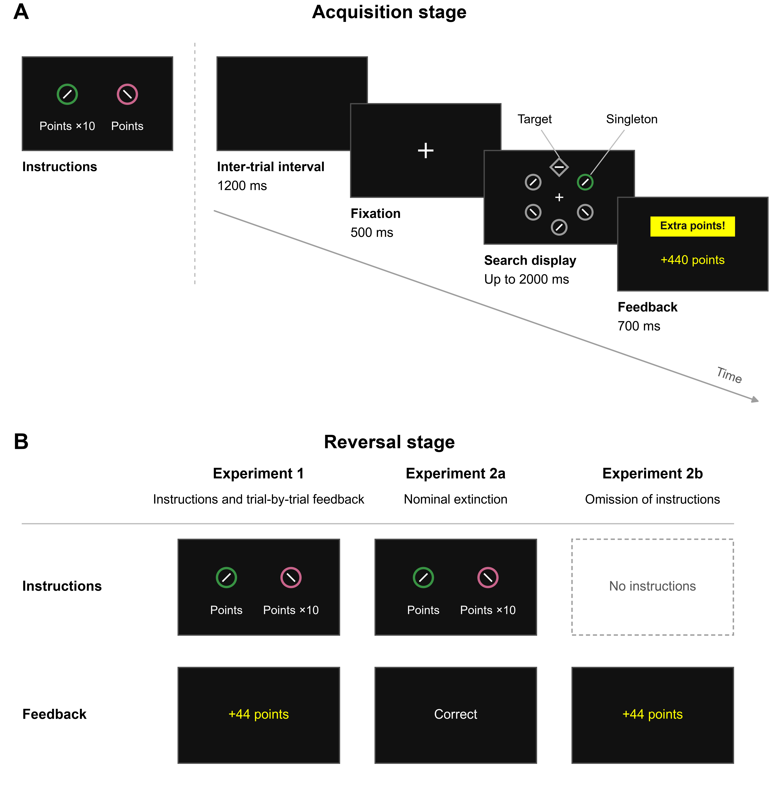
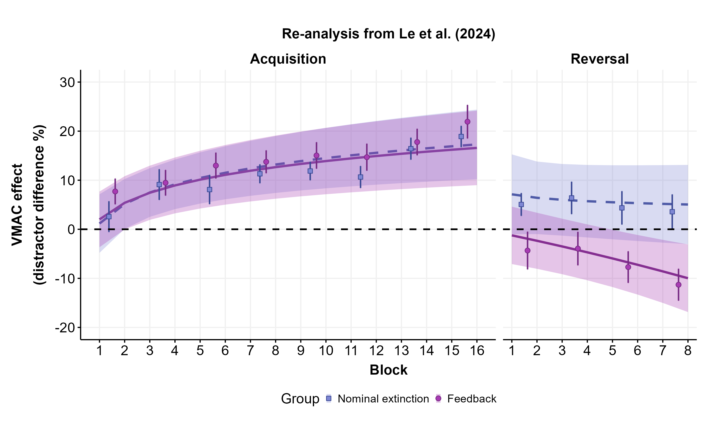

```{r}
#| label: setup-analysis-objects
#| include: false

knitr::opts_chunk$set(
  echo = FALSE,
  warning = FALSE,
  message = FALSE
)

read_results_rds <- function(path, label) {
  if (!file.exists(path)) {
    stop(sprintf("Could not find %s at '%s'.", label, path))
  }

  readRDS(path)
}

source(file.path("scripts", "functions.R"))

e1 <- read_results_rds(
  file.path("output", "analysis", "analysis_e1.rds"),
  "Experiment 1 analysis results"
)

e2 <- read_results_rds(
  file.path("output", "analysis", "analysis_e2.rds"),
  "Experiment 2 analysis results"
)

# Descriptive values reported in the text (computed by the analysis scripts)
rep_e1 <- e1$reported
rep_e2 <- e2$reported

fmt_num <- function(x, digits) formatC(x, format = "f", digits = digits)

# Numbers written in words (e.g., at the start of a sentence)
num_words <- function(n, capitalize = FALSE) {
  ones <- c("zero", "one", "two", "three", "four", "five", "six", "seven", "eight", "nine",
            "ten", "eleven", "twelve", "thirteen", "fourteen", "fifteen", "sixteen",
            "seventeen", "eighteen", "nineteen")
  tens <- c("", "", "twenty", "thirty", "forty", "fifty", "sixty", "seventy", "eighty", "ninety")
  w <- if (n < 20) ones[n + 1] else if (n %% 10 == 0) tens[n %/% 10 + 1] else
    paste0(tens[n %/% 10 + 1], "-", ones[n %% 10 + 1])
  if (capitalize) paste0(toupper(substring(w, 1, 1)), substring(w, 2)) else w
}

# Estimate and 95% CI of a row from predictions() or avg_comparisons()
est_ci <- function(row, digits = 0, label = NULL) {
  ci <- paste0("95\\% CI [", fmt_num(row$conf.low, digits), ", ",
               fmt_num(row$conf.high, digits), "]")
  if (is.null(label)) {
    return(paste0(fmt_num(row$estimate, digits), ", ", ci))
  }
  symbol <- if (label == "") "M" else paste0("M_{\\text{", label, "}}")
  paste0("$", symbol, " = ", fmt_num(row$estimate, digits), "$, ", ci)
}
pred_level <- function(df, level) df[df$Singleton == level, ]
demo_e2 <- function(experiment, column) {
  rep_e2$demographics[[column]][rep_e2$demographics$Experiment == experiment]
}
pred_experiment <- function(experiment) {
  df <- rep_e2$predictions$combined_by_experiment
  df[df$Experiment == experiment, ]
}
comp_contrast <- function(df, contrast) df[df$contrast == contrast, ]

# Smallest p value, truncated to three decimals (for "all p > ...")
p_floor <- function(p) sub("^0", "", fmt_num(floor(p * 1000) / 1000, 3))

le_reanalysis_path <- file.path("output", "analysis", "re_analysis_le2024.rds")
le <- if (file.exists(le_reanalysis_path)) readRDS(le_reanalysis_path) else NULL

bayes_summary_path <- file.path(
  "output",
  "models",
  "model_comparison_summary.csv"
)
bayes <- if (file.exists(bayes_summary_path)) {
  read.csv(bayes_summary_path, stringsAsFactors = FALSE)
} else {
  NULL
}

if (is.null(bayes)) {
  stop(
    "Could not find the Bayesian model comparison pairwise summary. Please rerun scripts/run_model_comparison.R or scripts/export_model_comparison_pairwise.R."
  )
}

e1_acquisition_rt_model <- e1$acquisition_rt_model
e1_reversal_rt_model <- e1$reversal_rt_model
e1_acquisition_acc_model <- e1$acquisition_acc_model
e1_reversal_acc_model <- e1$reversal_acc_model
e1_phase_anova <- e1$phase_anova
e1_final_plot <- e1$final_plot

e2_awareness_model_a <- e2$awareness_model_a
e2_awareness_model_b <- e2$awareness_model_b
e2_awareness_model_combined <- e2$awareness_model_combined
e2_awareness_vmac_model <- e2$awareness_vmac_model
e2_awareness_reliability <- e2$awareness_reliability
e2a_acquisition_rt_model <- e2$e2a_acquisition_rt_model
e2a_reversal_rt_model <- e2$e2a_reversal_rt_model
e2b_acquisition_rt_model <- e2$e2b_acquisition_rt_model
e2b_reversal_rt_model <- e2$e2b_reversal_rt_model
e2a_acquisition_acc_model <- e2$e2a_acquisition_acc_model
e2a_reversal_acc_model <- e2$e2a_reversal_acc_model
e2b_acquisition_acc_model <- e2$e2b_acquisition_acc_model
e2b_reversal_acc_model <- e2$e2b_reversal_acc_model
e2a_phase_anova <- e2$e2a_phase_anova
e2b_phase_anova <- e2$e2b_phase_anova
e2_comparison_rt_model <- e2$comparison_rt_model
e2_comparison_acc_model <- e2$comparison_acc_model
e2_comparison_plot <- e2$comparison_plot

le_phase_anova_nominal <- if (!is.null(le)) le$phase_anova_nominal else NULL
le_phase_anova_feedback <- if (!is.null(le)) le$phase_anova_feedback else NULL
le_within_block_model <- if (!is.null(le)) le$within_block_model else NULL

format_decimal <- function(x, digits = 1, drop_leading_zero = FALSE) {
  out <- formatC(x, format = "f", digits = digits)

  if (drop_leading_zero) {
    out <- sub("^-0\\.", "-.", out)
    out <- sub("^0\\.", ".", out)
  }

  out
}

extract_bayes_comparison <- function(bayes_results, group_code) {
  out <- bayes_results[bayes_results$group == group_code, , drop = FALSE]

  if (nrow(out) != 1) {
    stop(sprintf(
      "Could not find a unique Bayesian comparison summary row for group '%s'.",
      group_code
    ))
  }

  out
}

bayes_revfb <- extract_bayes_comparison(bayes, "RevFB")
bayes_rev <- extract_bayes_comparison(bayes, "Rev")

# Population mean of the instructed reversal parameter (rho) of the model-based model,
# by group and the difference between groups (scripts/posterior_predictions.R)
rho_summary <- read.csv(file.path("output", "models", "rho_summary.csv"))
rho_feedback <- rho_summary[rho_summary$group == "RevFB", ]
rho_extinction <- rho_summary[rho_summary$group == "Rev", ]
rho_difference <- rho_summary[rho_summary$group == "RevFB_minus_Rev", ]

extract_coef_table <- function(model) {
  out <- as.data.frame(coef(summary(model)))
  out$term <- rownames(out)
  rownames(out) <- NULL
  p_col <- grep("^Pr\\(", names(out), value = TRUE)[1]

  if (is.na(p_col)) {
    stop("Could not identify the p-value column in the model summary.")
  }

  out$p_value <- out[[p_col]]
  out
}

resolve_model_term_pattern <- function(model, patterns) {
  terms <- extract_coef_table(model)$term

  for (pattern in patterns) {
    hits <- terms[grepl(pattern, terms, perl = TRUE)]
    if (length(hits) > 0) {
      return(hits[1])
    }
  }

  stop(
    sprintf(
      "Could not identify a model term matching any of these patterns: %s",
      paste(patterns, collapse = ", ")
    )
  )
}

latex_model_term_pattern <- function(
  model,
  patterns,
  beta_label,
  include_ci = FALSE,
  ...
) {
  term <- resolve_model_term_pattern(model, patterns)
  latex_model_term(
    model = model,
    term = term,
    beta_label = beta_label,
    include_ci = include_ci,
    ...
  )
}

min_model_p <- function(
  model,
  include_patterns = NULL,
  exclude_patterns = NULL,
  exclude_terms = "(Intercept)"
) {
  out <- extract_coef_table(model)

  if (!is.null(include_patterns)) {
    keep <- Reduce(
      `|`,
      lapply(include_patterns, function(pattern) {
        grepl(pattern, out$term, perl = TRUE)
      })
    )
    out <- out[keep, , drop = FALSE]
  }

  if (!is.null(exclude_patterns)) {
    drop <- Reduce(
      `|`,
      lapply(exclude_patterns, function(pattern) {
        grepl(pattern, out$term, perl = TRUE)
      })
    )
    out <- out[!drop, , drop = FALSE]
  }

  out <- out[!out$term %in% exclude_terms, , drop = FALSE]

  if (nrow(out) == 0) {
    return(NA_real_)
  }

  min(out$p_value, na.rm = TRUE)
}

extract_awareness_criterion <- function(model) {
  out <- as.data.frame(
    marginaleffects::avg_predictions(
      model,
      type = "link",
      re.form = NA
    )
  )[1, , drop = FALSE]

  out$estimate <- -out$estimate

  if (all(c("conf.low", "conf.high") %in% names(out))) {
    old_low <- out$conf.low
    old_high <- out$conf.high
    out$conf.low <- -old_high
    out$conf.high <- -old_low
  }

  out
}

extract_awareness_dprime <- function(model) {
  as.data.frame(
    marginaleffects::avg_slopes(
      model,
      variables = "signal",
      type = "link",
      re.form = NA
    )
  )[1, , drop = FALSE]
}

latex_link_estimate <- function(row, symbol, digits = 2) {
  paste0(
    "$",
    symbol,
    " = ",
    format_num_latex(row$estimate, digits = digits),
    "$, 95\\% CI [",
    format_num_latex(row$conf.low, digits = digits),
    ", ",
    format_num_latex(row$conf.high, digits = digits),
    "]"
  )
}

extract_vmac_at_dprime <- function(model, dprime = 0) {
  as.data.frame(
    marginaleffects::avg_comparisons(
      model,
      variables = "Singleton",
      newdata = marginaleffects::datagrid(
        model = model,
        signal = dprime,
        ID = NA
      ),
      re.form = NA,
      comparison = \(hi, lo) {
        exp(hi + (sigma(model)^2) / 2) - exp(lo + (sigma(model)^2) / 2)
      }
    )
  )[1, , drop = FALSE]
}

latex_contrast_ci <- function(row, label, digits = 2) {
  paste0(
    "$M_{\\text{",
    label,
    "}} = ",
    format_num_latex(row$estimate, digits = digits),
    "$, 95\\% CI [",
    format_num_latex(row$conf.low, digits = digits),
    ", ",
    format_num_latex(row$conf.high, digits = digits),
    "]"
  )
}

latex_reliability <- function(
  estimate,
  ci_low,
  ci_high,
  label = "r_{\\text{sb}}",
  digits = 2
) {
  paste0(
    "$",
    label,
    " = ",
    format_num_latex(estimate, digits = digits),
    "$, 95\\% CI [",
    format_num_latex(ci_low, digits = digits),
    ", ",
    format_num_latex(ci_high, digits = digits),
    "]"
  )
}
```

Our ability to process information is deeply intertwined with our experience of the world. While it has been classically proposed that we can direct our attention "at will", based on our goals and intentions [@posner1980orienting; @corbetta2002control], our attention can also be *captured* by perceptually salient but task-irrelevant stimuli, even in situations in which such capture interferes with the processing of goal-relevant stimuli [@theeuwes2010top]. More recent proposals, however, have suggested that attentional control cannot be reduced to goal-directed and stimulus-driven influences alone, as our experience with the environment can also shape how we allocate attention beyond what current goals or physical salience alone would dictate. This influence of past experience is often referred to as selection history [@awh2012; @anderson2021_nbr_selectionhistory].

The theoretical distinction between stimulus-driven and goal-directed control of attention echoes broader questions about whether cognition, more generally, operates under deliberate, voluntary control or is instead governed by automatic, stimulus-driven processes [@shiffrin1977; @kahneman2003; @evans2013]. In this debate, selection history has frequently been used to argue that our attention is guided automatically by regularities in the environment, without intention and largely independently of our current goals [@awh2012; @theeuwes2018_joc; @gaspelin2025; @failing2018; @chun1998_contextualcueing; @anderson2016_habit; @jiang2018; @jiang2019]. However, automaticity is a multifaceted construct that encompasses several features that are not necessarily correlated [@moors2006_psychbull]. In other words, a process may be triggered without intention and yet depend on awareness or explicit knowledge. In fact, the idea that these features cluster into two distinct types of processes has been seriously questioned [@melnikoff2018].

Among the many phenomena grouped under selection history, how attention is shaped by reward illustrates the tension between automatic and controlled processes particularly well. When the prospect of reward is aligned with the current task, it can sharpen goal-directed control and improve how efficiently we select goal-relevant information [@engelmann2007_emotion; @padmala2011_jneuro; @botvinick2014computational]. However, reward is not always aligned with our goals, and in such cases it can instead lead us to prioritize stimuli that interfere with, rather than serve, the processing of goal-relevant information [@chelazzi2013; @failing2018; @rusz2020].

Perhaps one of the best examples of this conflict comes from the experimental paradigm developed by @lepelley2015_vmac_xge, in which participants performed a variant of the additional singleton task [@theeuwes1992], searching for a shape-defined target while ignoring a color singleton distractor. Unbeknownst to them, the color of that distractor signaled the magnitude of the reward available on each trial, even though attending to it was irrelevant, and even detrimental, to the task, since reward depended on fast and accurate responses to the target. Nevertheless, participants were reliably slower and more likely to look at the distractor when the high-value color appeared than when the low-value one did. In other words, a stimulus that reliably signals reward captures attention even when it is entirely task-irrelevant, and even when attending to it runs counter to the observer's goals [@anderson2011_plosone; @anderson2011_pnas_value].

This effect, known as value-modulated attentional capture (VMAC),[^vmac] is thought to arise from associative learning about the relationship between a stimulus feature and reward, rather than from task goals or physical salience [@lepelley2015_vmac_xge; @failing2018]. More specifically, the learning mechanism underlying this attentional bias has been conceptualized as Pavlovian [@lepelley2026; @lepelley2016], as VMAC seems to depend on the contingency between a feature of the stimulus and reward, rather than on the instrumental contingency between attending to that feature and obtaining a reward [@bucker2017a; @bucker2018; @mine2015b; @mine2018]. Indeed, VMAC emerges even when fixating the reward-predictive distractor cancels the reward it signals, including when participants are told about this contingency in advance [@lepelley2015_vmac_xge; @pearson2015; @pearson2020], and even after they have been explicitly rewarded for looking away from it [@kim2019a], a pattern typically regarded as a hallmark of Pavlovian learning [@williams1969_jeab; @hershberger1986]. Once established, VMAC persists despite the omission of reward feedback [@garre-frutos2024; @watson2019_plosone_vmac_persist] or the devaluation of the reward it signals [@detommaso2017; @detommaso2021; @watson2022; but see @pool2014_cognition_chocolate], and can be observed months after learning has taken place [@anderson2013_pbr_persistence]. This has led some authors to describe these biases as habit-like [@anderson2016_habit; @jiang2019] and markedly slow to update [@anderson2021_nbr_selectionhistory; @anderson2026_habit2; @lepelley2026].

Beyond its theoretical interest, VMAC has also been regarded as a useful model for how reward signals come to control behavior outside the laboratory. In particular, it has been proposed as a human analogue of sign-tracking behavior previously reported in animals [@lepelley2015_vmac_xge; @colaizzi2020; @lepelley2024], a phenomenon in which a cue that signals reward becomes attractive in its own right, so that some individuals approach and interact with it even when this behavior is unnecessary, or even detrimental, to obtain the reward [@hearst1974; @williams1969_jeab; @hershberger1986; @heck2025]. Such cues are thought to acquire incentive salience and become motivational "magnets," with an increased capacity to bias behavior and attention toward them [@berridge_robinson_2003; @berridge_robinson_2016]. Importantly, the tendency to attribute incentive salience to reward cues varies across individuals. In animals, this tendency has been linked to vulnerability to addiction [@flagel2011; @flagel2017; @robinson2008_rstb_incentivesensitization]. Similarly, in humans, individual differences in VMAC have been associated with several psychopathological conditions, including symptoms of depression [@anderson2014_depression; @anderson2017_depression], obsessive-compulsive disorder [@albertella2019_pab; @albertella2020a; @Albertella2020b_JBTEP; @basel2023], and attention-deficit/hyperactivity disorder [@sali2018], as well as with affect-driven impulsivity [@Albertella2020b_JBTEP; @garre-frutos2025b; @gonzalez2025] and addictive behaviors [e.g., @albertella2021; @watson2024; for reviews, see @anderson2021_copsyc_psychopathology; @lepelley2024]. In this sense, understanding the conditions under which these biases persist, or are updated, when the value of a stimulus changes may help explain why cue-controlled behaviors, such as those observed in addiction, are so difficult to change [@lepelley2026].

In addition to being expressed automatically, VMAC has often been assumed to be learned implicitly, that is, without awareness of the stimulus–reward contingencies [@anderson2016_habit; @anderson2021_nbr_selectionhistory; @anderson2026_habit2]. For example, participants often fail to report the correct stimulus–reward contingencies [@anderson2013_pbr_persistence; @anderson2015; @gregoire2019; @theeuwes2012], and VMAC has sometimes been observed even among those classified as unaware [@bourgeois2017; @gregoire2019; @gregoire2021; @lepelley2015_vmac_xge]. However, recent evidence suggests that the learning process underlying VMAC is influenced by verbal instructions [@garre-frutos2025a] and is associated with measures of awareness [@garre-frutos2025a; @garre-frutos2025c]. Although this evidence departs from the usual view of how learning shapes attention [@awh2012; @anderson2021_nbr_selectionhistory], it is not entirely surprising, considering that the implicit nature of other attentional biases attributed to selection history has also been questioned [@gimenez-fernandez2023a], and that human Pavlovian learning has often been linked to awareness [@lovibond2002a; @schmidt2012; @weidemann2016; @mertens2020]. Verbal instructions can strongly shape learned associations [@lovibond2003; @atlas2019; @atlas2023; @mertens2018], and according to propositional accounts, associative learning in humans may depend on the formation of beliefs about the relations between events [@mitchell2009; @dehouwer2019]. This does not imply, however, that the resulting responses are necessarily under voluntary control. According to the expectancy account of @lovibond2024, conditioned responses, such as Pavlovian attentional biases, are elicited involuntarily by a state of expectancy that can itself be acquired through verbal information. That is, these responses can be automatic in their expression but propositional in their content. In this sense, an expectancy that can be acquired through verbal information should also change when new information about the stimulus–reward contingencies becomes available. In the case of VMAC, this would imply that explicit knowledge could shape not only how the bias is acquired, but also how it is updated, while its expression remains involuntary.

This possibility is closely related to the distinction between model-free and model-based learning, which has been central to computational accounts of how values are learned and updated [for a review, see @drummond2020a]. In the context of instrumental learning, behavior is often thought to rely on two distinct systems. A model-free system relies on the cached value of actions learned through experience and updated through prediction errors, whereas a model-based system prospectively evaluates future outcomes using a representation of the structure of the environment. By contrast, Pavlovian learning has typically been presumed to be model-free [@dayan2014], and it has usually been modeled with algorithms such as the Rescorla–Wagner rule and other prediction-error models [@rescorla1972_rw; @pearce1980_psyr; @lePelley2004_qjepB; @esber2011_prsb], which have also been used to account for VMAC [@lepelley2016; @jeong2023]. However, @dayan2014 proposed that this distinction also applies within Pavlovian learning itself. In model-based Pavlovian learning, the value of a conditioned stimulus can change based on a representation of the outcome it predicts and of the current value of that outcome. This value depends, among other factors, on the motivational state of the organism. For instance, rats that had learned to avoid a cue paired with an intensely salty taste began to approach it as soon as they were salt-depleted, before experiencing any new pairing [@robinsond2013].

In humans, verbal instructions may produce a similar form of updating, and the effect of instructions about a contingency reversal on Pavlovian learning has accordingly been formalized as an immediate update of the learned values of the stimuli [@atlas2016_elife; @atlas2019]. Updating through instructions and updating through experience can therefore be distinguished by examining the time course of responding after a reversal [@atlas2019; @stemerding2026]. If a learned response is updated only through experience, it should change gradually, as participants encounter the new outcomes. In contrast, if explicit knowledge can directly update the learned value of a stimulus, the response should change as soon as participants are informed about the new contingencies, before any new outcome has been experienced [@dayan2014; @atlas2023; @lopez2016].

Studies using this logic suggest that instructions do not affect all learned responses in the same way. In human fear conditioning, instructions about a reversal or an extinction of contingencies can alter skin conductance and outcome expectancy from the very first trials after they are given [for reviews, see @atlas2019; @luck2016_review; @mertens2018], whereas their effects are weaker, or absent, in other response systems [@atlas2016_elife; @luck2015; @sevenster2012]. Learned attentional biases show a similar dissociation [@lepelley2013], as instructions have been found to reverse [@mitchell2012] or abolish [@donlivesey2015] the learned predictiveness effect, but to leave rapid attentional biases toward previously predictive stimuli unaffected [@cobos2018]. Likewise, implicit evaluations are readily shaped by new relational information, but they resist the retrospective revaluation of what has already been learned [@gregg2006; @kurdi_dunham2020; @melnikoff2025].

Similarly, VMAC seems resistant to instructions, as the bias persists even when participants are informed that reward is no longer available, or that it has lost its value [@watson2019_plosone_vmac_persist; @le2024; but see @garre-frutos2025b]. However, the picture is less clear when stimulus–reward contingencies are reversed. For example, @liao2020 trained participants to search for color-defined targets associated with different reward values, and then reversed these contingencies without informing them. In a subsequent test phase, the originally high-value color still captured attention in the first block[^d1]. By contrast, when @failing2017_app reversed the stimulus–reward contingencies at the start of every block and informed participants of each reversal, VMAC emerged gradually within each block, which the authors interpreted as evidence for a learning-dependent mechanism rather than goal-directed attentional prioritization. Other studies have found no reliable VMAC when averaging over an instructed reversal phase [@Albertella2019_AddictBehRep; @le2024], and @le2024 concluded that knowledge of a switch in outcome values was sufficient for a partial updating of attentional priority. However, @failing2017_app averaged this time course across all blocks, including the first one, in which no reversal had taken place, whereas the other studies did not examine the time course at all. As a result, it is not possible to determine whether instructions abolished VMAC immediately, or whether the bias persisted for some time and was then reversed through experience. Moreover, to our knowledge, instructed and uninstructed reversals have never been compared within the same paradigm, so it remains unclear whether the updating of Pavlovian attentional biases depends on explicit knowledge, on experience with the new contingencies, or on both [@lepelley2026].

The present study therefore tested the impact of explicit knowledge on the reversal of VMAC by examining its time course. In Experiment 1, participants completed an acquisition and a reversal stage, and received explicit instructions about the contingency change along with trial-by-trial reward feedback. In Experiment 2a, participants were only instructed about the reversal and received no trial-by-trial reward feedback (nominal extinction), whereas in Experiment 2b, they received trial-by-trial feedback but no instructions, and their awareness of the new contingencies was assessed at the end of the task. This design allowed us to examine the effect of instructions in the absence of trial-by-trial reward feedback, and the effect of this feedback in the absence of instructions. If Pavlovian attentional biases are also supported by a representation of the outcome signaled by the distractor, instructions should abolish the previously learned bias at the onset of the reversal stage, even in the absence of feedback, whereas if they are updated only through experience, the bias should persist until the new contingencies are experienced. Such an immediate effect would be difficult to attribute to a deliberate change in search strategy, because ignoring the two distractors remains the best strategy after the reversal. In the absence of instructions, we expected the bias to persist, and its later reversal to be associated with participants' awareness of the new contingencies.

Finally, we re-analyzed the eye-tracking data of @le2024, whose Experiment 2 included instructed reversals with and without trial-by-trial feedback, comparable to our Experiments 1 and 2a. In their task, fixating the distractor cancels the outcome it predicts [@pearson2016b], a feature that makes a strategic account even less plausible. Using these trial-level data, we examined whether VMAC changed immediately after the reversal instructions, and developed two computational models to test whether the learned values of the stimuli were updated only through experience, or also immediately through the instructions [@atlas2016_elife]. Overall, the present study sought to determine whether an attentional bias that is expressed involuntarily, and against participants' goals, can nonetheless be updated by explicit knowledge.

[^d1]: A design feature of @liao2020 that may explain their results is that the reversal involved a stimulus that had previously been associated with no outcome, rather than stimuli associated with different outcome magnitudes (e.g., high- and low-value stimuli). In most paradigms used to measure VMAC, reward-predictive stimuli are reliable predictors of an outcome, and the magnitude of the reward is manipulated [@anderson2011_pnas_value; @lepelley2015_vmac_xge]. Making a stimulus completely nonpredictive of reward can strongly affect learning [@lubow1973] and attention [@lePelley2013_jep_lmc_dotprobe; @luque2018]. Therefore, it is possible that the persistence observed by @liao2020 was driven primarily by the low predictiveness of the new high-value stimulus rather than by resistance to reversal itself.

[^vmac]: For the sake of simplicity, throughout this article, we use VMAC in cases where attentional capture is driven by reward [@anderson2011_pnas_value], not only by a modulation of an already salient singleton distractor [@anderson2011_plosone; @lepelley2015_vmac_xge]. While this distinction is of methodological relevance, both experimental designs are likely to tap into related processes.


# Experiment 1

Experiment 1 aimed to test the temporal dynamics of VMAC reversal learning. We followed the same procedure as @garre-frutos2024, except that we employed a reversal stage instead of an unrewarded stage. In the reversal stage, participants were explicitly informed that the high-value distractor would swap its role with the previously low-value distractor, and they also received direct experience (trial-by-trial feedback) of the reversal.

## Method

### Transparency and Openness

We report how we determined our sample sizes, all data exclusions, all manipulations, and all measures in all the experiments reported in this article, and the article follows the Journal Article Reporting Standards [JARS\; @appelbaum2018]. Experiment 1 was not preregistered. De-identified data, analysis code, computational models, and task materials of all experiments are archived at Zenodo [@garre-frutos2026_data], and the version history of the project is available at <https://github.com/franfrutos/vmac_reversal>. All analyses were conducted in R, and computational models were fitted in Stan.[^software]

[^software]: We used R, version 4.3.1 [@rcoreteam2023], with the packages dplyr, version 1.1.4, tidyr, version 1.3.0, and ggplot2, version 3.5.1 [@wickham2019], Rmisc, version 1.5.1 [@hope2022], lme4, version 1.1-34 [@bates2015_lme4], lmerTest, version 3.2-1 [@kuznetsova2017], afex, version 1.4-1 [@singmann2024], emmeans, version 1.10.5 [@lenth2024], marginaleffects, version 0.32.0 [@arelbundock2024], hypr, version 0.2.7 [@rabe2020], effectsize, version 0.8.9 [@benshachar2020], rapidsplithalf, version 0.4 [@kahveci2025], simr, version 1.0.7 [@green2016], and performance, version 0.12.4 [@ludecke2021]. Computational models were fitted through the cmdstanr interface, version 0.9.0, with CmdStan 2.40.0 [@stan2024; @cmdstanr], and were processed and compared with the posterior, version 1.6.0, and loo, version 2.8.0, packages [@posterior2024; @loo2024; @vehtari2017].

### Participants

No a priori power analysis was conducted for this experiment. However, we recruited a larger sample than any of the individual studies included in the meta-analysis by @rusz2020, in which the largest sample was 80 participants. `r num_words(rep_e1$demographics$n, capitalize = TRUE)` students from the University of Granada participated in the experiment (`r rep_e1$demographics$females` self-identified as female). Their ages ranged from `r rep_e1$demographics$age_min` to `r rep_e1$demographics$age_max` years ($M = `r fmt_num(rep_e1$demographics$age_mean, 2)`$, $SD = `r fmt_num(rep_e1$demographics$age_sd, 2)`$). Inclusion criteria were fluency in Spanish and normal or corrected-to-normal vision, including normal color perception. `r num_words(rep_e1$demographics$n_excluded, capitalize = TRUE)` participant was excluded due to exceptionally low accuracy (< .70). A sensitivity analysis indicated that, with the final sample of `r rep_e1$demographics$n - rep_e1$demographics$n_excluded` participants, the design had 80% power to detect within-participant effects of $d_z$ = 0.30 or larger (two-tailed $\alpha$ = .05), which is smaller than the meta-analytic estimate of the VMAC effect [$d$ = 0.35\; @rusz2020]. All experiments reported here were approved by the Ethics Committee of the University of Granada (ref. 2442/CEIH/2021) and were conducted in accordance with the principles of the Declaration of Helsinki. Experiments 2a and 2b, which included participants from the University of Málaga, were also approved by the Ethics Committee of that university (ref. 46-2020-H).

### Stimuli, Materials, and Procedure

Upon arrival at the laboratory, participants read and signed the informed consent[^d3]. Subsequently, they started the experimental task. The VMAC task was adapted from @lepelley2015_vmac_xge and @watson2019_plosone_vmac_persist, and was extended with a reversal stage. Participants completed the VMAC task in a darkened room, seated approximately 60 cm from the screen. The design of the experiment ([@fig-1]A) comprised two stages: acquisition and reversal, with 12 blocks per phase and 24 trials in each block. Between blocks, participants were allowed to rest as long as they wished. In each trial, the participant was first presented with a fixation cross at the center of the screen. After a delay of 500 ms, a search display appeared, consisting of six shapes (~2.3º $\times$ 2.3º) arranged evenly around an imaginary circle (~10.1º $\times$ 10.1º). Out of the six shapes, five were circles (distractors) containing a white line randomly tilted 45º to the right or left. The remaining shape was a diamond (target) and contained a line oriented horizontally or vertically. The search display remained on the screen until either a response was recorded or the trial reached its maximum duration of 2000 ms, resulting in a timeout.

[^d3]: After informed consent, participants performed a series of questionnaires for a project outside of the scope of the present study: the Spanish adaptation of the short version of the UPPS-P questionnaire [UPPS-P\; @candido2012], the Spanish adaptation of the Emotion Regulation Questionnaire [ERQ\; @cabello2013_erq_es], and the Spanish version of the Trait Food Craving Questionnaire [FCQ-T\; @cepedabenito2000_fcqt_es]. 

::: {#fig-1}

{width="100%" fig-scap="Schematic representation of the task." apa-note="\footnotesize Panel A: Participants could earn points based on performance, and when a high-value singleton appeared in the display, points were multiplied by 10 (a bonus trial). The two singleton colors (pink and green, or orange and blue) were randomly assigned to high and low value. Panel B: In the reversal stage, the color–reward contingencies were switched, so that the previously low-value singleton predicted high reward. Participants were informed about the reversal in Experiments 1 and 2a, but not in Experiment 2b. In Experiment 2a, feedback on each trial only indicated whether the response was correct, and the total number of points was shown at the end of each block."}

Example of the sequence of events in the experimental task.
:::

Participants were instructed to indicate the orientation of the line within the diamond as quickly as possible to earn points, pressing either "C" for horizontal or "G" for vertical. The number of points received on each trial depended on their speed and accuracy, and points had no monetary value. Before starting the task, participants underwent a practice block without reward feedback and without colored distractors. During the task, in 20 of 24 trials per block, one of the circles was colored in one of two specific colors, and the other shapes were gray. One color defined a high-value singleton and the other a low-value singleton. This resulted in 10 high-value trials and 10 low-value trials per block. Possible pairs of colors for high- and low-value assignments were pink/green or orange/blue, and the assignment was random. In the remaining four trials, none of the circles were colored (absent). The order of trial presentation was randomized within each block. For correct responses, participants were awarded 0.1 points for every millisecond that their RT was under 1000 ms in the low-value and absent conditions. In the high-value condition, points earned were multiplied by 10 (bonus trial). Before starting the task, participants were informed about which singletons would predict the multiplier. They were instructed to ignore them to avoid distractions and maximize points. Responses with an RT >1000 ms did not award points, and errors in each condition resulted in losing the points that could have been won otherwise. The feedback screen was presented for 700 ms, indicating the points won or lost. If no response was received within 2000 ms, a timeout was shown with the message: "Too slow. Please, respond faster." The inter-trial interval was 1200 ms. To improve motivation and attention to the task, accumulated points were reported at the end of the block, and participants unlocked medals sequentially through the task (Bronze, Silver, Gold, Platinum, Diamond, Elite).

After completing the acquisition stage, participants were informed that the singleton-value contingencies would reverse: the previous high-value singleton would no longer predict a bonus, and the previous low-value singleton would now anticipate extra points. Participants then initiated the reversal blocks, during which all other parameters remained unchanged.

At the end of the experiment, participants were asked to provide a contingency rating for the color–reward relationship. A slider was presented with two color singletons at its ends, representing the relative percentage of points gained with each of them. Participants moved a dot to indicate the relative number of points earned for each color. For instance, if the slider was shifted toward the high-value color, the percentages updated accordingly (e.g., 70% high-value vs. 30% low-value).

### Data Analysis

Data preprocessing and analyses followed previous studies [@garre-frutos2024; @garre-frutos2025a; @garre-frutos2025b]. Participants with accuracy below 0.70 were excluded. In all analyses, we excluded trials with RTs below 150 ms or above 1800 ms (`r fmt_num(rep_e1$exclusions$outliers, 2)`%), and trials with incorrect responses (`r fmt_num(rep_e1$exclusions$incorrect, 2)`%) were also excluded from the RT analyses. We employed linear mixed models (LMM) on log-transformed RTs, including predictors for Singleton (high-value, low-value, absent), Block, and the Singleton × Block interaction. Following @barr2013, we fitted the maximal random-effects structure allowed by the design without singular fits or convergence issues [@bates2015; @matuschek2017]. We used repeated contrasts for Singleton, coding one coefficient for the VMAC effect (high–low) and one for the AC effect (low–absent). In the reversal stage, the same contrasts were used, but with different interpretations: a successful reversal was indicated by a negative VMAC effect, meaning that RTs for the previously low-value distractor were higher than for the previously high-value distractor. The low–absent contrast now reflected both attentional capture and the new, higher value of the previously low-value distractor, and a positive interaction of this contrast with Block would indicate a progressive increase in the attentional priority of this distractor. Because RTs across blocks are often better explained by a power function, we compared linear vs. power models using the Akaike Information Criterion (AIC). This analysis was performed independently for each stage. 

Task accuracy was analyzed with generalized linear mixed models (GLMM) with a binomial likelihood and a logit link [@jaeger2008]. To test persistence of VMAC at the onset of reversal, we compared the last two acquisition blocks with the first two reversal blocks using a repeated-measures ANOVA with Phase (Acquisition, Reversal) and Singleton (High, Low) as factors. Planned *t* tests probed the VMAC effect in each phase separately.

## Results and Discussion
### Acquisition Stage
```{r}
#| label: exp1-acquisition-results-setup
#| include: false

model_rt <- e1_acquisition_rt_model
model_acc <- e1_acquisition_acc_model
include_ci <- FALSE

extract_acc_summary <- function(model) {
  out <- as.data.frame(coef(summary(model)))
  out$term <- rownames(out)
  rownames(out) <- NULL
  p_col <- grep("^Pr\\(", names(out), value = TRUE)[1]
  list(
    table = out,
    p_col = p_col
  )
}

extract_acc_overall <- function(model) {
  mf <- stats::model.frame(model)
  y <- stats::model.response(mf)
  w <- stats::weights(model)

  if (is.null(w)) {
    w <- rep(1, length(y))
  }

  total_n <- sum(w, na.rm = TRUE)
  total_success <- sum(y * w, na.rm = TRUE)
  estimate <- total_success / total_n
  ci <- stats::prop.test(total_success, total_n)$conf.int

  data.frame(
    estimate = estimate,
    conf.low = ci[1],
    conf.high = ci[2]
  )
}

latex_acc_overall <- function(row, digits = 3) {
  paste0(
    "$M = ",
    format_num_latex(row[[1]], digits = digits),
    "$, ",
    "95\\% CI [",
    format_num_latex(row[[2]], digits = digits),
    ", ",
    format_num_latex(row[[3]], digits = digits),
    "]"
  )
}

acc_term_labels <- c(
  "scale(Block_num)" = "Block",
  "scale(log(Block_num))" = "Block",
  "SingletonAC" = "low-absent",
  "SingletonVMAC" = "high-low",
  "SingletonAC:scale(Block_num)" = "low-absent \\times Block",
  "SingletonVMAC:scale(Block_num)" = "high-low \\times Block",
  "SingletonAC:scale(log(Block_num))" = "low-absent \\times Block",
  "SingletonVMAC:scale(log(Block_num))" = "high-low \\times Block"
)

extract_acc_sig_terms <- function(model) {
  acc_info <- extract_acc_summary(model)
  acc_table <- subset(acc_info$table, term != "(Intercept)")
  acc_table$term[acc_table[[acc_info$p_col]] < 0.05]
}

has_acc_sig_terms <- function(model) {
  length(extract_acc_sig_terms(model)) > 0
}

acc_min_p_nonsig <- function(model) {
  acc_info <- extract_acc_summary(model)
  acc_table <- subset(acc_info$table, term != "(Intercept)")
  p <- acc_table[[acc_info$p_col]]
  min(p[p >= 0.05], na.rm = TRUE)
}

min_acc_p <- function(model) {
  acc_info <- extract_acc_summary(model)
  acc_table <- subset(acc_info$table, term != "(Intercept)")
  min(acc_table[[acc_info$p_col]], na.rm = TRUE)
}

latex_acc_sig_terms <- function(model, term_labels = acc_term_labels) {
  sig_terms <- extract_acc_sig_terms(model)
  beta_labels <- unname(ifelse(
    sig_terms %in% names(term_labels),
    term_labels[sig_terms],
    sig_terms
  ))
  sig_text <- unname(latex_model_terms(
    model = model,
    terms = sig_terms,
    beta_labels = beta_labels,
    include_ci = FALSE
  ))
  paste(sig_text, collapse = "; ")
}

acc_overall <- extract_acc_overall(model_acc)
```

A power function model was selected due to its lower AIC ($|\Delta_{\text{AIC}}| = `r fmt_num(rep_e1$aic_diff[["acquisition"]], 1)`$). Model predictions are shown in @fig-2. There was a main effect of Block (`r latex_model_term(model_rt, term = "scale(log(Block_num))", beta_label = "Block", include_ci = include_ci)`), indicating a general decrease in RTs. A significant AC effect was found (`r latex_model_term(model_rt, term = "SingletonAC", beta_label = "low-absent", include_ci = include_ci)`; `r est_ci(comp_contrast(rep_e1$comparisons$acquisition, "Low, Absent"), 1, "low-absent")`), with higher RTs in the low-value distractor condition (`r est_ci(pred_level(rep_e1$predictions$acquisition, "Low"), 0, "")`) compared to the absent condition (`r est_ci(pred_level(rep_e1$predictions$acquisition, "Absent"), 0, "")`). A significant VMAC effect was also observed (`r latex_model_term(model_rt, term = "SingletonVMAC", beta_label = "high-low", include_ci = include_ci)`; `r est_ci(comp_contrast(rep_e1$comparisons$acquisition, "High, Low"), 1, "VMAC")`), showing higher RTs for the high-value singleton (`r est_ci(pred_level(rep_e1$predictions$acquisition, "High"), 0, "")`) than for the low-value singleton. Both the AC effect (`r latex_model_term(model_rt, term = "SingletonAC:scale(log(Block_num))", beta_label = "low-absent \\times Block", include_ci = include_ci)`) and the VMAC effect (`r latex_model_term(model_rt, term = "SingletonVMAC:scale(log(Block_num))", beta_label = "high-low \\times Block", include_ci = include_ci)`) interacted significantly with Block, indicating a progressive increase in VMAC and a decrease in AC.

::: {#fig-2}

{width="100%" fig-scap="Model predictions for Experiment 1." apa-note="\footnotesize Insets show the model high-low conditional effect (VMAC) together with the raw VMAC effect. Lines represent predicted conditional means on the raw response scale, shaded areas indicate 95% confidence intervals, dots represent raw mean RTs using epochs of two blocks, and error bars represent the standard error of the mean."}

Model predictions as a function of singleton condition across blocks.

:::

Accuracy was near ceiling (`r latex_acc_overall(acc_overall)`) and decreased slightly across blocks (`r latex_model_term(model_acc, term = "scale(Block_num)", beta_label = "Block", include_ci = FALSE)`), with no other significant main effects or interactions (all $p > `r p_floor(acc_min_p_nonsig(model_acc))`$).

### Reversal Stage
```{r}
#| label: exp1-reversal-results-setup
#| include: false

model_rt <- e1_reversal_rt_model
model_acc <- e1_reversal_acc_model
include_ci <- FALSE
acc_overall <- extract_acc_overall(model_acc)
```

In the reversal stage, the power function again provided a better fit ($|\Delta_{\text{AIC}}| = `r fmt_num(rep_e1$aic_diff[["reversal"]], 1)`$). As shown in @fig-2, there was a significant effect of Block (`r latex_model_term(model_rt, term = "scale(log(Block_num))", beta_label = "Block", include_ci = include_ci)`) and a reversed VMAC effect (`r latex_model_term(model_rt, term = "SingletonVMAC", beta_label = "high-low", include_ci = include_ci)`; `r est_ci(comp_contrast(rep_e1$comparisons$reversal, "High, Low"), 1, "high-low")`), with RTs for the previously low-value distractor (`r est_ci(pred_level(rep_e1$predictions$reversal, "Low"), 0, "")`) higher than for the previously high-value distractor (`r est_ci(pred_level(rep_e1$predictions$reversal, "High"), 0, "")`). The low-absent contrast was also significant (`r latex_model_term(model_rt, term = "SingletonAC", beta_label = "low-absent", include_ci = include_ci)`; `r est_ci(comp_contrast(rep_e1$comparisons$reversal, "Low, Absent"), 1, "low-absent")`), showing that RTs for the previously low-value distractor were also higher than when no distractor was presented (`r est_ci(pred_level(rep_e1$predictions$reversal, "Absent"), 0, "")`). Both the high-low and low-absent contrasts interacted with Block (`r latex_model_term(model_rt, term = "SingletonVMAC:scale(log(Block_num))", beta_label = "high-low \\times Block", include_ci = include_ci)`; `r latex_model_term(model_rt, term = "SingletonAC:scale(log(Block_num))", beta_label = "low-absent \\times Block", include_ci = include_ci)`), reflecting a progressive increase in attentional priority for the previously low-value distractor.

Accuracy remained near ceiling (`r latex_acc_overall(acc_overall)`), with no significant main effects or interactions (all $p > `r p_floor(min_acc_p(model_acc))`$).

```{r}
#| label: exp1-persistence-results-setup
#| include: false

extract_phase_results <- function(
  phase_model,
  acquisition_pattern = "^Acquisition$",
  reversal_pattern = "^Reversal$",
  singleton_var = "Singleton",
  phase_var = "Phase"
) {
  phase_formula <- stats::as.formula(paste("~", singleton_var, "|", phase_var))
  emm_formula <- stats::as.formula(paste("~", singleton_var))
  phase_emm <- emmeans::emmeans(phase_model, phase_formula)
  phase_levels <- unique(as.character(phase_emm@grid[[phase_var]]))
  acquisition_phase <- phase_levels[grepl(
    acquisition_pattern,
    phase_levels,
    ignore.case = TRUE
  )][1]
  reversal_phase <- phase_levels[grepl(
    reversal_pattern,
    phase_levels,
    ignore.case = TRUE
  )][1]

  if (is.na(acquisition_phase) || is.na(reversal_phase)) {
    if (length(phase_levels) == 2) {
      numeric_levels <- suppressWarnings(as.numeric(phase_levels))

      if (!all(is.na(numeric_levels))) {
        ordered_levels <- phase_levels[order(numeric_levels)]
      } else {
        ordered_levels <- sort(phase_levels)
      }

      acquisition_phase <- ordered_levels[1]
      reversal_phase <- ordered_levels[2]
    } else {
      stop(
        "Could not identify the Acquisition and Reversal phase labels in the afex model."
      )
    }
  }

  get_phase_vmac <- function(phase_label) {
    emm <- emmeans::emmeans(
      phase_model,
      emm_formula,
      at = stats::setNames(list(phase_label), phase_var)
    )
    out <- as.data.frame(summary(pairs(emm), infer = c(TRUE, TRUE)))
    if (nrow(out) < 1) {
      stop(sprintf(
        "Could not extract the planned Singleton contrast for phase '%s'.",
        phase_label
      ))
    }
    out[1, , drop = FALSE]
  }

  acq_vmac <- get_phase_vmac(acquisition_phase)
  rev_vmac <- get_phase_vmac(reversal_phase)

  list(
    acquisition = acq_vmac,
    reversal = rev_vmac,
    acquisition_d = as.data.frame(effectsize::t_to_d(
      acq_vmac$t.ratio,
      df_error = acq_vmac$df,
      paired = TRUE
    )),
    reversal_d = as.data.frame(effectsize::t_to_d(
      rev_vmac$t.ratio,
      df_error = rev_vmac$df,
      paired = TRUE
    ))
  )
}

latex_phase_vmac <- function(row, d_obj) {
  paste0(
    "$M_{\\text{VMAC}} = ",
    format_num_latex(row$estimate, digits = 1),
    "$, ",
    "95\\% CI [",
    format_num_latex(row$lower.CL, digits = 1),
    ", ",
    format_num_latex(row$upper.CL, digits = 1),
    "], ",
    "$t(",
    format_num_latex(row$df, digits = 0),
    ") = ",
    format_num_latex(row$t.ratio, digits = 2),
    "$, ",
    "$p ",
    format_p_latex(row$p.value),
    "$, ",
    "$d_z = ",
    format_num_latex(d_obj$d, digits = 2),
    "$, ",
    "95\\% CI [",
    format_num_latex(d_obj$CI_low, digits = 2),
    ", ",
    format_num_latex(d_obj$CI_high, digits = 2),
    "]"
  )
}

e1_phase_results <- extract_phase_results(e1_phase_anova)
acq_vmac <- e1_phase_results$acquisition
rev_vmac <- e1_phase_results$reversal
acq_d <- e1_phase_results$acquisition_d
rev_d <- e1_phase_results$reversal_d
```


To test persistence of VMAC after reversal instructions, we compared the last two acquisition blocks with the first two reversal blocks in an RM-ANOVA. A main effect of Singleton was found (`r latex_afex_term(e1_phase_anova, "Singleton", effect_label = "Singleton")`), with higher RTs for the high- vs. low-value distractor. A significant effect of Phase was also found (`r latex_afex_term(e1_phase_anova, "Phase", effect_label = "Phase")`), reflecting faster RTs in the reversal stage. Importantly, there was a significant Singleton $\times$ Phase interaction (`r latex_afex_term(e1_phase_anova, "Singleton:Phase", effect_label = "Singleton x Phase")`). This interaction indicated that the VMAC effect was reduced in the reversal stage compared to acquisition (`r latex_phase_vmac(acq_vmac, acq_d)`) and was effectively abolished at the onset of reversal (`r latex_phase_vmac(rev_vmac, rev_d)`).


We observed a robust VMAC effect in the acquisition phase, replicating previous studies. The effect developed over trials, with search times becoming progressively slower for the high- than for the low-value singleton. In the reversal stage, the VMAC effect was no longer observed at the beginning of the reversal phase and then progressively reversed following the new contingencies. These results are consistent with previous studies that did not find a reliable VMAC effect when averaging over an instructed reversal phase [@Albertella2019_AddictBehRep; @le2024].

# Experiments 2a and 2b

In Experiments 2a and 2b, we aimed to test the role of explicit knowledge in the reversal of the VMAC effect by varying the type of information provided to participants (instructions or trial-by-trial reward feedback) in the reversal phase ([@fig-1]B). In Experiment 2a, participants underwent a reversal phase under nominal extinction, as in Experiment 2 by @le2024, who used a similar design and procedure, except that they measured overt eye fixations to the distractor instead of RTs. In Experiment 2b, we tested VMAC reversal without explicit instructions. To our knowledge, in the studies that follow the paradigm developed by @lepelley2015_vmac_xge, the reversal has been implemented by providing participants with instructions about the reversed contingencies. For that reason, we aimed to test whether reward feedback alone would produce a similar pattern of results as in Experiment 1. To that aim, in Experiment 2b, participants performed the same acquisition stage as in Experiment 1, but contingencies were reversed without informing participants about the transition between the acquisition and reversal stages.

If knowledge about the new contingencies is necessary to reverse the previously acquired attentional bias, we expect that instructions alone should abolish VMAC (Experiment 2a), while in the absence of such knowledge the previously acquired association should persist (Experiment 2b). In Experiment 2b, however, participants may eventually become aware of the reversal through experience and reverse the previously acquired association.

## Method

### Transparency and Openness

The design, hypotheses, and analysis plan of Experiments 2a and 2b were preregistered before data collection (<https://osf.io/g96yj>). The only deviation from the preregistered analysis plan concerned the coding of the attentional capture contrast in the reversal stage and is reported in the Data Analysis section. Analyses that were not preregistered are identified as such.

### Participants

Following a preregistered power analysis based on Experiment 1 (see Supplementary Material), we aimed to recruit at least 60 participants for both Experiments 2a and 2b. As in Experiment 1, the inclusion criteria were speaking Spanish fluently and having normal or corrected vision and perception of color. Participants were recruited from the University of Granada and the University of Málaga in exchange for course credit. `r num_words(demo_e2("A", "n"), capitalize = TRUE)` participants took part in Experiment 2a (`r demo_e2("A", "females")` self-identified as female; participants’ ages ranged from 18 to `r demo_e2("A", "age_max")`, $M_{\text{age}} = `r fmt_num(demo_e2("A", "age_mean"), 2)`$, $SD_{\text{age}} = `r fmt_num(demo_e2("A", "age_sd"), 2)`$), with `r demo_e2("A", "malaga")` from the University of Málaga. In Experiment 2b, `r num_words(demo_e2("B", "n"))` participants were recruited (`r demo_e2("B", "females")` self-identified as female; participants’ ages ranged from 18 to `r demo_e2("B", "age_max")`, $M_{\text{age}} = `r fmt_num(demo_e2("B", "age_mean"), 2)`$, $SD_{\text{age}} = `r fmt_num(demo_e2("B", "age_sd"), 2)`$), with `r demo_e2("B", "malaga")` from the University of Málaga.

### Stimuli, Materials, and Procedure

All the details of the task remained as in Experiment 1, except for the manipulations outlined below. Trials with RTs below 150 ms or above 1800 ms were excluded from all analyses, and trials with incorrect responses were also excluded from the RT analyses. In Experiment 2a, we omitted `r fmt_num(rep_e2$exclusions$e2a$incorrect, 2)`% of trials due to incorrect responses and `r fmt_num(rep_e2$exclusions$e2a$outliers, 2)`% due to outlier RTs. Similarly, in Experiment 2b, `r fmt_num(rep_e2$exclusions$e2b$incorrect, 2)`% of trials were excluded for incorrect responses and `r fmt_num(rep_e2$exclusions$e2b$outliers, 2)`% for outlier RTs.

#### Experiment 2a: Reversal Under Nominal Extinction

Before starting the reversal stage, participants of Experiment 2a were informed that the color-reward associations would switch: the previously low-value singleton now predicted high-value rewards. We also informed participants that they could earn points in each trial, although the points feedback would remain hidden. Feedback was only provided on whether the response was correct or incorrect. At the end of each block, we informed the participants of the total number of points accumulated until that point, without giving any information about the new contingencies.

#### Experiment 2b: Reversal With Omission of Instructions

In contrast to Experiments 1 and 2a, in Experiment 2b, the reversal phase was introduced without prior announcement; that is, participants were not explicitly informed of the change in contingencies. Starting from the 13th block, the color-reward contingencies were reversed, and feedback indicated points earned or lost in each trial under the new contingencies.
In both experiments, participants underwent an awareness test to assess their understanding of the reversal contingencies once the task finished. In this task, we presented participants with different configurations of stimuli as presented during the main task. Participants were asked to report if a specific configuration of stimuli would have predicted a bonus trial during the last blocks (i.e., last blocks of the reversal stage) in the previous task by pressing either “c” (yes) or “m” (no). Participants performed 48 trials of this task (equivalent to 2 block trials in the main task) with 20 high, 20 low, and eight absent singleton trials. This test was designed to have a measure of awareness based on Signal Detection Theory (SDT) and allowed us to calculate the reliability of the test (see Data Analysis section).

### Data Analysis

Our analytical approach was the same as in Experiment 1.[^d5] The only addition was an awareness test to measure participants' knowledge of the contingency reversal. The awareness task included at the end of Experiments 2a and 2b was analyzed using an SDT framework. Every time a participant indicated that a bonus trial was presented in a given trial of the awareness test, we considered it as a “Hit” if an initially high-value singleton (i.e., high-value color in acquisition) was presented, and a “False Alarm” otherwise. We fitted a GLMM with a probit link to calculate SDT parameters [@decarlo1998; @decarlo2010]. The intercept of our model represents the overall probability of saying “yes” in *z* scores and acts as a response criterion (-$c$). We also included a predictor that indicates whether in a given trial the high-value singleton during the acquisition stage was presented (signal trials) or not (noise trials) using deviation coding, which reflects the participant’s discrimination capacity ($d^\prime$), or the increase in the probability of saying “yes” as a function of the presence of the signal in *z* scores. Unlike most analyses using SDT indexes, note that given our procedure, it is reasonable to expect both positive and negative $d^{\prime}$ scores. Namely, a positive $d^\prime$ indicates that a participant responds consistently with the contingency learned in the acquisition phase, while a negative $d^\prime$ implies that participants have correctly updated their responses to the contingencies presented during the reversal phase.

[^d5]: This involved a deviation from the preregistration, according to which the AC contrast in the reversal stage would compare the previously high-value distractor with the distractor-absent condition. To facilitate interpretation, we kept the same contrasts in both stages, so that each coefficient referred to the same distractors throughout the task. This change does not affect the estimates of the VMAC effect.

Furthermore, we also assessed whether individual differences in awareness modulated the time course of the VMAC reversal in the absence of instructions [Experiment 2b\; see also @garre-frutos2025a; @garre-frutos2025c]. To that end, we extracted the by-participant random $d^{\prime}$ from the probit model described above and used it as an additional predictor in the model for RTs in the reversal phase, together with its interaction with VMAC and Block (dropping the absent singleton distractor condition for simplicity). We reported both the split-half reliabilities of $d^{\prime}$ and the VMAC effect to inform the interpretation of this analysis.

Lastly, we compared the pattern of results from the three experiments during the reversal stage. This analysis was performed by fitting the same LMM for the reversal stage described above, but including Experiment as an additional predictor together with its interaction with the rest of predictors. To facilitate interpretability, we used dummy coding, setting Experiment 1 as the reference level, with separate coefficients for Experiments 2a and 2b. In other words, the LMM for this analysis would be comparable to the model fitted for Experiment 1, and the coefficients for Experiment 2a and 2b would indicate how both experiments deviate from the results described in Experiment 1. To reduce model complexity and simplify interpretation, the analysis was restricted to high- and low-value distractors.

## Results

### Acquisition Stages
```{r}
#| label: exp2-acquisition-results-setup
#| include: false

model_rt_a <- e2a_acquisition_rt_model
model_rt_b <- e2b_acquisition_rt_model
model_acc_a <- e2a_acquisition_acc_model
model_acc_b <- e2b_acquisition_acc_model
acc_overall_a <- extract_acc_overall(model_acc_a)
acc_overall_b <- extract_acc_overall(model_acc_b)
acc_info_a <- extract_acc_summary(model_acc_a)
acc_info_b <- extract_acc_summary(model_acc_b)
acc_min_p_a <- min(
  subset(acc_info_a$table, term != "(Intercept)")[[acc_info_a$p_col]],
  na.rm = TRUE
)
acc_main_min_p_b <- min_model_p(
  model_acc_b,
  exclude_patterns = c(":"),
  exclude_terms = "(Intercept)"
)
include_ci <- FALSE
```

As in the previous experiment, we selected a power function model for both Experiments 2a and 2b due to its lower $AIC$ (Exp. 2a: $|\Delta_{\text{AIC}}| = `r fmt_num(rep_e2$aic_diff[["e2a_acquisition"]], 1)`$, Exp. 2b: $|\Delta_{\text{AIC}}| = `r fmt_num(rep_e2$aic_diff[["e2b_acquisition"]], 1)`$). The two experiments yielded nearly identical patterns during the acquisition phases, as shown in @fig-3. In both cases, there was a main effect of Block (Exp. 2a: `r latex_model_term(model_rt_a, term = "scale(log(Block_num))", beta_label = "Block", include_ci = include_ci)`; Exp. 2b: `r latex_model_term(model_rt_b, term = "scale(log(Block_num))", beta_label = "Block", include_ci = include_ci)`), reflecting a gradual reduction in RTs across the blocks. There was also a significant AC effect in both Experiments 2a (`r latex_model_term(model_rt_a, term = "SingletonAC", beta_label = "low-absent", include_ci = include_ci)`; `r est_ci(comp_contrast(rep_e2$comparisons$e2a_acquisition, "Low, Absent"), 1, "low-absent")`) and 2b (`r latex_model_term(model_rt_b, term = "SingletonAC", beta_label = "low-absent", include_ci = include_ci)`; `r est_ci(comp_contrast(rep_e2$comparisons$e2b_acquisition, "Low, Absent"), 1, "low-absent")`), with RTs consistently greater when the low-value distractor was presented (Exp. 2a: `r est_ci(pred_level(rep_e2$predictions$e2a_acquisition, "Low"), 0, NULL)`; Exp. 2b: `r est_ci(pred_level(rep_e2$predictions$e2b_acquisition, "Low"), 0, NULL)`) compared to the absent distractor condition (Exp. 2a: `r est_ci(pred_level(rep_e2$predictions$e2a_acquisition, "Absent"), 0, NULL)`; Exp. 2b: `r est_ci(pred_level(rep_e2$predictions$e2b_acquisition, "Absent"), 0, NULL)`). Intriguingly, the model for Experiment 2b yielded a significant interaction between AC effect and Block (`r latex_model_term(model_rt_b, term = "SingletonAC:scale(log(Block_num))", beta_label = "low-absent \\times Block", include_ci = include_ci)`), whereas the model for Experiment 2a did not reveal such interaction (`r latex_model_term(model_rt_a, term = "SingletonAC:scale(log(Block_num))", beta_label = "low-absent \\times Block", include_ci = include_ci)`).

As expected, we observed a significant VMAC effect in both datasets (Exp. 2a: `r latex_model_term(model_rt_a, term = "SingletonVMAC", beta_label = "high-low", include_ci = include_ci)`; Exp. 2b: `r latex_model_term(model_rt_b, term = "SingletonVMAC", beta_label = "high-low", include_ci = include_ci)`), as RTs for the high-value distractor were consistently slower (Exp. 2a: `r est_ci(pred_level(rep_e2$predictions$e2a_acquisition, "High"), 0, NULL)`; Exp. 2b: `r est_ci(pred_level(rep_e2$predictions$e2b_acquisition, "High"), 0, NULL)`) than for the low-value distractor. Consistent with the AC effect, an interaction of the VMAC effect with Block was observed in Experiment 2b (`r latex_model_term(model_rt_b, term = "SingletonVMAC:scale(log(Block_num))", beta_label = "high-low \\times Block", include_ci = include_ci)`) whereas such interaction was not found in Experiment 2a (`r latex_model_term(model_rt_a, term = "SingletonVMAC:scale(log(Block_num))", beta_label = "high-low \\times Block", include_ci = include_ci)`).

Regarding accuracy, performance was near ceiling in both experiments (Exp. 2a: `r latex_acc_overall(acc_overall_a)`; Exp. 2b: `r latex_acc_overall(acc_overall_b)`). In the model for Experiment 2a, no significant effect was found (all $ps \ge `r format_decimal(acc_min_p_a, 3, drop_leading_zero = TRUE)`$). By contrast, in Experiment 2b, while no main effects were significant (all $ps \ge `r format_decimal(acc_main_min_p_b, 3, drop_leading_zero = TRUE)`$), significant interactions were observed between AC and Block (`r latex_model_term(model_acc_b, term = "SingletonAC:scale(Block_num)", beta_label = "low-absent \\times Block", include_ci = FALSE)`) and between VMAC and Block (`r latex_model_term(model_acc_b, term = "SingletonVMAC:scale(Block_num)", beta_label = "high-low \\times Block", include_ci = FALSE)`). Both interactions were driven by the low-value distractor condition, where accuracy increased through blocks, which rules out a speed-accuracy trade-off explanation for our previous results.

### Experiment 2a: Reversal Under Nominal Extinction

```{r}
#| label: exp2a-reversal-results-setup
#| include: false

phase_model <- e2a_phase_anova
phase_results <- extract_phase_results(phase_model)
acq_vmac <- phase_results$acquisition
rev_vmac <- phase_results$reversal
acq_d <- phase_results$acquisition_d
rev_d <- phase_results$reversal_d
model_rt <- e2a_reversal_rt_model
model_acc <- e2a_reversal_acc_model
acc_overall <- extract_acc_overall(model_acc)
acc_info <- extract_acc_summary(model_acc)
acc_other_min_p <- min_model_p(
  model_acc,
  exclude_terms = c("(Intercept)", "SingletonAC", "SingletonVMAC")
)
awareness_dprime <- extract_awareness_dprime(e2_awareness_model_a)
awareness_criterion <- extract_awareness_criterion(e2_awareness_model_a)
include_ci <- FALSE
```

We tested the immediate impact of the reversal instructions on the previous VMAC effect by comparing the last two blocks of the acquisition with the first two blocks of the reversal phase. The RM-ANOVA revealed a main effect of Singleton (`r latex_afex_term(phase_model, "Singleton", effect_label = "Singleton")`), with higher RTs for the high- than the low-value distractor, and a significant effect of Phase (`r latex_afex_term(phase_model, "Phase", effect_label = "Phase")`), reflecting faster RTs during the reversal phase. Importantly, a significant Singleton $\times$ Phase interaction was also revealed (`r latex_afex_term(phase_model, "Singleton:Phase", effect_label = "Singleton x Phase")`). As predicted, while the VMAC effect was present in the last two blocks of the acquisition stage (`r latex_phase_vmac(acq_vmac, acq_d)`), it was no longer observed at the onset of the reversal stage (`r latex_phase_vmac(rev_vmac, rev_d)`).

::: {#fig-3}

{width="90%" fig-scap="Model predictions for Experiments 2a and 2b." apa-note="\footnotesize Insets display the VMAC effect throughout blocks of each stage together with the raw VMAC effect at the group level. Lines represent predicted conditional marginal means for each singleton condition, shaded areas denote 95% confidence intervals, dots show observed means for epochs of two blocks, and error bars reflect the standard error of the mean. Panel A: Experiment 2a. Panel B: Experiment 2b."}

Model predictions for each singleton condition across blocks and stages.

:::

Then we analyzed all blocks of the reversal stage under nominal extinction using a power function as it fitted the data better ($|\Delta_{\text{AIC}}| = `r fmt_num(rep_e2$aic_diff[["e2a_reversal"]], 1)`$). Consistent with the previous stage, we found a significant effect of Block (`r latex_model_term(model_rt, term = "scale(log(Block_num))", beta_label = "Block", include_ci = include_ci)`), with RTs consistently decreasing during the phase. Further, the AC effect was significant (`r latex_model_term(model_rt, term = "SingletonAC", beta_label = "low-absent", include_ci = include_ci)`; `r est_ci(comp_contrast(rep_e2$comparisons$e2a_reversal, "Low, Absent"), 1, "low-absent")`) which showed that the previously low-value distractor (now high-value) had slower RTs (`r est_ci(pred_level(rep_e2$predictions$e2a_reversal, "Low"), 0, "low")`) than the distractor-absent condition (`r est_ci(pred_level(rep_e2$predictions$e2a_reversal, "Absent"), 0, "absent")`); its interaction with Block was also significant (`r latex_model_term(model_rt, term = "SingletonAC:scale(log(Block_num))", beta_label = "low-absent \\times Block", include_ci = include_ci)`). The model did not reveal a significant main effect of VMAC (`r latex_model_term(model_rt, term = "SingletonVMAC", beta_label = "high-low", include_ci = include_ci)`), with similar overall RTs between previously high- (`r est_ci(pred_level(rep_e2$predictions$e2a_reversal, "High"), 0, "high")`) and low-value distractors. Critically, however, we found a significant interaction between VMAC and Block (`r latex_model_term(model_rt, term = "SingletonVMAC:scale(log(Block_num))", beta_label = "high-low \\times Block", include_ci = include_ci)`) which revealed that the previously acquired VMAC effect gradually reversed its direction without trial-by-trial feedback, with a significant reversed VMAC effect in the last two blocks of reversal (`r est_ci(comp_contrast(rep_e2$comparisons$e2a_reversal_last_two_blocks, "High, Low"), 1, "high-low")`; see [@fig-3]A).

During this phase, accuracy was again near ceiling (`r latex_acc_overall(acc_overall)`). Still, we observed a significant AC effect (`r latex_model_term(model_acc, term = "SingletonAC", beta_label = "low-absent", include_ci = FALSE)`), with lower accuracy for previously low-value distractors than for the distractor-absent condition. Notably, the contrast between previously high and previously low-value distractors was not significant (`r latex_model_term(model_acc, term = "SingletonVMAC", beta_label = "high-low", include_ci = FALSE)`), and the remaining predictors were also not significant (all $ps \ge `r format_decimal(acc_other_min_p, 3, drop_leading_zero = TRUE)`$).

In the awareness test, as expected, the SDT hierarchical model revealed a significant and negative $d^{\prime}$ at the group level (`r latex_link_estimate(awareness_dprime, "d^\\prime")`), meaning that participants in Experiment 2a reported that the high-value distractor during the reversal stage was more likely to predict a bonus trial, confirming that participants as a group understood instructions about the new association in the reversal stage. Additionally, participants also showed a small but significant tendency to present a liberal response criterion (`r latex_link_estimate(awareness_criterion, "c", digits = 3)`), which indicates a slight bias to respond that a trial predicted a bonus trial in the awareness task.

### Experiment 2b: Reversal With Omission of Instructions

```{r}
#| label: exp2b-reversal-results-setup
#| include: false

phase_model <- e2b_phase_anova
phase_results <- extract_phase_results(phase_model)
acq_vmac <- phase_results$acquisition
rev_vmac <- phase_results$reversal
acq_d <- phase_results$acquisition_d
rev_d <- phase_results$reversal_d
model_rt <- e2b_reversal_rt_model
model_acc <- e2b_reversal_acc_model
acc_overall <- extract_acc_overall(model_acc)
acc_info <- extract_acc_summary(model_acc)
acc_min_p <- min(
  subset(acc_info$table, term != "(Intercept)")[[acc_info$p_col]],
  na.rm = TRUE
)
awareness_dprime <- extract_awareness_dprime(e2_awareness_model_b)
awareness_criterion <- extract_awareness_criterion(e2_awareness_model_b)
awareness_between_min_p <- min_model_p(
  e2_awareness_model_combined,
  include_patterns = c("Experiment")
)
vmac_dprime_term <- resolve_model_term_pattern(
  e2_awareness_vmac_model,
  c("^Singleton.*:signal$", "^signal:Singleton.*$")
)
vmac_at_zero <- extract_vmac_at_dprime(e2_awareness_vmac_model, dprime = 0)
dprime_rel <- e2_awareness_reliability$dprime_split_half
vmac_rel <- e2_awareness_reliability$vmac_split_half
include_ci <- FALSE
```

```{r}
#| label: exp2-between-results-setup
#| include: false

comparison_rt_model <- e2_comparison_rt_model
comparison_acc_model <- e2_comparison_acc_model
comparison_acc_min_p <- min_model_p(
  comparison_acc_model,
  exclude_terms = c(
    "(Intercept)",
    "scale(Block_num)",
    "ExperimentA",
    "ExperimentB"
  )
)
comparison_rt_vmac_block_min_p <- min_model_p(
  comparison_rt_model,
  include_patterns = c("^Singleton.*:scale\\(log\\(Block_num\\)\\):Experiment")
)
```

We followed the approach used in the previous two experiments to assess whether the VMAC effect persisted given the absence of explicit reversal instructions and compared the last two blocks of the acquisition to the first two blocks of the reversal stage. The RM-ANOVA yielded a main effect of Singleton (`r latex_afex_term(phase_model, "Singleton", effect_label = "Singleton")`), indicating higher RTs for the originally high-value distractor. Overall RTs were similar across the stage's blocks, as reflected in a non-significant effect of Phase (`r latex_afex_term(phase_model, "Phase", effect_label = "Phase")`). Importantly, we did not find a significant Singleton $\times$ Phase interaction (`r latex_afex_term(phase_model, "Singleton:Phase", effect_label = "Singleton x Phase")`). By the end of the acquisition phase, participants showed a VMAC effect (`r latex_phase_vmac(acq_vmac, acq_d)`) that persisted during the first two reversal blocks (`r latex_phase_vmac(rev_vmac, rev_d)`).

For all blocks of the reversal stage, we fitted a power function model, given again its superior fit ($|\Delta_{\text{AIC}}| = `r fmt_num(rep_e2$aic_diff[["e2b_reversal"]], 1)`$). RTs declined during this phase, reflected in a significant main effect of Block (`r latex_model_term(model_rt, term = "scale(log(Block_num))", beta_label = "Block", include_ci = include_ci)`). As we anticipated, there was also a significant reversed VMAC effect (`r latex_model_term(model_rt, term = "SingletonVMAC", beta_label = "high-low", include_ci = include_ci)`; `r est_ci(comp_contrast(rep_e2$comparisons$e2b_reversal, "High, Low"), 1, "high-low")`), indicating that attentional capture was now greater for previously low- (`r est_ci(pred_level(rep_e2$predictions$e2b_reversal, "Low"), 0, "low")`) than for the previously high-value distractor (`r est_ci(pred_level(rep_e2$predictions$e2b_reversal, "High"), 0, "high")`), and a significant interaction with Block (`r latex_model_term(model_rt, term = "SingletonVMAC:scale(log(Block_num))", beta_label = "high-low \\times Block", include_ci = include_ci)`) that revealed that the VMAC effect reversal became stronger across blocks. @fig-3 shows that when participants were not given explicit instructions, the VMAC effect remained stable across phases and reversed with trial-by-trial reward feedback. Lastly, we found a significant AC effect, with faster RTs for distractor-absent trials (`r est_ci(pred_level(rep_e2$predictions$e2b_reversal, "Absent"), 0, "absent")`) compared to trials with a low-value distractor (`r latex_model_term(model_rt, term = "SingletonAC", beta_label = "low-absent", include_ci = include_ci)`; `r est_ci(comp_contrast(rep_e2$comparisons$e2b_reversal, "Low, Absent"), 1, "low-absent")`), though this effect did not significantly interact with Block (`r latex_model_term(model_rt, term = "SingletonAC:scale(log(Block_num))", beta_label = "low-absent \\times Block", include_ci = include_ci)`).

In terms of accuracy, performance was as high as in Experiments 1 and 2a (`r latex_acc_overall(acc_overall)`), with no significant main effects or interactions (all $ps \ge `r format_decimal(acc_min_p, 3, drop_leading_zero = TRUE)`$). In the awareness test, the SDT hierarchical model showed that participants in Experiment 2b were aware of the reversal manipulation at the end of the reversal stage at the group level (`r latex_link_estimate(awareness_dprime, "d^\\prime")`) and also showed a higher tendency to report a bonus trial (`r latex_link_estimate(awareness_criterion, "c", digits = 3)`). Although awareness of the new contingencies was numerically weaker in Experiment 2b than in 2a, a (non-preregistered) comparison between experiments in the awareness test showed that when an Experiment predictor is included in the model, there is no significant difference between experiments in either $c$ or $d^\prime$ (all $ps \ge `r format_decimal(awareness_between_min_p, 3, drop_leading_zero = TRUE)`$; see [@fig-4]A), suggesting that, at the end of the task, participants in Experiment 2b were just as aware of the new contingencies as participants from Experiment 2a. 

Lastly, as preregistered, we analyzed whether individual differences in $d^{\prime}$ in Experiment 2b were associated with the reversal of the VMAC effect. As described in the Data Analysis section, we extracted each participant's $d^{\prime}$ from the SDT hierarchical model fitted above, and we added it as a predictor to the RT model of the reversal stage of the visual search task. This analysis revealed that individual differences in $d^{\prime}$ were significantly associated with the VMAC effect during the reversal stage (`r latex_model_term(e2_awareness_vmac_model, term = vmac_dprime_term, beta_label = "high-low \\times d^{\\prime}", include_ci = FALSE)`), showing that individual differences in contingency awareness about the reversal were associated with a successful reversal of the VMAC effect (see [@fig-4]B). To further explore this association, we conducted a non-preregistered analysis testing the VMAC effect for participants at $d^{\prime} = 0$ [@greenwald1995; @greenwald1996], showing a non-significant VMAC effect for participants who reported that high- and low-value distractors equally predicted bonus trials in the awareness test (`r latex_contrast_ci(vmac_at_zero, "high-low")`). As this kind of analysis is biased by measurement error [@miller2000; @shanks2017; @shanks2021], as preregistered, we reported the split-half reliabilities of both the VMAC and $d^{\prime}$ scores. While the reliability of $d^{\prime}$ is substantially high (`r latex_reliability(dprime_rel$r, dprime_rel$ci[1], dprime_rel$ci[2])`) compared to similar measures in awareness tests [e.g., @vadillo2022], reliability for the VMAC effect is low (`r latex_reliability(vmac_rel$r, vmac_rel$ci[1], vmac_rel$ci[2])`) compared to previous reports [@garre-frutos2024].

::: {#fig-4}

{width="90%" fig-scap="Awareness analysis and between-experiment comparisons in reversal." apa-note="\footnotesize Panel A: ROC curve visualization for the SDT hierarchical model used to analyze awareness tests in both experiments, where the ROC curve was inverted for interpretability. Panel B: Association between the VMAC effect during the reversal stage and $d\prime$ in the awareness test for Experiment 2b. Panel C: Comparison between Experiments 1, 2a, and 2b during the reversal stage. In all plots, solid dots represent group-level means (epochs of two blocks in Panel C), transparent dots show individual participants, lines indicate conditional predicted means, and shaded areas show 95% confidence intervals. Error bars in Panel B represent 95% confidence intervals."}

Awareness analysis and between-experiment comparisons in reversal.
:::

### Between-Experiment Comparisons in Reversal

We compared the RTs from Experiments 1, 2a, and 2b during the reversal stage by including an Experiment predictor (with two coefficients, one for Experiment 2a and the other for Experiment 2b). This analysis revealed a significant effect for Experiment (`r latex_model_term_pattern(comparison_rt_model, c("^ExperimentA$"), "Experiment 2a", include_ci = FALSE)`; `r latex_model_term_pattern(comparison_rt_model, c("^ExperimentB$"), "Experiment 2b", include_ci = FALSE)`), reflecting that RTs during the reversal phase were significantly slower in both Experiments 2a and 2b (`r est_ci(pred_experiment("A"), 0, "Experiment 2a")`; `r est_ci(pred_experiment("B"), 0, "Experiment 2b")`) than in Experiment 1 (`r est_ci(pred_experiment("1"), 0, "Experiment 1")`), possibly revealing the joint effect of feedback and instructions on motivation. Interestingly, the significant Singleton $\times$ Experiment 2a interaction (`r latex_model_term_pattern(comparison_rt_model, c("^Singleton[^:]*:ExperimentA$", "^ExperimentA:Singleton[^:]*$"), "high-low \\times Experiment 2a", include_ci = FALSE)`) showed that the reversed VMAC effect was higher in Experiment 1 than in Experiment 2a. By contrast, although VMAC was also numerically reduced in Experiment 2b compared to Experiment 1, the same interaction did not reach statistical significance (`r latex_model_term_pattern(comparison_rt_model, c("^Singleton[^:]*:ExperimentB$", "^ExperimentB:Singleton[^:]*$"), "high-low \\times Experiment 2b", include_ci = FALSE)`). Finally, although there was a significant Block $\times$ Experiment 2b interaction (`r latex_model_term_pattern(comparison_rt_model, c("^scale\\(log\\(Block_num\\)\\):ExperimentB$", "^ExperimentB:scale\\(log\\(Block_num\\)\\)$"), "Block \\times Experiment 2b", include_ci = FALSE)`), meaning that RTs in Experiment 2b decreased faster during reversal, we did not find significant differences in the course of reversal of the VMAC effect between experiments (all $ps \ge `r format_decimal(comparison_rt_vmac_block_min_p, 3, drop_leading_zero = TRUE)`$). This is congruent with the fact that the same interaction is significant in all experiments independently, but as can be seen in [@fig-4]C, the reversal observed in Experiment 2a is numerically slower than for Experiments 1 and 2b, which raised the possibility that learning in Experiment 2a is attenuated, and this lack of significance may be due to the lack of statistical power to test this complex three-way interaction [@brysbaert2019].

Regarding accuracy, we fitted the above model using a logistic regression. The model only revealed a significant effect of Block (`r latex_model_term(comparison_acc_model, term = "scale(Block_num)", beta_label = "Block", include_ci = FALSE)`), with overall accuracy slowly declining through the reversal stage, and a significant effect of Experiment 2a (`r latex_model_term_pattern(comparison_acc_model, c("^ExperimentA$"), "Experiment 2a", include_ci = FALSE)`), showing that overall accuracy was higher in Experiment 2a than in Experiment 1, whereas the effect of Experiment 2b was not significant (`r latex_model_term_pattern(comparison_acc_model, c("^ExperimentB$"), "Experiment 2b", include_ci = FALSE)`). Critically, there were no other significant predictors or interactions (all $ps \ge `r format_decimal(comparison_acc_min_p, 3, drop_leading_zero = TRUE)`$), meaning that the above results were not contaminated by a speed-accuracy trade-off.

### Within- and Between-Block Changes During Reversal (Exploratory Analysis)

```{r}
#| label: intrablock-results-setup
#| include: false

if (is.null(le_within_block_model)) {
  stop(
    "Could not find the within-block re-analysis model. Please rerun scripts/re_analysis_Le2024.R."
  )
}

within_block_model <- le_within_block_model
within_block_block_exp_min_p <- min_model_p(
  within_block_model,
  include_patterns = c("^Singleton.*:scale\\(log\\(Block_num\\)\\):Experiment")
)

```

In Experiment 2a, participants received no reward feedback during the reversal stage, but they were informed of the total number of points accumulated at the end of each block. Although this information did not indicate which color predicted high reward, it was the only outcome-related information that could have contributed to the later reversal of VMAC observed in this experiment. If so, the change in VMAC should have developed between blocks rather than within them, whereas the trial-by-trial feedback received in Experiments 1 and 2b should also allow it to develop within blocks. To test this, we performed a non-preregistered analysis of the between-experiment comparison reported above. For this analysis, we coded the position of each trial within its block (Trial, ranging from 1 to 24) and added the Singleton $\times$ Trial $\times$ Experiment interaction, together with its lower-order terms, to the model of the between-experiment comparison. In this model, the Singleton $\times$ Block interaction captures changes in VMAC across blocks, whereas the Singleton $\times$ Trial interaction captures changes within blocks. Both the within-block (`r latex_model_term_pattern(within_block_model, c("^Singleton[^:]*:scale\\(log\\(trial\\)\\)$", "^scale\\(log\\(trial\\)\\):Singleton[^:]*$"), "high-low \\times Trial", include_ci = FALSE)`) and the across-block (`r latex_model_term_pattern(within_block_model, c("^Singleton[^:]*:scale\\(log\\(Block_num\\)\\)$", "^scale\\(log\\(Block_num\\)\\):Singleton[^:]*$"), "high-low \\times Block", include_ci = FALSE)`) interactions were significant, indicating that VMAC changed both within and across blocks. Critically, the Experiment predictor was not significant for any interactions involving Singleton $\times$ Block (all $p \ge `r format_decimal(within_block_block_exp_min_p, 3, drop_leading_zero = TRUE)`$). For the Singleton $\times$ Trial term, the contrast relative to Experiment 1 was not significant for Experiment 2b (`r latex_model_term_pattern(within_block_model, c("^Singleton[^:]*:scale\\(log\\(trial\\)\\):ExperimentB$", "^Singleton[^:]*:ExperimentB:scale\\(log\\(trial\\)\\)$", "^ExperimentB:Singleton[^:]*:scale\\(log\\(trial\\)\\)$"), "high-low \\times Trial \\times Experiment 2b", include_ci = FALSE)`), but it was significant for Experiment 2a (`r latex_model_term_pattern(within_block_model, c("^Singleton[^:]*:scale\\(log\\(trial\\)\\):ExperimentA$", "^Singleton[^:]*:ExperimentA:scale\\(log\\(trial\\)\\)$", "^ExperimentA:Singleton[^:]*:scale\\(log\\(trial\\)\\)$"), "high-low \\times Trial \\times Experiment 2a", include_ci = FALSE)`). Thus, the model indicates that the within-block pattern observed in Experiment 2b did not differ reliably from Experiment 1, whereas Experiment 2a did. This result is illustrated in @fig-7, where Experiment 2a shows a weaker within-block change than Experiments 1 and 2b.

::: {#fig-7}

{width="96%" fig-align="center" fig-scap="Trial-by-trial learning during reversal across experiments." apa-note="\footnotesize Solid dots represent group-level means, transparent dots show individual participants, lines indicate conditional predicted means, and shaded areas show 95% confidence intervals."}

Conditional VMAC effect from the intra-block learning analysis for Experiments 1, 2a, and 2b.

:::

## Discussion

As in Experiment 1, in Experiments 2a and 2b we showed that the reversal of a previously learned Pavlovian attentional bias is quite flexible, compared to reward omission procedures. Specifically, when the reversal was conducted under nominal extinction (Experiment 2a), the VMAC effect was no longer observed from the very beginning of the reversal stage, in line with the absence of a reliable VMAC effect under nominal extinction in @le2024. On the other hand, when participants were not informed about the reversed contingencies (Experiment 2b), VMAC persisted at the beginning of the reversal stage and progressively reversed following the new contingencies. Interestingly, participants in Experiment 2b were as aware of the new contingencies as participants in Experiment 2a at the end of the reversal stage, suggesting that participants who are instructed about the initial color–reward contingencies actively track changes in these contingencies [as opposed to when participants are not instructed\; @garre-frutos2025a; @garre-frutos2025c]. Critically, a successful reversal in the absence of instructions was associated with $d^{\prime}$ in the awareness test, which suggests that knowledge of the new contingencies may underlie this reversal. Perhaps more surprisingly, participants in Experiment 2a also reversed the previously acquired bias in the absence of trial-by-trial reward feedback, which suggests that explicit knowledge, on its own, may also trigger new learning.

These results are consistent with accounts according to which explicit knowledge about a new contingency can immediately update the learned value of a stimulus [@dayan2014; @atlas2019; @lovibond2024]. However, an experience-based account could also explain part of this pattern. For example, in purely associative terms, if attention to the distractor facilitates learning about it [@mackintosh1975_psyr; @lepelley2011; @lepelley2016], the absence of VMAC under nominal extinction could reflect a fast extinction process, as no outcome was presented during the reversal stage, and the reversal observed with trial-by-trial feedback could reflect a fast learning process. To test whether these alternatives can account for the immediate effect of the instructions, in the next section we re-analyzed the eye-tracking data of @le2024 and compared a model in which learned values are updated only through experience with a model in which they can also be updated immediately after the instructions.[^le-model]

[^le-model]: We fitted these models to the data of @le2024 rather than to our own data for two reasons. First, their eye-tracking measure indicates on each trial whether the distractor captured attention, which maps directly onto the response rule of the models. Because fixating the distractor cancels the reward it signals, their task also makes a strategic account of the bias less plausible. Second, in RT versions of this paradigm, including ours, the points earned on each trial depend on response speed [e.g., @lepelley2015_vmac_xge; @watson2019_plosone_vmac_persist]. The outcome of each trial is therefore partly determined by the very measure used to index the bias, which complicates modeling how the values of the stimuli are learned.

# Re-Analysis of @le2024

@le2024 examined the influence of different revaluation procedures on the VMAC effect using an eye-tracking procedure in which making a saccade toward the distractor eliminated the possibility of earning a reward on that trial [@lepelley2015_vmac_xge; @pearson2016b]. Their Experiment 2 included a reversal with feedback and explicit instructions (as in our Experiment 1), a reversal under nominal extinction (as in our Experiment 2a), and a no-reversal control condition. When averaged over the test phase, the VMAC effect shifted in line with the new outcome values when participants received reversal instructions and trial-by-trial feedback, and was no longer reliable when participants only received reversal instructions. Importantly, these analyses did not test whether such revaluation occurred immediately after the reversal instructions or, on the contrary, developed throughout the reversal phase after new experience with the contingencies. Here, we conducted a (non-preregistered) re-analysis of their publicly available data [@le2021_data] to address this question.


## Is There Evidence of an Immediate Revaluation of the VMAC Effect After Reversal Instructions in @le2024?

```{r}
#| label: le2024-results-setup
#| include: false

if (is.null(le)) {
  stop(
    "Could not find the Le et al. (2024) re-analysis results. Please rerun scripts/re_analysis_Le2024.R."
  )
}

le_nominal_phase_results <- extract_phase_results(
  le_phase_anova_nominal,
  acquisition_pattern = "^2$",
  reversal_pattern = "^3$",
  singleton_var = "distractType",
  phase_var = "phase"
)
le_feedback_phase_results <- extract_phase_results(
  le_phase_anova_feedback,
  acquisition_pattern = "^2$",
  reversal_pattern = "^3$",
  singleton_var = "distractType",
  phase_var = "phase"
)

le_nominal_acq <- le_nominal_phase_results$acquisition
le_nominal_rev <- le_nominal_phase_results$reversal
le_nominal_acq_d <- le_nominal_phase_results$acquisition_d
le_nominal_rev_d <- le_nominal_phase_results$reversal_d

le_feedback_acq <- le_feedback_phase_results$acquisition
le_feedback_rev <- le_feedback_phase_results$reversal
le_feedback_acq_d <- le_feedback_phase_results$acquisition_d
le_feedback_rev_d <- le_feedback_phase_results$reversal_d

le_nominal_interaction_txt <- latex_afex_term(
  le_phase_anova_nominal,
  "distractType:phase",
  effect_label = "Singleton x Phase",
  mse_digits = 2
)
le_nominal_acq_txt <- latex_phase_vmac(le_nominal_acq, le_nominal_acq_d)
le_nominal_rev_txt <- latex_phase_vmac(le_nominal_rev, le_nominal_rev_d)

le_feedback_interaction_txt <- latex_afex_term(
  le_phase_anova_feedback,
  "distractType:phase",
  effect_label = "Singleton x Phase",
  mse_digits = 2
)
le_feedback_acq_txt <- latex_phase_vmac(le_feedback_acq, le_feedback_acq_d)
le_feedback_rev_txt <- latex_phase_vmac(le_feedback_rev, le_feedback_rev_d)
```

In @fig-5 we present the data of @le2024 displaying the VMAC effect as the difference in the % of trials in which participants fixated on the distractor (omission trials) during the acquisition (16 blocks of 24 trials) and reversal (8 blocks) phases of the two groups including reversal (i.e., reversal with feedback and reversal under nominal extinction). The results from this re-analysis are qualitatively similar to those of our Experiment 1, showing a significant VMAC effect at the end of the acquisition phase that was abolished after reversal instructions. However, although there was a clear reduction of the VMAC effect at the onset of the reversal phase in the nominal extinction group, unlike in our Experiment 2a, there was no evidence of new learning through the reversal phase. To confirm whether revaluation occurred immediately after reversal instructions, we re-analyzed data from @le2024 using an RM-ANOVA with Phase (last two blocks of acquisition vs. first two blocks of reversal) and Singleton (high- vs. low-value) as within-subject factors for each reversal group separately (instructed reversal with nominal extinction and instructed reversal with feedback). Consistent with our results in Experiment 2a, the RM-ANOVA for the nominal extinction group revealed a significant Singleton $\times$ Phase interaction (`r le_nominal_interaction_txt`), with a significant VMAC effect at the end of the acquisition phase (`r le_nominal_acq_txt`) that was eliminated upon reversal instructions (`r le_nominal_rev_txt`). For the reversal with feedback group, the RM-ANOVA showed a significant Singleton $\times$ Phase interaction (`r le_feedback_interaction_txt`), with a significant VMAC effect at the end of the acquisition phase (`r le_feedback_acq_txt`) that was no longer significant upon reversal instructions (`r le_feedback_rev_txt`). These results confirm that, as in our Experiment 1, there was an immediate revaluation of the VMAC effect after reversal instructions in both reversal groups of @le2024.

::: {#fig-5}

{width="92%" fig-pos="H" fig-scap="Immediate revaluation after reversal instructions in Le et al. (2025)." apa-note="\footnotesize For consistency with the analyses reported above, we fitted the data with a multilevel logistic regression predicting the probability of fixating the distractor from Singleton, Block, and their interaction. During acquisition, the VMAC effect increased across blocks in both groups. During reversal, the VMAC effect decreased across blocks only in the reversal-with-feedback group. Lines represent mean predictions, and shaded areas represent 95% confidence intervals."}

Conditional VMAC effect, defined as the difference in the percentage of distractor fixations, during the acquisition and reversal phases of the instructed reversal under nominal extinction and feedback in Experiment 2 of @le2024.

:::


## Model-Based vs. Model-Free Reversal Learning in @le2024

Next, can we frame the previous results as a *model-based* revaluation of the VMAC effect upon reversal instructions? To test this possibility, we developed a computational reinforcement learning model that explains VMAC as a function of experience with stimulus-reward pairings across trials. Specifically, we adapted the model proposed by @lepelley2016, in which the learned value ($V$) associated with a color singleton $s$ is updated on each trial $i$ according to a Rescorla-Wagner learning rule [@rescorla1972_rw]:

$$ 
V_{s, i} = V_{s, i-1} + \eta\,\alpha_{s, i}\,\bigl(\lambda_{i} - V_{s, i-1}\bigr)
$$ {#eq-6_1}
where $\eta$ is a learning rate phase-specific parameter[^d4] ranging from 0 to 1, $\lambda$ is the reward in trial $i$, and $\alpha$ is a weight parameter (also ranging from 0 to 1) reflecting attention to the cue. Importantly, as proposed by @lepelley2016, $\alpha$ is updated on each trial according to the learned value of the cue in the previous trial: 

[^d4]: We decided to model the learning rate as phase-specific to account for potential differences in learning speed between the acquisition and reversal stages, given known differences in learning dynamics between these two phases [@Izquierdo2016; @Costa2015; @Piray2021], and because in the instructed reversal with nominal extinction group, as there is no feedback during the reversal phase, using a single learning rate parameter would not capture differences in learning speed between the acquisition and reversal phases.

$$
\alpha_{s, i} = \lvert V_{s, i-1}\rvert
$$ {#eq-6_2}

In this sense, the more valuable a cue is, the more attention it receives, and, as a consequence, the faster its value is updated. We implemented two versions of this model. In the *model-free* version, learned value was updated only based on @eq-6_1 and @eq-6_2, meaning that learned values were only updated based on the experienced reward in each trial, with a different $\eta$ parameter for the acquisition and reversal phases. The *model-based* version of the model is practically identical to its model-free counterpart, but it includes an instructed reversal parameter ($\rho$) that exchanges the learned values of the two singletons, to a degree determined by $\rho$, immediately after the reversal instructions and before any experience with the new contingencies [@atlas2016_elife; @atlas2019; @atlas2019b]: 

$$
\begin{aligned}
V_{\text{high}, i} &= \rho \cdot V_{\text{low}, i-1} + (1 - \rho) \cdot V_{\text{high}, i-1}\\
V_{\text{low}, i} &= \rho \cdot V_{\text{high}, i-1} + (1 - \rho) \cdot V_{\text{low}, i-1}
\end{aligned}
$$ {#eq-6_2b}
where $\rho$ is a free parameter ranging from 0 to 1, with $\rho = 0$ indicating no reversal of learned values and $\rho = 1$ indicating a complete reversal of learned values. We refer to this version as model-based because it allows learned values to change before any new outcome has been experienced, which is the signature of model-based updating [@dayan2014; @stemerding2026]. Note, however, that this model does not implement a full representation of the task structure, as it only formalizes the immediate effect of the instructions on the learned values of the stimuli. Additionally, to link learned values to actual behavior, we assumed that the probability of fixating on a color singleton in trial $i$ follows a logistic function based on the latent attention parameter ($\alpha$) of each singleton in the previous trial:

$$
\begin{aligned}
\text{Look}_{i} \sim \text{Bernoulli}(\theta_{i})\\
\theta_{i} = \frac{1}{1 + e^{-(\beta_{0} + \beta_{1} \cdot \alpha_{s, i-1})}}
\end{aligned}
$$ {#eq-6_3}
where $\beta_0$ is an intercept parameter, reflecting the base probability of fixating a distractor, and $\beta_1$ is a slope parameter reflecting the influence of attention on the probability of fixating on the distractor. In this sense, higher values of $\beta_1$ indicate a greater influence of learned value on the probability of fixating on the distractor, reflecting individual differences in the expression of the VMAC effect. This model was then implemented in a hierarchical Bayesian framework [@gelman2013; @mcElreath2020; @carpenter2017Stan] using the probabilistic programming language *Stan* [@stan2024] and the *cmdstanr* [@cmdstanr] interface. The Supplementary Material describes the hierarchical implementation of this model in detail.


We fitted both the model-free and model-based models to each reversal group of @le2024, that is, reversal with feedback and reversal under nominal extinction. We then compared their performance using both a relative and an absolute criterion. As a relative measure of fit, we used Pareto-smoothed importance sampling leave-one-out cross-validation [PSIS-LOO\; @vehtari2017], summarized by the expected log predictive density (ELPD). As an absolute assessment, we also examined posterior predictive checks to determine how well each model reproduced the observed data patterns. Models were fitted with four chains of 4,500 iterations, including 2,000 warm-up iterations, and convergence was assessed using the $\hat{R}$ statistic [@gelman1992; @gelman2013]. In all cases, $\hat{R}$ values were below 1.01, indicating good convergence of the chains [@vehtari2021]. 

::: {#fig-6}

{width="82%" fig-align="center" fig-scap="Posterior predictive checks and instructed reversal parameter for the re-analysis of Le et al. (2025)." apa-note="\footnotesize Panel A: reversal with feedback. Panel B: nominal extinction. Solid lines show the predictions of the model-based account, with shaded 95% credible intervals, and dashed lines those of the model-free account. Points show empirical means with within-participant standard errors. Panel C: Posterior distributions of the population mean of the instructed reversal parameter ($\rho$) of the model-based account in each group, with the median and the 66% and 95% credible intervals. The dotted line marks $\rho = .5$, at which the instructions make both distractors equally valuable."}

Posterior predictive checks of the model-free and model-based models fitted to the data of @le2024 and posterior distributions of the instructed reversal parameter

:::

The relative fit analysis showed that the model-based account had better out-of-sample predictive performance than the model-free one in both the reversal-with-feedback group ($\Delta\text{ELPD} = `r format_decimal(bayes_revfb$elpd_diff, 1)`$, $SE = `r format_decimal(bayes_revfb$se_diff, 1)`$, $z_{\Delta\text{ELPD}} = `r format_decimal(bayes_revfb$elpd_diff / bayes_revfb$se_diff, 1)`$) and the nominal-extinction group ($\Delta\text{ELPD} = `r format_decimal(bayes_rev$elpd_diff, 1)`$, $SE = `r format_decimal(bayes_rev$se_diff, 1)`$, $z_{\Delta\text{ELPD}} = `r format_decimal(bayes_rev$elpd_diff / bayes_rev$se_diff, 1)`$).[^bayes-prob] In both groups, this pattern suggests that the change in VMAC observed in @le2024 is better explained by a model that includes an immediate update of learned values after the instructions (see Figures S2 and S3 in the Supplementary Material for a model recovery analysis). Finally, posterior predictive checks in @fig-6 supported this pattern, showing that the model-based account captured the empirical data better than the model-free one in both reversal groups. Specifically, in the nominal extinction group, only the model-based account captured the immediate change in the VMAC effect after the reversal instructions. Similarly, in the reversal with feedback group, the model-free account predicted the persistence of the original VMAC effect at the very beginning of the reversal phase (as in Experiment 2b), whereas only the model-based account captured the immediate abolition of the VMAC effect after the instructions (as in Experiment 1). In other words, the model-based account captures the qualitative pattern of results observed in both reversal groups of @le2024, suggesting that instructions can immediately update the learned values associated with the color singletons, even without any experience with the new contingencies.

In the model-based account, the population mean of the instructed reversal parameter was credibly above 0 and below 1 in both groups ([@fig-6]C; reversal with feedback: $\rho = `r format_decimal(rho_feedback$median, 2, drop_leading_zero = TRUE)`$, 95% CrI [$`r format_decimal(rho_feedback$low, 2, drop_leading_zero = TRUE)`$, $`r format_decimal(rho_feedback$high, 2, drop_leading_zero = TRUE)`$]; nominal extinction: $\rho = `r format_decimal(rho_extinction$median, 2, drop_leading_zero = TRUE)`$, 95% CrI [$`r format_decimal(rho_extinction$low, 2, drop_leading_zero = TRUE)`$, $`r format_decimal(rho_extinction$high, 2, drop_leading_zero = TRUE)`$]), and the two posterior distributions overlapped considerably ($\Delta_{\rho} = `r format_decimal(rho_difference$median, 2, drop_leading_zero = TRUE)`$, 95% CrI [$`r format_decimal(rho_difference$low, 2, drop_leading_zero = TRUE)`$, $`r format_decimal(rho_difference$high, 2, drop_leading_zero = TRUE)`$]). In both groups, the credible interval included .5, at which the instructions make both distractors equally valuable. This result is consistent with our Experiments 1 and 2a, suggesting that the instructions alone modulated the values associated with each color.

[^bayes-prob]: $z_{\Delta\text{ELPD}}$ is the difference in ELPD divided by its standard error, that is, the number of standard errors by which the model-based account outperforms the model-free account under the normal approximation for LOO comparisons [@sivula2025loo; @vehtari2017].


# General Discussion

Stimuli that signal reward are thought to capture attention automatically, and the strength of this capture depends on the value that each stimulus has come to signal through experience [@anderson2011_pnas_value; @lepelley2015_vmac_xge; @lepelley2016]. Accordingly, researchers have often regarded such Pavlovian attentional biases as implicit and habit-like, and thus largely independent of explicit knowledge [@anderson2016_habit; @anderson2026_habit2; @jiang2019]. In the present study, we aimed to evaluate the impact of verbal instructions on the reversal of a previously learned Pavlovian attentional bias. In Experiment 1, once participants were instructed about the reversed contingencies, the VMAC effect was effectively abolished from the very beginning of the reversal stage. The same result was observed in Experiment 2a, where participants received the instructions but no trial-by-trial reward feedback during the reversal stage. In contrast, when participants received trial-by-trial feedback but were not informed about the reversal (Experiment 2b), VMAC persisted over the first reversal blocks and only reversed progressively. In this experiment, VMAC reversal was associated with participants' knowledge of the new contingencies, as measured at the end of the task. Therefore, the modulation of VMAC at the onset of the reversal stage was driven by the instructions, and not by new experience with the reversed contingencies. Finally, we re-analyzed the eye-tracking data of @le2024, in which looking at the distractor canceled the outcome it predicted. In these data, a computational model in which instructions immediately update the learned values of the stimuli predicted participants' eye movements better than a model in which these values change only through experience.

Overall, our results suggest that Pavlovian attentional biases are more flexible than previously assumed [@anderson2016_habit; @anderson2021_nbr_selectionhistory; @failing2018; for similar conclusions about other Pavlovian biases, see @chen2026; @wirth2026], and that verbal instructions alone can abolish a previously learned Pavlovian attentional bias. This pattern is difficult to reconcile with the idea that VMAC depends only on a cached value updated through prediction errors, as assumed by formal models of this bias [@lepelley2016; @jeong2023], because such a value could only change once participants had experienced the new outcomes. Instead, it suggests that the bias also depends on a representation of the outcome signaled by each color, which can be updated as soon as participants become aware that the outcome has changed [@dayan2014].

Previous results have shown that VMAC acquisition depends on awareness and instructions [@garre-frutos2025a]. Here, we extended that evidence and demonstrated that explicit knowledge also contributes to its updating. Notably, in both VMAC acquisition and reversal, attending to the distractor was not only task-irrelevant but also contradicted the instrumental goals of the task [as it prevents the delivery of reward\; @lepelley2015_vmac_xge; @pearson2016b; @pearson2015; see also @lee2023]. We therefore argue that this updating is not necessarily voluntary. A possible alternative is that participants voluntarily changed their attentional settings once informed about the reversal [see @anderson2026_habit2], but the best strategy in this task, which is to ignore both distractors, was the same before and after the reversal. Moreover, informing participants about the costs of attending to the distractor, such as the loss of reward or an electric shock, does not reduce capture, and can even make it stronger [@pearson2015; @mikhael2021]. In our experiments, capture changed instead with information about what the distractor signals, as would be expected if this bias depends on stimulus–outcome rather than response–outcome relationships [@williams1969_jeab; @hershberger1986]. The same immediate change was also observed in the eye-tracking data of @le2024, where every fixation on the distractor cost participants the outcome it predicted.

The fact that VMAC can be updated by explicit knowledge while it continues to be expressed involuntarily is consistent with its conceptualization as a form of attentional sign-tracking [@colaizzi2020; @lepelley2024; @heck2025]. In computational accounts, sign-tracking has often been attributed to model-free learning, in which a cue acquires a cached value through prediction errors [@lesaint2014_dual_systems_factored; @moinafshar2023_rl_pavlovian_instrumental; @schad2020]. However, Pavlovian values can also be updated in a model-based fashion, as the incentive salience of a cue can change immediately when the physiological state of the organism changes, without any new experience with the outcome [@robinsond2013; @zhang2009; @dayan2014]. In this sense, verbal instructions could trigger a similar process, with the new information immediately updating the incentive salience of each color. Intriguingly, because this revaluation is clearly counterproductive to task goals, it might reflect a process that, once the new association is known, updates the incentive salience of the distractor feature automatically [@melnikoff2025]. In other words, perhaps we can consider this revaluation "inflexible," as such learning supports the automatic capture of attention by the new reward-signaling feature, even when this is detrimental to task performance. More generally, these results suggest that the involuntary expression of an attentional bias does not imply that the bias itself is updated without the contribution of explicit knowledge. Thus, VMAC illustrates that the features usually attributed to automatic processes do not necessarily go together [@moors2006_psychbull; @melnikoff2018], in line with the proposal of @lovibond2024 that conditioned responses can be propositional in their content but automatic in their expression.

In this sense, VMAC seems to behave like other forms of human Pavlovian learning, which are strongly modulated by awareness of stimulus–outcome contingencies [@lovibond2002a; @mertens2020], and in which verbal instructions often produce conditioned responses that are difficult to distinguish from those acquired through direct experience [@cook1937; @mowrer1938; @tabbert2011]. Moreover, evidence suggests that the human brain encodes the outcome signaled by each stimulus during Pavlovian conditioning [@prevost2013; @pauli2019; @aquino2024_jneuro]. For example, @pauli2019 found that the more accurately the caudate encoded the outcome predicted by each stimulus, the better participants' explicit knowledge of these associations. Critically, the model that best accounted for the data of @le2024 implemented the effect of the instructions in the same way as models of instructed reversals in fear conditioning [@atlas2016_elife; @atlas2019], which suggests that a similar mechanism may underlie the instructed reversal of VMAC.

However, even though our results suggest that explicit knowledge plays a key role in the reversal of VMAC, it is important to note that, both in our study and in @le2024, instructing participants about the reversal was not sufficient to completely reverse the VMAC effect in the first blocks after the reversal. Accordingly, the instructed reversal parameter estimated in the data of @le2024 was close to .5, where the instructions make both distractors equally valuable, rather than to 1, where their values would be fully reversed. These results suggest that the influence of instructions may not be strong enough to completely overwrite prior learning, a pattern that has also been reported for other learned responses [@atlas2016_elife; @mertens2016_startle; @donlivesey2015; @martinezlopez2026temporal; see also @melnikoff2025]. One possibility is that VMAC reflects both a value that explicit knowledge can update directly and a cached value that changes only through experience [@dayan2014; @stemerding2026]. If both values contribute to attentional priority, instructions would be enough to cancel the previously learned bias, but a reversed bias would emerge only as the cached values were updated through experience. This possibility fits well with neuroimaging evidence showing that learning through instructions and learning through experience can be dissociated in the brain. For example, during the instructed reversal of fear conditioning, responses in the striatum and orbitofrontal cortex followed the instructions, whereas the amygdala continued to track the history of reinforcement [@atlas2016_elife]. Nevertheless, because this pattern was observed at the group level, it could also reflect a mixture of participants who fully updated their bias after the instructions and those who did not. Another factor that may limit the effect of instructions is the motivational relevance of the outcome, as most of the studies in which instructions have strong effects on conditioned responses come from aversive conditioning [@cook1937; @mowrer1938; @tabbert2011; @atlas2016_elife], where the unconditioned stimulus is inherently salient and motivationally relevant. If the revaluation of Pavlovian attentional biases depends on the motivational state triggered by the new information about the reversal [@zhang2009; @dayan2014; @smith_read_2022_mais], the effects of instructions may therefore be stronger with aversive outcomes than with the points used here and in @le2024.

A particularly puzzling result is that participants successfully reversed VMAC without trial-by-trial feedback in Experiment 2a, where, in principle, only participants' propositional knowledge of the new association could explain the reversal. If a reversed bias requires updating cached values through experience, this result suggests that some form of new learning occurred even under nominal extinction. However, @le2024 did not observe any evidence of reversal learning in the absence of trial-by-trial feedback. This discrepancy may be explained by several factors, such as the shorter acquisition and longer reversal stages of our Experiment 2a (288 trials each, compared to 384 and 192 trials in their study), the different processes measured by oculomotor capture and RTs [@watson2020; @muller2016], or the larger sample of Experiment 2a (`r demo_e2("A", "n")` vs. 29 participants). In addition, participants in our Experiment 2a were informed of the total points accumulated at the end of each block, whereas @le2024 provided no such feedback. In principle, this feedback should not support learning about each color, because it was completely uninformative about which color had signaled a high reward in previous trials. Nor can it explain the immediate change in VMAC at the onset of the reversal stage, as in the first reversal block the instructions were the only information that participants had about the new contingencies. However, an exploratory analysis showed that VMAC reversal developed less within blocks in Experiment 2a than in Experiment 1, whereas Experiment 2b did not differ from Experiment 1 (@fig-7). This pattern is consistent with block-level feedback contributing to the reversal observed in Experiment 2a, and we speculate that this feedback may have served as a teaching signal that updated the learned values of each color based on propositional knowledge of the new association. Alternatively, explicit knowledge may continue to train the cached values over time, for instance, by replaying or simulating the expected outcomes [@gershman2014]. In any case, these explanations are speculative, and future studies should directly manipulate the presence of block-level feedback under nominal extinction.

Our results also raise an important question, namely, why the instructions abolished VMAC after a reversal, whereas the bias usually persists when reward is omitted, even when participants are told that reward is no longer available or that it has lost its value [@watson2019_plosone_vmac_persist; @garre-frutos2024; @le2024; but see @garre-frutos2025b]. Our results show that VMAC can be sensitive to changes in the value signaled by the distractor, suggesting that its persistence in other procedures depends on how this value changes. One possibility is that updating requires a difference between the outcome values signaled by the two stimuli [@kim2020], which still exists after a reversal but disappears when reward is omitted or devalued. Another possibility is that, in the latter case, the distractor becomes not only response-irrelevant but also uninformative about reward delivery, so participants may stop monitoring its identity. Given that selective attention to the reward-predictive feature may be necessary for the acquisition of VMAC [@garre-frutos2025c], the absence of such attention may hinder new learning. In contrast, after a reversal, the distractor remains informative about reward, which may sustain participants' motivation to monitor its identity [i.e., information-seeking\; @gottlieb2013], as most participants in Experiment 2b detected the contingency change without being explicitly told. This dependence on how value changes distinguishes Pavlovian attentional biases from attentional priorities that serve current goals, such as the priority given to a rewarded target feature, which is quickly reduced when the incentive is withdrawn [@stankevich2015]. Therefore, VMAC seems independent of current goals, but not insensitive to the value of the outcome it signals. In other words, apparent observations regarding the inflexibility of Pavlovian attentional biases may be explained by the specific conditions under which revaluation occurs.

These findings may also help explain the persistence of cue-driven behaviors outside the laboratory, such as those observed in addiction [@anderson2021_copsyc_psychopathology; @lepelley2024; @lepelley2026]. On the one hand, the attentional priority of a reward cue seems to persist when the cue no longer predicts reward, or when the reward has lost its value, both when people experience this change and when they are simply informed about it. For instance, a smoker who has decided to quit may be well aware of the harms of smoking, and yet a pack of cigarettes or someone lighting up may still capture their attention and make it harder to resist the urge to smoke again. On the other hand, when the value signaled by a cue is reversed, explicit knowledge can update the bias, although its expression may well remain outside voluntary control. Moreover, the reversal of VMAC in Experiment 2b was associated with awareness of the new contingencies, which suggests that individual differences in the persistence of the bias, linked, for instance, to risky alcohol use and affect-driven impulsivity [@Albertella2019_AddictBehRep; @Albertella2020b_JBTEP], may partly reflect how readily people update the value of reward cues based on explicit knowledge.

In conclusion, these results show that instruction-driven, model-based revaluation can promptly reshape Pavlovian attentional biases, even when such changes conflict with instrumental goals. More broadly, they qualify the view that attentional biases attributed to selection history reflect a form of implicit learning that operates independently of current goals, as VMAC was updated by explicit knowledge while it continued to work against participants' goals. It may therefore be more fruitful to ask which features of an attentional bias, such as its acquisition, its updating, or its expression, depend on explicit knowledge, rather than whether the bias as a whole is automatic or controlled.

**Constraints on Generality.** Our samples consisted of Spanish university students, most of whom identified as female, aged 18 to 45, who performed a visual search task in which color distractors signaled rewards as points with no monetary value. However, whether rewards are monetary or symbolic does not seem to moderate the size of VMAC [@rusz2020; @garre-frutos2025a]. We expect the effect of instructions observed here to generalize to other healthy adults and to similar tasks in which a task-irrelevant feature signals reward, as suggested by our re-analysis of an eye-tracking study with a different sample and outcome type [@le2024]. It remains to be tested whether this effect extends to two-stage paradigms, aversive outcomes or primary rewards, clinical populations, or attentional biases acquired outside the laboratory.

# References

::: {#refs}
:::


