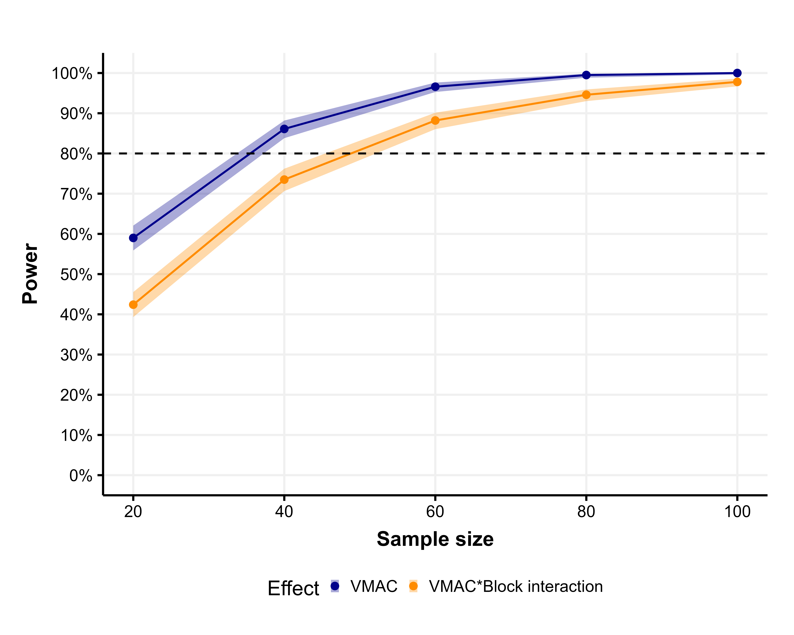
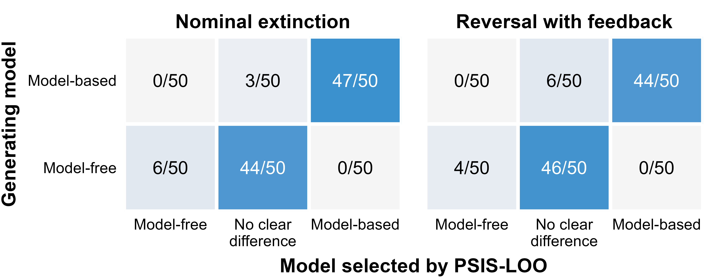
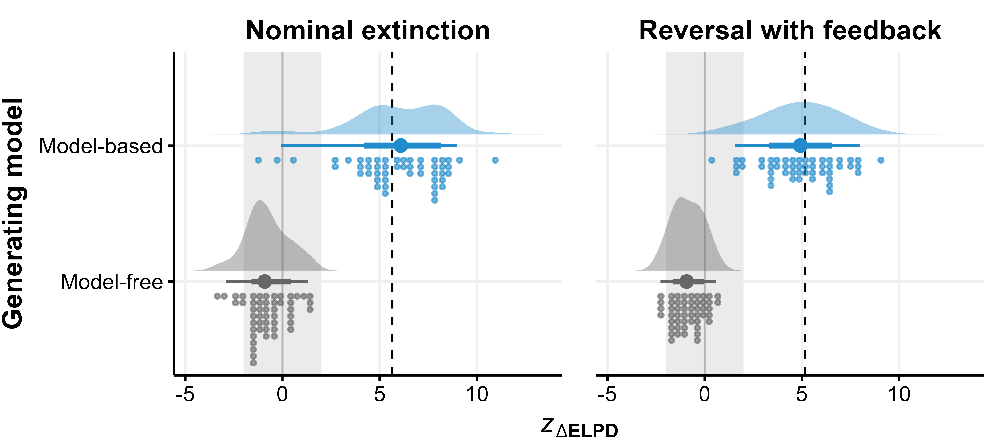

## Sample Size Rationale for Experiments 2a and 2b

The following rationale for the sample size of Experiments 2a and 2b was preregistered before data collection (<https://osf.io/g96yj>), and we include it here verbatim.

It is far from trivial to estimate the appropriate number of participants for the present two studies. First, it is difficult to justify what would be the smallest effect size of interest [SESOI\; @AlbersLakens2018] for our research question [i.e., what difference in RTs is considered theoretically irrelevant? see @PrenticeMiller1992], and setting an extremely low effect size could involve the recruitment of an unnecessarily large number of participants [@Lakens2022]. In addition, defining effect sizes in Multilevel Linear Models (MLMs) has added complexities. Some authors recommend working with unstandardized coefficients due to the difficulty of standardizing coefficients in complex designs [as it requires the integration of within- and between-subject variance\; @JuddWestfallKenny2017]. An alternative approach proposed by @Kumle2021 consists of attenuating the target coefficient to a certain degree. For instance, if one wants to replicate a given study, one can assume that the unstandardized coefficient that tests the critical hypothesis in a study is (arbitrarily) attenuated by 15% compared to its original value and then compute statistical power using a simulation-based approach.

Following this logic, we estimated the sample size required to detect both VMAC and its interaction with Block after attenuating the effects observed in Experiment 1 to 30% of their original value. A simulation-based power analysis indicated that 60 participants would be sufficient to detect a highly attenuated reversal in VMAC with 90% power to detect the reversal in the VMAC effect and nearly 90% power to detect the VMAC $\times$ Block interaction (@fig-s1).

We will collect a minimum of 60 participants for both Experiments 2a and 2b. We will continue collecting samples until we have at least 60 participants who meet the inclusion criteria of an accuracy cut-off of 0.7. Nevertheless, more than 60 participants will be invited to participate in both Experiments, and no participant will be turned away.

::: {#fig-s1}

{width="70%" fig-align="center" apa-note="Points denote the percentage of significant results (statistical power). Shaded areas represent the binomial CI for the observed statistical power based on 1,000 simulations."}

Power curve for the VMAC effect in the reversal stage and its interaction with Block

:::

## Hierarchical Implementation of the Computational Models

In this section, we describe how the model-free and model-based models presented in the main text were implemented and fitted to the data of @le2024. Let participants be indexed by $j \in \{1, \dots, J\}$ and trials by $i \in \{1, \dots, I\}$. On each trial, one of the two color singletons, $s \in \{\text{high}, \text{low}\}$, is presented within a stage $p(i) \in \{\text{acq}, \text{rev}\}$ (acquisition or reversal), yields an outcome $\lambda_{ij}$,[^outcome] and produces a binary observation $Y_{ij} \in \{0, 1\}$, where $Y_{ij} = 1$ denotes a fixation on the distractor. In both models, learned values were updated with the Rescorla–Wagner rule described in the main text, with a learning rate specific to each stage ($\eta^{(\text{acq})}_j$ and $\eta^{(\text{rev})}_j$). In the model-based model, the learned values of the two singletons were also exchanged to a degree $\rho_j$ immediately after the reversal instructions.

For each participant, the learned values of both singletons were initialized at a common value $\alpha_{0j}$. Learned values were bounded below at 0.02 (the outcome of the low-value singleton), so that attention, and therefore learning, could not fall to zero, and attention was rescaled to the unit interval before entering the observation model:

$$
Y_{ij} \sim \text{Bernoulli}(\theta_{ij}), \qquad
\theta_{ij} = \operatorname{logit}^{-1}\bigl(\beta_{0j} + \beta_{1j}\,\tilde{\alpha}_{ij}\bigr), \qquad
\tilde{\alpha}_{ij} = \frac{\alpha_{ij} - 0.02}{0.98},
$$

where $\alpha_{ij}$ is the attention paid on trial $i$ to the singleton presented on that trial, based on its learned value at the end of the previous trial. Only valid trials (i.e., trials without a timeout and with more than 25% of valid eye-tracking samples) entered the likelihood, but all trials contributed to the updating of learned values.

The participant-level parameters were therefore $\boldsymbol{\theta}_j = (\beta_{0j}, \beta_{1j}, \eta^{(\text{acq})}_j, \eta^{(\text{rev})}_j, \alpha_{0j})$ in the model-free model, with the addition of $\rho_j$ in the model-based model. All participant-level parameters were drawn from population distributions with a non-centered parametrization [@Papaspiliopoulos2007; @BetancourtGirolami2015], so that, for each parameter $k$,

$$
z_{jk} \sim \mathcal{N}(0, 1), \qquad
\theta^\star_{jk} = \mu_k + \sigma_k z_{jk}, \qquad
\mu_k \sim \mathcal{N}(0, 1), \qquad
\sigma_k \sim \mathcal{N}^{+}(0, 1).
$$

Parameters with natural bounds were then mapped onto their range with the standard normal cumulative distribution function ($\Phi$),

$$
\eta^{(\cdot)}_j = \Phi\bigl(\theta^\star_{j,\eta^{(\cdot)}}\bigr), \qquad
\alpha_{0j} = \Phi\bigl(\theta^\star_{j,\alpha_0}\bigr), \qquad
\rho_j = \Phi\bigl(\theta^\star_{j,\rho}\bigr), \qquad
\beta_{1j} = 10\,\Phi\bigl(\theta^\star_{j,\beta_1}\bigr),
$$

whereas the intercept ($\beta_{0j} = \theta^\star_{j,\beta_0}$) was left unconstrained. The slope was constrained to be positive, so that higher learned values always increase the probability of fixating the distractor. In this sense, the observation model can be viewed as a softmax choice rule with two options, the target and the distractor, in which $\beta_0$ acts as a bias term and $\beta_1$ as an inverse temperature [@daw2011; @sutton2018], and the upper bound of 10 allows for behavior ranging from nearly random to nearly deterministic. Finally, as the learning rates of the two stages are likely to be related, their latent values were drawn from a bivariate normal distribution, so that their correlation was estimated on the latent scale:

$$
\begin{bmatrix}
\theta^\star_{j,\eta^{(\text{acq})}} \\[2pt]
\theta^\star_{j,\eta^{(\text{rev})}}
\end{bmatrix}
\sim \mathcal{N}\!\left(
\begin{bmatrix} \mu_{\eta^{(\text{acq})}} \\[2pt] \mu_{\eta^{(\text{rev})}} \end{bmatrix},
\ \Sigma_\eta
\right), \qquad
\Sigma_\eta = \operatorname{diag}(\boldsymbol{\sigma}_\eta)\,R\,\operatorname{diag}(\boldsymbol{\sigma}_\eta), \qquad
R \sim \text{LKJ}(1).
$$

Both models were fitted to each reversal group of @le2024 separately, with four chains of 4,500 iterations, of which the first 2,000 were discarded as warm-up (10,000 post-warm-up draws in total), and a target acceptance rate of 0.95. The models were compared with PSIS-LOO [@vehtari2017], computed from the pointwise log-likelihood of valid trials, and moment matching was applied whenever a Pareto $k$ value exceeded 0.7.

[^outcome]: Outcomes were divided by the maximum reward (500 points), so that $\lambda = 1$ for the high-value singleton and $\lambda = 0.02$ for the low-value singleton (10 points), and $\lambda = 0$ on trials in which no reward was delivered, either because the participant fixated the distractor (omission trials) or because the response was too slow. During the reversal stage, outcomes in the reversal-with-feedback group followed the new contingencies, whereas $\lambda = 0$ in the nominal-extinction group, in which participants did not see the outcome of each trial. This last coding is conservative, as it is the only way in which the model-free model can reduce VMAC during the reversal stage, and the model-based model was nonetheless preferred in this group.

## Model Recovery

```{r}
#| label: setup-recovery-report
#| include: false

# Values computed by scripts/model_recovery.R
rec <- readRDS(file.path("output", "models", "recovery", "recovery_report.rds"))

fmt <- function(x, digits = 2) formatC(x, format = "f", digits = digits)
fmt_nolead <- function(x, digits = 2) {
  ifelse(round(x, digits) == 1, "1", sub("^(-?)0\\.", "\\1.", fmt(x, digits)))
}
n_outcome <- function(g, gm, oc) {
  d <- rec$confusion
  d$n[d$group == g & d$gen_model == gm & d$outcome == oc]
}
n_datasets <- function(g, gm) {
  d <- rec$confusion
  sum(d$n[d$group == g & d$gen_model == gm])
}
mimicry <- function(group, gen_model, column) {
  rec$mimicry[[column]][rec$mimicry$group == group & rec$mimicry$gen_model == gen_model]
}
rho_rec <- function(group, column) rec$rho_recovery[[column]][rec$rho_recovery$group == group]
rho_mf <- function(column) rec$rho_model_free_data[[column]]
coverage_range <- range(rec$parameter_recovery$coverage)
fmt_percent <- function(x) paste0(round(100 * x), "%")
fmt_nolead_same <- function(x) {
  # One value if both groups round to the same number, otherwise both
  x <- unique(fmt_nolead(x))
  if (length(x) == 1) paste(x, "in both groups") else paste(x, collapse = " and ")
}
ceiling_nolead <- function(x, digits = 2) fmt_nolead(ceiling(x * 10^digits) / 10^digits, digits)
rho_covered_text <- function() {
  covered <- c(rho_rec("Rev", "covered"), rho_rec("RevFB", "covered"))
  n <- rho_rec("Rev", "n")
  if (covered[1] == covered[2]) {
    paste(covered[1], "of the", n, "datasets of each group")
  } else {
    paste(covered[1], "and", covered[2], "of the", n,
          "datasets of the nominal-extinction and reversal-with-feedback groups, respectively")
  }
}
```

To assess whether the model comparison could discriminate between the model-free and model-based models in the design of @le2024, we performed a model recovery analysis [@wilson2019]. For each reversal group, we simulated datasets from each model. For each dataset, we selected a posterior draw at random from the fit of that model to the real data, and we used its population-level parameters to generate a new sample of participants, so that the simulations reflected both the variability between participants and the uncertainty of the population estimates. Each simulated participant followed the trial sequence of one of the original participants, but the outcome of each trial depended on the simulated behavior, so that $\lambda = 0$ whenever the simulated participant fixated the distractor.[^recovery] We simulated 50 datasets per group and generating model, fitted both models to each of them with the settings described above but with 1,000 warm-up and 1,000 sampling iterations per chain, and compared them with PSIS-LOO without moment matching. The simulations were run in parallel with the future, version 1.49.0, and furrr, version 0.3.1, packages [@bengtsson2021; @vaughan2022], and the distributions in @fig-s3 were plotted with ggdist, version 3.3.2 [@kay2024]. A model was considered recovered when it outperformed the other model by more than two standard errors of the difference in ELPD, and the comparison was otherwise classified as inconclusive. Because the model-free model corresponds to the model-based model with $\rho = 0$, the critical question was whether the model-based model would be selected for data generated without any instructed revaluation.

The model comparison never selected the model-based model when the data were generated by the model-free model (@fig-s2). When the data were generated by the model-based model, this model was selected in `r n_outcome("Nominal extinction", "Model-based", "Model-based")` of the `r n_datasets("Nominal extinction", "Model-based")` datasets of the nominal-extinction group and in `r n_outcome("Reversal with feedback", "Model-based", "Model-based")` of the `r n_datasets("Reversal with feedback", "Model-based")` datasets of the reversal-with-feedback group, and the comparison was inconclusive in the remaining ones. When the data were generated by the model-free model, the comparison was mostly inconclusive (`r n_outcome("Nominal extinction", "Model-free", "No clear difference")` and `r n_outcome("Reversal with feedback", "Model-free", "No clear difference")` of the `r n_datasets("Nominal extinction", "Model-free")` datasets, respectively), and the model-free model was selected in the rest. This low rate of selection of the model-free model is expected, as the evidence that leave-one-out cross-validation can provide for the simpler of two nested models is limited, even when that model generated the data [@gronau2019].

::: {#fig-s2}

{width="100%" fig-align="center" apa-note="Each cell shows the number of simulated datasets in which each model was selected, that is, in which its ELPD exceeded that of the other model by more than two standard errors of the difference, or in which there was no clear difference between the models."}

Model selected by PSIS-LOO for the datasets simulated from each model

:::

We also assessed whether the model-free model could mimic the advantage of the model-based model observed in the real data. Following the logic of the parametric bootstrap cross-fitting method [@wagenmakers2004], we compared the difference in ELPD between the model-based and model-free models, divided by its standard error ($z_{\Delta\text{ELPD}}$), with its distribution under each generating model (@fig-s3). For data generated by the model-free model, $z_{\Delta\text{ELPD}}$ was centered slightly below zero (*Mdn* = $`r fmt(mimicry("Rev", "model_free", "median_z"))`$ in the nominal-extinction group and *Mdn* = $`r fmt(mimicry("RevFB", "model_free", "median_z"))`$ in the reversal-with-feedback group), and no simulated dataset reached the values observed in the real data (`r fmt(mimicry("Rev", "model_free", "z_obs"))` and `r fmt(mimicry("RevFB", "model_free", "z_obs"))`, respectively). In contrast, the values simulated from the model-based model were close to the observed ones. Therefore, the advantage of the model-based model in the data of @le2024 is unlikely to reflect a bias of the comparison in favor of the more complex model.

::: {#fig-s3}

{width="100%" fig-align="center" apa-note="Each point is one simulated dataset, shown below its density and its median with the 66% and 95% intervals. The difference in ELPD (model-based minus model-free) is divided by its standard error. The shaded area marks the region without a clear difference between the models, and the dashed line marks the value observed in the real data."}

Difference in ELPD between the model-based and model-free models in the simulated datasets

:::

Finally, the 95% credible intervals of the population parameters contained the generating values in between `r fmt_percent(coverage_range[1])` and `r fmt_percent(coverage_range[2])` of the datasets. For the instructed reversal parameter, the interval of its population median, $\Phi(\mu_\rho)$, contained the generating value in `r rho_covered_text()`. Moreover, when the data were generated by the model-free model, which has no instructed reversal, the model-based model estimated $\Phi(\mu_\rho)$ close to zero (*Mdn* = `r fmt_nolead_same(rho_mf("median_est"))`, never above `r ceiling_nolead(max(rho_mf("max_est")))`).

```{=latex}
\clearpage
```

[^recovery]: Invalid trials and trials in which the original participant responded too slowly kept their observed outcome, as the models do not simulate response times. In the nominal-extinction group, $\lambda = 0$ during the whole reversal stage, as in the fits to the real data.
